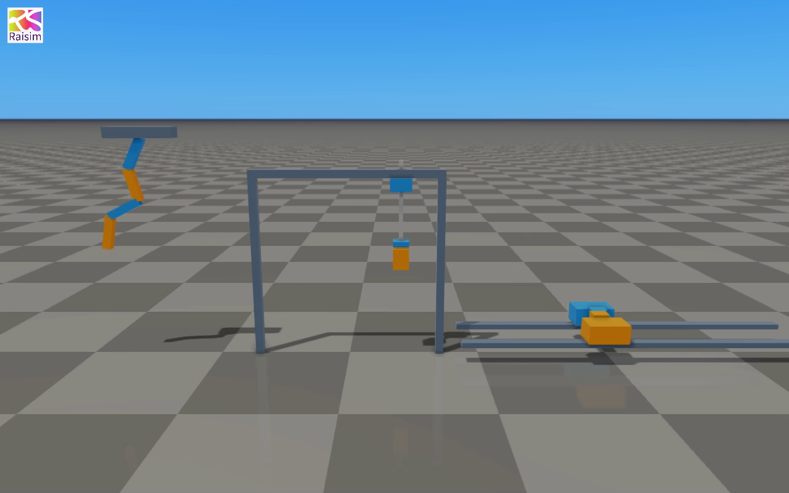

# Joining objects into articulated systems

`World::joinObjects()` connects two objects with a joint and replaces them with
one articulated system. Any rigid object can take part: a box, sphere, cylinder,
capsule, file mesh, compound, or articulated system. The result is simulated in
generalized coordinates, exactly like a robot loaded from a URDF: the joint has
no position error, no stiffness to tune, and costs no extra solver work.
`World::detachJoint()` removes any joint again and splits the system when it
falls apart.

Typical uses are building a mechanism from primitives, mounting an arm on a
mobile base, attaching a gripper, picking up and releasing a tool, and docking
two robots.



## Joining two objects

```cpp
raisim::World world;
auto* upper = world.addBox(0.2, 0.1, 0.4, 1.);
upper->setPosition(0., 0., 1.);
auto* lower = world.addBox(0.2, 0.1, 0.4, 2.);
lower->setPosition(0., 0., 0.6);

raisim::Joint hinge;
hinge.type = raisim::Joint::REVOLUTE;
hinge.name = "hinge";
hinge.pos_P = {0., 0., -0.2};  // joint frame in the parent body frame
hinge.axis = {0., 1., 0.};     // axis in the joint frame
hinge.limit = {-1., 1.};
hinge.damping = 0.1;

raisim::ArticulatedSystem* pendulum = world.joinObjects(upper, 0, lower, 0, hinge);
// upper and lower are removed from the world; their pointers are invalid now.
```

The arguments are the parent object and body, the child object and body, and a
`raisim::Joint`, the same structure used to build an articulated system from a
`Child` tree. The body index is `0` for a single body and
`system->getBodyIdx("link")` for an articulated system. Pass `nullptr` as the
parent (with body `0`) to connect the child to the world; the joint frame is
then given in world coordinates.

| `Joint::type` | Relative motion of the child |
| --- | --- |
| `FIXED` | None: the child becomes part of the parent body |
| `REVOLUTE` | Rotation about `axis` |
| `PRISMATIC` | Translation along `axis` |
| `SPHERICAL` | Any rotation about the joint origin |

`pos_P` and `rot` place the joint frame in the parent body frame and `axis` is
expressed in that joint frame. The joint must have a unique name. Its limits,
damping, Coulomb friction, spring (`stiffness`, `springMount`), rotor inertia,
effort limit and velocity limit act as they do in a URDF.

### Configuration and frames

Nothing moves when objects are joined: every body keeps its world pose. The
current configuration is the joint's reference position, `Joint::jointRef`
(zero by default), so joint limits and spring rest positions are measured from
it. Set `jointRef` to give the present pose a different coordinate.

As in URDF, the link frame of a body moved by a joint is the joint frame. After
the join above, `pendulum->getBodyPose(1, ...)` reports the hinge frame, not the
centre of the lower box. Collision and visual geometry, the centre of mass and
the inertia are re-expressed in the new frame. The old link names remain: the
child body is still `"lower"`, and the new joint adds a frame named `"hinge"`.
A `FIXED` joint merges the child into the parent body, as fixed URDF links are;
its link is then found with `getFrameByName(jointName)`, not `getBodyIdx()`.

### Velocities and momentum

Joining is a perfectly inelastic connection. The new system's generalized
velocity is the one with the same generalized momentum as the separate bodies
that also satisfies its loop constraints, so linear and angular momentum are
conserved, and kinetic energy is lost only in the directions the new joint
removes. Bodies that already move rigidly
together keep their velocities. Detaching keeps every body's velocity.

## What the new system contains

Bodies keep their relative order. The child's bodies are inserted after the
existing descendants of the parent body, so the indices of later bodies, and of
their coordinates, can shift. Look up bodies, joints and frames by name rather
than by index. The system takes the parent's name unless `JoinOptions::name` is
set.

| Kept from the joined objects | |
| --- | --- |
| Inertia | Masses, centres of mass and inertias, including values changed at run time |
| Geometry | Collision shapes, materials, collision groups and masks, fluid coefficients, visual shapes and colors (a single body's numeric `"r, g, b, a"` appearance) |
| Joints | Types, axes, limits, damping, friction, every spring, rotor inertia, effort and velocity limits, fixed-link frames, and the forces, damping and limits of a floating base that stays the base |
| Control | Control mode, PD gains and targets, feedforward forces, actuators with their motor operating regions and torques |
| Devices | [Thrusters and grippers](./articulated_system/ThrustersAndGrippers.md) on their links, with their thrusts and whether each gripper is on |
| Constraints | Pin, equality and mimic constraints of the robot descriptions, and earlier loop joints |
| Other | Ignored collision pairs, body segmentation labels, integration scheme, inverse-dynamics and motor-region settings |

If one object uses PD control and the other uses force control, the system uses
PD control with zero gains on the force-controlled joints, which applies the
same forces.

When two copies of one robot are joined, their link, joint, actuator, thruster and gripper names
collide. `JoinOptions::childPrefix` prefixes every name from the child:

```cpp
raisim::JoinOptions options;
options.childPrefix = "right/";
options.name = "pair";
auto* pair = world.joinObjects(left, 0, right, 0, dock, options);
pair->getBodyIdx("right/base");
```

Without a prefix, a name clash throws `std::invalid_argument`.

## Connections to the world and closed loops

The parent keeps its connection to the world: a fixed base, a static body, or
a floating base. The child depends on which of its bodies is joined:

- **The child's base** (body `0`): the new joint replaces the child's own
  connection to the world. A fixed-base arm joined at its base to a mobile robot
  rides on the robot instead of staying fixed in place. A static body joined
  this way becomes dynamic.
- **Another body of the child**: the child keeps its connection to the world. A
  floating child is re-rooted: its joints are re-oriented so that the joined
  body hangs from the parent, with the same motion as before. A child fixed to
  the world closes a loop through the world.

A joint that connects two bodies that are already connected, either two systems
fixed to the world or two bodies of one system, closes a kinematic loop. It is
enforced exactly as a loop-closure constraint, like the pin constraints of a
URDF; the system has no coordinate for it, and it carries no limits, damping or
actuation. The two bodies it connects do not collide with each other while it
exists. `getLoopJointNames()` lists these joints.

```cpp
// two carriages on fixed rails: docking them closes a loop
auto* docked = world.joinObjects(driven, driven->getBodyIdx("cart"),
                                 passive, passive->getBodyIdx("cart"), dock, options);
docked->getLoopJointNames();  // {"dock"}
```

To free a system from the world, detach its root joint:
`detachJoint(system, "ROOT")` (or the name of the URDF's fixed root joint)
leaves a floating-base system.

## Detaching a joint

```cpp
std::vector<raisim::ArticulatedSystem*> parts = world.detachJoint(pendulum, "hinge");
// parts[0]: the part with the root ("upper"), parts[1]: the part beyond the joint ("lower")
```

Any joint can be detached: one created by `joinObjects()`, a movable or fixed
joint of the robot description, a loop joint, or the root joint of a fixed base.
A body joined with a `FIXED` joint gets back its own mass, centre of mass,
inertia and geometry. The part beyond the joint becomes a floating-base system
named `detachedName`, or after the link the joint moved. A loop joint, or a joint whose
two sides stay connected through a loop, leaves one system, whose loop joints
may become ordinary joints. A part without mass, geometry or joints, such as
the world anchor left when the only joint of a body hinged to the world is
detached, is not kept. Detached parts stay articulated systems; a single
released box is a one-body system with a floating base.

## Rules and limitations

- Both operations replace objects: the input pointers become invalid. Use the
  returned systems, `World::getObject(name)` or object ids.
- Call them between complete steps; between `integrate1()` and `integrate2()`
  they throw `std::logic_error`. Invalid input throws `std::invalid_argument`
  before anything changes, leaving the world as it was.
- A join or detach whose result could not be simulated, because a body would
  have no mass or a non-physical inertia (its mass matrix would be singular or
  indefinite), throws `std::invalid_argument` as well.
- Remove tendons, wires and runtime joints attached to an object before joining
  or detaching it.
- Objects that cannot take part: kinematic bodies, the ground, height maps,
  cones, deformable and granular objects, meshes created from vertex arrays,
  meshes with a convex decomposition, and articulated systems with sensors or
  tracks. Collision meshes of the joined objects must use one mode, convex hull
  or original mesh.
- The joined system uses the parent's `ArticulatedSystemOption`s, such as
  `doNotCollideWithParent`, for all its bodies.
- Re-rooting reverses the joints between the joined body and the old base. A
  reversed ball joint must have no effort limit and the same damping, rotor
  inertia and PD gains on its three axes.
- A joint whose two sides stay connected through a pin or equality constraint of
  the robot description (a closed linkage such as the Minitaur's legs) cannot be
  detached.
- A body that merges fixed links can only be split if its mass properties still
  contain them. If its mass, centre of mass or inertia was changed at run time
  so that what remains for its own link would have a negative mass or an
  inertia that is not positive semidefinite, joining or detaching it fails. The
  split is resolved to about 1e-12 of the mass and inertia
  terms involved; smaller changes, such as tiny inertias next to the
  parallel-axis terms of links a kilometre apart, cannot be told from round-off
  and may be ignored or rejected.
- Single-body linear and angular damping, and the segmentation label of a body
  merged by a `FIXED` joint, are not carried over.
- A rebuilt system has no URDF text, so `World::exportToXml()` cannot save it
  yet. Checkpoints taken before a join or detach are invalidated, as by any
  added or removed object.

## Joined systems or runtime joints

[Runtime joints](./RuntimeJoints.md) keep both objects and enforce the joint
with constraint impulses. Use them when the objects must stay separate, for
breakable joints, joint reaction loads, and connections that are switched on
and off often. Use `joinObjects()` for mechanisms that stay assembled: the
joint is exact and the result is as fast as a robot loaded from a file.

The `articulated_join_benchmark` target compares an 8-link pendulum chain built
both ways (eight chains, 1 ms timestep, gravity, one thread, AMD Ryzen 9 3950X):

| Chain | Time per step | Largest hinge separation |
| --- | --- | --- |
| `joinObjects()` | 12.9 µs | 1.4e-17 m |
| Runtime hinge joints | 1350 µs | 3.8e-6 m |

Joining a tool to an ANYmal takes 133 µs, and detaching it 134 µs. Each call
rebuilds the system, so it is not meant for every step.

## Python

```python
import numpy as np
import raisimpy as r

world = r.World()
upper = world.addBox(0.2, 0.1, 0.4, 1.0)
upper.setPosition(np.array([0.0, 0.0, 1.0]))
lower = world.addBox(0.2, 0.1, 0.4, 2.0)
lower.setPosition(np.array([0.0, 0.0, 0.6]))

hinge = r.Joint(r.JointType.REVOLUTE, "hinge", position=[0.0, 0.0, -0.2], axis=[0.0, 1.0, 0.0])
hinge.limit = np.array([-1.0, 1.0])
options = r.JoinOptions()
options.name = "pendulum"
pendulum = world.joinObjects(upper, 0, lower, 0, hinge, options)
del upper, lower  # removed from the world

upper_part, lower_part = world.detachJoint(pendulum, "hinge")
```

Pass `None` as the parent to join to the world. `raisimPy/examples/articulatedJoin.py`
carries and releases a tool with a gantry robot and docks two carriages.

## Example, tests and benchmark

The [Articulated Join example](./examples/worlds/articulated_join.md) builds a
chain from boxes, picks up and releases a tool, and docks two robots in one
scene. `testArticulatedJoin` checks poses, momentum, mass properties, control
settings and loop constraints through joins and detaches, including a Minitaur
whose URDF loop constraints must reproduce the original motion after a round
trip, and `testPythonArticulatedJoin` covers the Python bindings and example:

```bash
ctest --test-dir /path/to/test-build -j12 --output-on-failure \
  -R '^test(ArticulatedJoin|PythonArticulatedJoin|ArticulatedJoinExample)'
cmake --build /path/to/benchmark-build --target articulated_join_benchmark --parallel 12
/path/to/benchmark-build/benchmark/articulated_join_benchmark --copies 8 --links 8 --steps 5000
```
