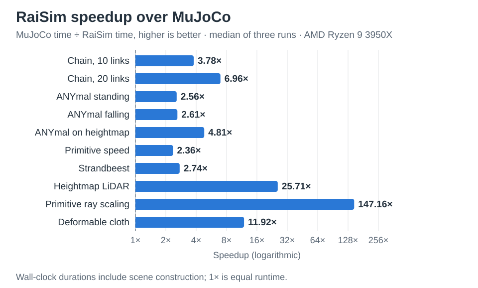
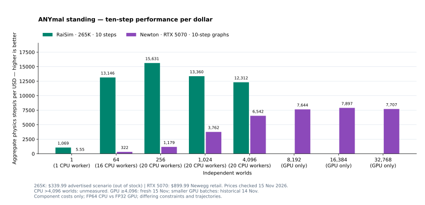
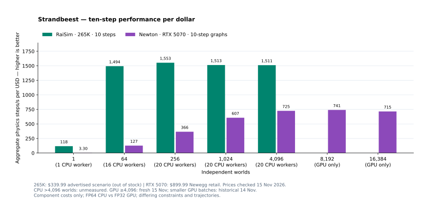
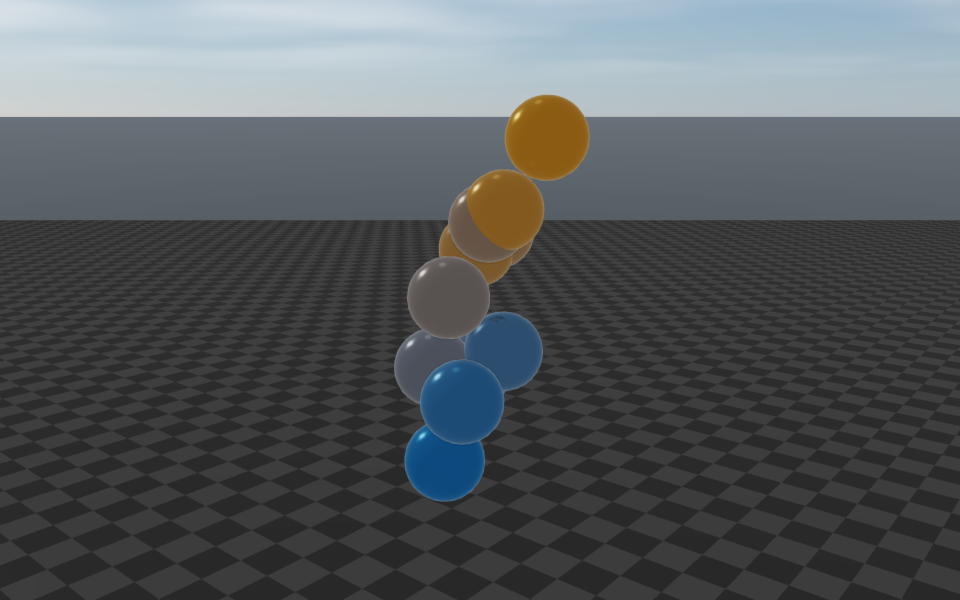
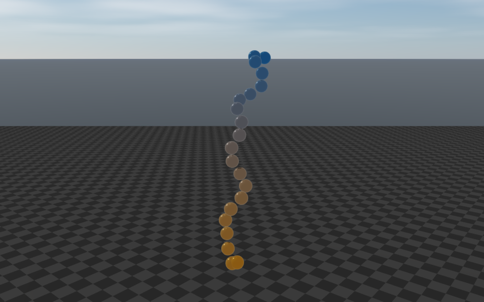
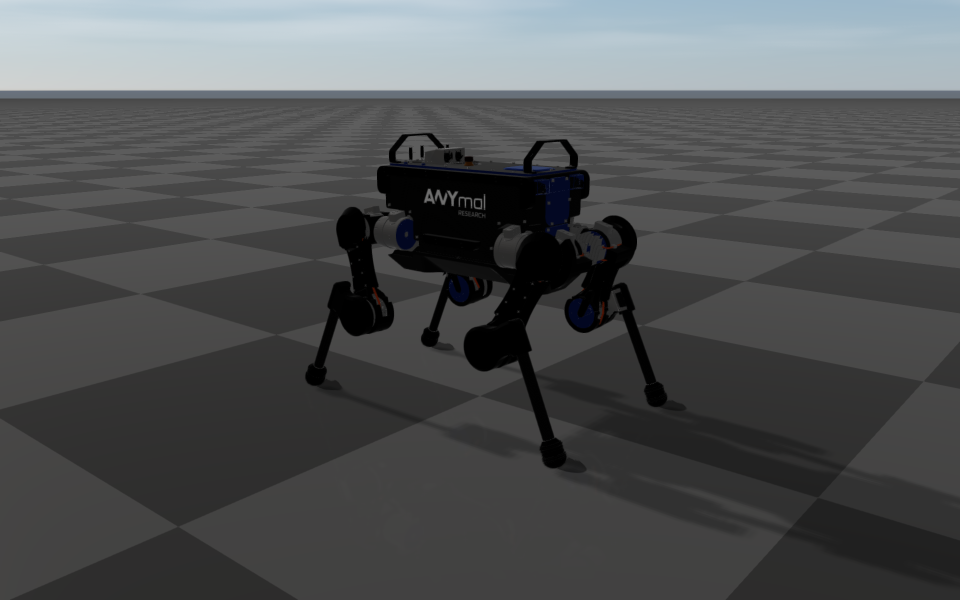
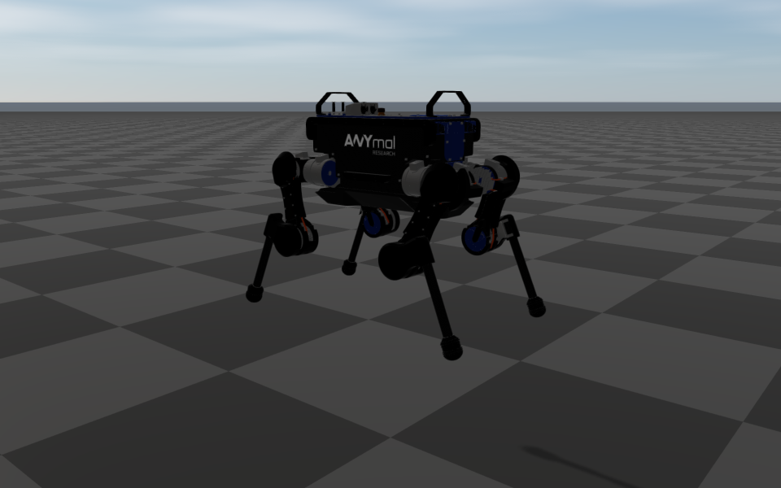
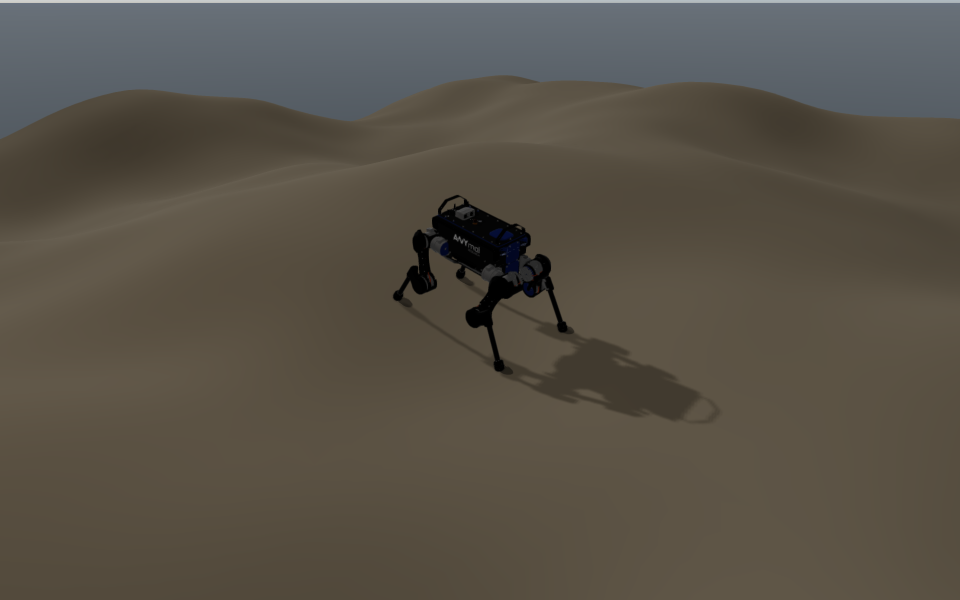
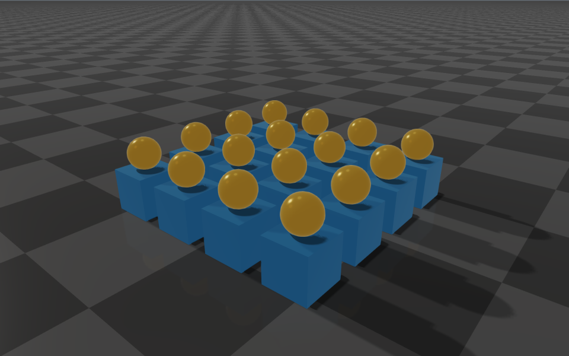
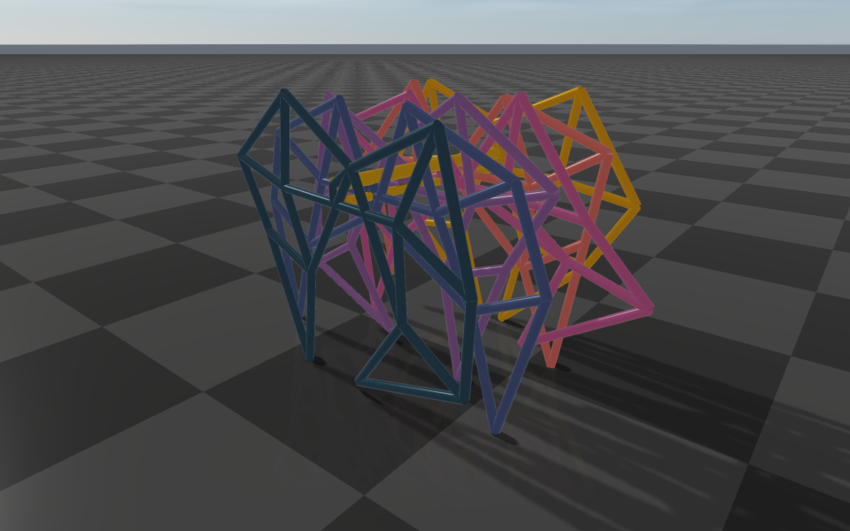

# Benchmark

Eleven workloads cover articulated dynamics, rigid contacts, closed loops, ray queries, and
deformable objects. The tables compare RaiSim and MuJoCo on the same machine, with three runs per
backend. For tuning guidance, see [Performance](./Performance.md).

## Results

**Median wall-clock seconds; lower is better.** The smaller range below each median is
the minimum–maximum of three runs. Speedup is MuJoCo's median divided by RaiSim's median.
All rows run on a single thread and include scene construction and the benchmark loop; rendering is disabled.

<!--@include: ./_benchmark_results.md-->

The eight-cube MuJoCo run reports numerical instability at 0.020 s. Its timing and speedup
are omitted. Cloth and cube-stack backends use different deformable models; their
parameters and comparison limits are in **Workloads**.

<figure>

</figure>

[Download the recorded results and exact arguments](/benchmark_results.json).
Absolute timings depend on the machine, compiler, and scene. These ratios describe the
recorded development build; use your application workload to evaluate the distributed
{{ $raisimVersion }} package.


## Parallel simulation performance per USD

This separate experiment compares **ten-step RaiSim scheduling on a Core Ultra 7 265K**
with **Newton SolverMuJoCo / MuJoCo Warp on an RTX 5070**. Higher is better.
FPS/USD means aggregate world physics steps per second divided by the entire component
price, including when only one CPU worker is used. Each environment has its own world, ground and robot.

[Open the interactive ten-step FPS/USD report](/raisim_newton_ten_step_value.html)
· [Download the recorded data](/raisim_newton_ten_step_value.json).

Prices checked 15 November 2026: **265K $339.99**, a recent
[Newegg advertised-price scenario](https://www.newegg.com/Intel-x-Newegg-Anniversary-Deals/EventSaleStore/ID-10632)
from an index crawled last month; the
[direct CPU listing](https://www.newegg.com/intel-core-ultra-7-265k-arrow-lake-lga-1851-desktop-cpu-processor/p/N82E16819118506?Item=N82E16819118506)
is now out of stock, so this is not a verified currently buyable quote.
**RTX 5070 $899.99** comes from the
[new MSI Ventus listing sold/shipped by Newegg](https://www.newegg.com/msi-geforce-rtx-5070-12g-ventus-2x-oc-video-card/p/N82E16814137994?Item=N82E16814137994),
shown with Add to cart. That board is a pricing proxy for the measured RTX 5070.
Tax, host system, RAM, motherboard, cooling, energy and licensing are excluded;
the GPU also needs a host CPU. Prices are editable in the interactive report.

### Reading the price-normalized results

At the prices above, the RTX 5070 costs **2.65× as much as the 265K**
($899.99 / $339.99). Its throughput must therefore be 2.65× higher to match
RaiSim's FPS/USD. Dividing GPU throughput by the higher price reduces its value score.

At 4,096 worlds, Newton's measured throughput is **1.42× higher for ANYmal** and
**1.28× higher for Strandbeest**. These gains are smaller than the 2.65× price difference,
so RaiSim provides **1.86× and 2.06× the FPS/USD**, respectively.
The last column below is a **performance-per-dollar ratio**, not a hardware-price ratio
or a raw-throughput ratio:

`RaiSim / Newton FPS-per-dollar = (RaiSim FPS / Newton FPS) × ($899.99 / $339.99)`.

### ANYmal standing

<figure>

<figcaption>Ten-step performance per USD at $339.99 for the CPU and $899.99 for the GPU; the GPU costs 2.65× as much. Prices and comparison limits are described above and below.</figcaption>
</figure>

| Worlds | CPU workers | RaiSim FPS/USD | Newton FPS/USD | RaiSim / Newton FPS-per-dollar |
| ---: | ---: | ---: | ---: | ---: |
| 1 | 1 | 1,068.60 | 5.55 | 192.43× |
| 64 | 16 | 13,146.06 | 321.84 | 40.85× |
| 256 | 20 | 15,630.98 | 1,178.54 | 13.26× |
| 1,024 | 20 | 13,360.45 | 3,761.72 | 3.55× |
| 4,096 | 20 | 12,312.24 | 6,609.44 | 1.86× |

### Strandbeest

<figure>

<figcaption>Ten-step performance per USD at $339.99 for the CPU and $899.99 for the GPU; the GPU costs 2.65× as much. Prices and comparison limits are described above and below.</figcaption>
</figure>

| Worlds | CPU workers | RaiSim FPS/USD | Newton FPS/USD | RaiSim / Newton FPS-per-dollar |
| ---: | ---: | ---: | ---: | ---: |
| 1 | 1 | 117.60 | 3.30 | 35.67× |
| 64 | 16 | 1,493.57 | 127.10 | 11.75× |
| 256 | 20 | 1,553.38 | 365.93 | 4.25× |
| 1,024 | 20 | 1,513.19 | 606.58 | 2.49× |
| 4,096 | 20 | 1,511.11 | 732.23 | 2.06× |

### Protocol and limits

CPU workers integrate each world ten times before visiting the next world. Newton
uses graphs of ten GPU steps. Workers own disjoint world ranges and are CPU-pinned;
integration inside each world is single-threaded. Worker counts are recorded
configurations, not a demonstrated optimum. Setup, warmup, validation and external
policy computation are excluded. Time steps are 2 ms for ANYmal and 1 ms for Strandbeest.
CPU throughput uses median elapsed wall time; single-world cases have 21 trials
across three processes and multiworld cases have 10 across two, except ANYmal
4,096/20 scores six of ten after the prespecified first-two-per-process exclusion.
Processes ran serially; timed horizons vary with world count.

RaiSim CPU measurements are from 15 November 2026 and use FP64. Newton GPU measurements
are historical results from 14 November, use FP32, and were not rerun for this experiment.
The scenes/controllers were matched, but solvers, constraint formulations and
trajectories differ; these ratios do not compare identical numerical work. ANYmal
has four contacts/world. Historical Strandbeest trajectory means are approximately
0.959 contacts/world for RaiSim and 0.686–0.700 for Newton; the current RaiSim ending
count of one/world is a different statistic. RaiSim merges fixed links (74 bodies),
while Newton retains them (92). All 18 CPU scheduling cases matched final state hashes
and contacts against one-step scheduling, with six extra partial-block/uneven-range checks.
The tables select the ten primary comparison cases.

## Workloads

DOF counts generalized velocity coordinates; a floating base contributes six.
A step count denotes simulation steps unless the row says queries or sensor updates.

<table>
<thead>
<tr>
<th>Benchmark ID</th>
<th>Run</th>
<th>Scene and settings</th>
</tr>
</thead>
<tbody>
<tr>
<td><code>chain10_speed</code></td>
<td><p>100,000 steps</p><p>Δt = 1 ms</p></td>
<td>Fixed-base chain, 10 spherical joints, <strong>30 DOF</strong>. Spring-dampers bend each link by 90°. No collision geometry or contacts; pure articulated dynamics.</td>
</tr>
<tr>
<td><code>chain20_speed</code></td>
<td><p>100,000 steps</p><p>Δt = 1 ms</p></td>
<td>The same spring chain with 20 spherical joints and <strong>60 DOF</strong>.</td>
</tr>
<tr>
<td><code>anymal_standing</code></td>
<td><p>1,000,000 steps</p><p>Δt = 2 ms</p></td>
<td>ANYmal: floating base and 12 revolute joints, <strong>18 DOF</strong>. PD control holds a stance on a plane, with about four persistent foot contacts. Primitive robot collision shapes; friction 0.8.</td>
</tr>
<tr>
<td><code>anymal_falling</code></td>
<td><p>100,000 steps</p><p>Δt = 2 ms</p></td>
<td>ANYmal, <strong>18 DOF</strong>, falling freely with no ground or contacts.</td>
</tr>
<tr>
<td><code>heightmap_anymal_speed</code></td>
<td><p>200,000 steps</p><p>Δt = 2 ms</p></td>
<td>ANYmal, <strong>18 DOF</strong>, on a 20 × 20 m fractal heightmap: 100 × 100 samples, three octaves. Tests robot–terrain contacts.</td>
</tr>
<tr>
<td><code>primitive_speed</code></td>
<td><p>100,000 steps</p><p>Δt = 2 ms</p></td>
<td><strong>32 rigid bodies</strong>: sixteen 0.4 m boxes and sixteen spheres of radius 0.15 m, in a 4 × 4 grid at 0.6 m spacing. Spheres fall onto boxes above a ground plane; tests box–ground and sphere–box contacts.</td>
</tr>
<tr>
<td><code>strandbeest</code></td>
<td><p>3,000 steps</p><p>Δt = 1 ms</p></td>
<td>Twelve-legged linkage, <strong>79 DOF</strong> and <strong>42 hinge closures / 84 pin constraints</strong>, driven by a crank at one revolution per second. RaiSim imports OpenUSD; MuJoCo loads converted MJCF with connect equalities. This row includes import, unlike the simulation-only timing in earlier versions of this page.</td>
</tr>
<tr>
<td><code>heightmap_lidar</code></td>
<td><p>2,000 updates</p><p>Δt = 5 ms</p></td>
<td>Spinning LiDAR on ANYmal C over a <strong>200 × 200 m heightmap, 400 × 400 samples</strong>. Uses 512 yaw × 64 pitch samples per revolution at 10 Hz, ±16.6° pitch and 0.8–40 m range. The robot settles for 200 steps, then stays fixed while sensor time advances. Both backends check hit ratio and terrain-surface error.</td>
</tr>
<tr>
<td><code>primitive_ray_scaling</code></td>
<td><p>10,000 queries</p><p>256 warmup rays</p></td>
<td><strong>10,000 static primitives</strong> on a 2.5 m grid: spheres, boxes, capsules, and cylinders. The deterministic <code>mixed</code> workload casts vertical rays in an incoherent order, with 50% hits. Initial queries verify hits and target IDs; the timed loop consumes hit results. This row is one point in the scaling workload; change <code>--objects</code> and <code>--workload</code> to measure others.</td>
</tr>
<tr>
<td><code>deformable_cloth</code></td>
<td><p>2,000 steps</p><p>Δt = 1 ms</p></td>
<td>Unpinned <strong>32 × 32 cloth grid: 1,024 particles, 1,922 triangles</strong>, 0.035 m spacing, dropped from 0.85 m onto a static sphere of radius 0.25 m and a plane. Six solver iterations. RaiSim uses XPBD distance compliance 10⁻⁵ with bending disabled; MuJoCo uses a 2D flex grid with edge equalities.</td>
</tr>
<tr>
<td><code>deformable_cube_stack</code></td>
<td><p>1,200 steps</p><p>Δt = 1 ms</p></td>
<td><strong>Eight 0.3 m cubes</strong>, stacked above a plane; six solver iterations. Explicit arguments request resolution 4 and collision radius 0.04 m; the shared spacing guard increases resolution to 5. RaiSim uses 784 surface particles with internal struts, compliance 7.5 × 10⁻⁵ and effective collision radius 0.06525 m. MuJoCo uses 1,000 volumetric flex particles, Young's modulus 50 kPa and radius 0.005 m; that run becomes unstable.</td>
</tr>
</tbody>
</table>

Deformable rows compare these implementations and settings, without matching material
response or solver accuracy. In particular, the cube stack uses different particle
counts, masses, and collision radii. A timing ratio alone does not measure physical fidelity.

## Method

| Setting | Recorded configuration |
| --- | --- |
| Machine | AMD Ryzen 9 3950X, 16 cores / 32 threads, 64 GB RAM; x86-64. |
| System | Ubuntu 26.04.1 LTS, Linux 7.0.0-38-generic. |
| Run | October 14, 2026; private development revision `ded44a528` with local rendering fixes. Physics and benchmark sources match that revision. |
| Builds | Clang 20.1.8, C++20, `Release`. RaiSim: `-O3 -DNDEBUG -march=native -mtune=native`; MuJoCo 3.13.0 built from source with `-O3 -DNDEBUG -mavx`. |
| Threading | One thread, pinned to CPU 8 with `taskset`; `OMP_NUM_THREADS`, `OPENBLAS_NUM_THREADS`, `MKL_NUM_THREADS`, and `VECLIB_MAXIMUM_THREADS` all set to 1. Benchmarks run serially, without rendering. |
| Measurement | Three calls per workload and backend. Median, minimum, and maximum of the launcher's wall-clock duration, including construction, warmup, validation, and the benchmark loop. Separate query-only timings appear in the downloadable results for `primitive_ray_scaling`. Speedups use unrounded medians. |
| Arguments | Default launcher arguments for ten workloads; explicit eight-cube arguments below replace the launcher's one-cube, 20-step quick check. Exact arguments for every row are in the downloadable JSON. |

**Private comparison suite.** The launcher and MuJoCo backend are maintained in the
engine repository and are not targets in `raisim2Lib`. The recorded commands are:

```bash
export OMP_NUM_THREADS=1 OPENBLAS_NUM_THREADS=1 MKL_NUM_THREADS=1 VECLIB_MAXIMUM_THREADS=1
taskset -c 8 ./build-benchmark/benchmark/benchmarks --backend=both --repeat 3 \
    -b chain10_speed -b chain20_speed -b anymal_standing -b anymal_falling \
    -b heightmap_anymal_speed -b primitive_speed -b strandbeest \
    -b heightmap_lidar -b primitive_ray_scaling -b deformable_cloth \
    --report --report-dir /tmp/raisim-benchmark-report
taskset -c 8 ./build-benchmark/benchmark/benchmarks --backend=both --repeat 3 \
    -b deformable_cube_stack --report --report-dir /tmp/raisim-cube-stack-report \
    -- --cubes=8 --resolution=4 --steps=1200 --iterations=6 --collision-radius=0.04
```

**Measure the distributed package.** Build the public timing examples from
`raisim2Lib` and repeat your chosen run at least three times:

```bash
cmake -S . -B build-examples -DCMAKE_BUILD_TYPE=Release -DRAISIM_EXAMPLE=ON
cmake --build build-examples --target anymal_standing_benchmark \
    articulated_system_benchmark --parallel 12
OMP_NUM_THREADS=1 OPENBLAS_NUM_THREADS=1 MKL_NUM_THREADS=1 \
    ./build-examples/examples/anymal_standing_benchmark --steps=1000000
```

On Windows, build with `--config Release` and run
`build-examples\bin\anymal_standing_benchmark.exe`. These public examples time RaiSim
only, using their own scenes; they do not reproduce the private comparisons. Keep the
package version, scene, timestep, step count, and machine fixed. See [Build, Test, and Benchmark](./BuildAndTest.md)
for other timing examples.

## Runtime joint workloads

The engine-source `runtime_joint_benchmark` target measures runtime joints
separately from the recorded RaiSim/MuJoCo comparisons above. Configure the
benchmark build with `-DRAISIM_BENCHMARK=ON` and build with 12 jobs:

```bash
cmake --build build-benchmark --target runtime_joint_benchmark --parallel 12
OMP_NUM_THREADS=1 OPENBLAS_NUM_THREADS=1 MKL_NUM_THREADS=1 \
  ./build-benchmark/benchmark/runtime_joint_benchmark --copies 16 --steps 10000
```

All seven workloads use a 1 ms timestep, disabled sleeping, and no collision
geometry interaction. Each reports the median microseconds per complete world
step from five timed repetitions after one warmup. Checkpoint restoration,
scene construction, and correctness checks are outside the timed loop.

| Workload | Scene and correctness checks |
| --- | --- |
| `unconstrained` | `copies` freely falling rigid spheres; checks finite state. |
| `fixed`, `ball`, `hinge`, `slider` | `copies` spheres supported against gravity by the selected joint type, with a world attachment. Checks finite state and supported position. Hinge and slider free axes are horizontal. |
| `offset_fixed` | Fixed joints attached 0.2/0.1/−0.1 m from each sphere's centre. The lever arm couples the linear and angular response, exercising the full eigensolver; checks pose, force, and reaction couple. |
| `two_robot_docking` | `copies` pairs of separate fixed-base robots, each with one prismatic joint. A fixed dock joins their carriage links. A 1 N force applied to the first carriage accelerates both; checks matching positions/velocities and a 0.5 N transmitted force. |

Timing covers the whole scene, rather than one joint; the docking workload has
two articulated systems per copy. `max_position_error` is in metres and must
remain below `1e-8`. Invalid attachment or force-transfer results fail the run.
Use `--copies` to measure scaling and `--steps` to change the timed duration.
See [Runtime joints](./RuntimeJoints.md) for the APIs, tests, and runnable C++ and
Python examples.

### Optimization measurement

A local Linux x86-64 Clang 20 Release build on an AMD Ryzen 9 3950X measured
the following medians for 16 copies, 10,000 steps per repetition, and one
calling thread. Before and after use the same benchmark source, timestep,
solver settings, and validation; only the runtime-joint implementation differs.
Setup, checkpoint restore, and validation are excluded from the timed loop.

| Workload | Before (µs/step) | After (µs/step) |
| --- | ---: | ---: |
| `unconstrained` | 4.131 | 4.139 |
| `fixed` | 38.305 | 22.320 |
| `ball` | 34.411 | 17.684 |
| `hinge` | 36.229 | 21.769 |
| `slider` | 36.445 | 21.855 |
| `offset_fixed` | 56.125 | 47.823 |
| `two_robot_docking` | 57.887 | 35.526 |

The centred-joint and docking cases reduce step time by about 39–49%; the fully
coupled offset case reduces it by about 15%. The unconstrained reference stays
essentially unchanged. Runs with 1 and 64 copies also retain their validation
checks and show improvements for every joint workload. These are development
measurements, not a comparison between released package versions.

State and reaction-load traces from 34 native runtime-joint tests were also
compared with the saved pre-optimization library. Differences remained at
floating-point roundoff scale (maximum approximately `1.42e-14` in the recorded fields).
Separate regressions require exact checkpoint replay for coupled contacts and
changing active joint/body layouts; both passed 100 repetitions. Physical
assertions, rank thresholds, and convergence settings are unchanged. See
[Determinism](./Determinism.md) for cross-build expectations.

## Dense-mesh contact workloads

Two additional source benchmarks exercise the Unitree G1's hand collision mesh:
a closed half-sphere with 3,002 vertices and 6,000 triangles. They are separate
from the eleven recorded comparisons above and require the engine source
benchmark runner, which is not shipped in the public binary-package workspace.

| Benchmark ID | Workload and measurements |
| --- | --- |
| `mesh_primitive_proximity` | The hand mesh is posed around a torso cylinder, pelvis box, limb cylinder, capsule and sphere at deterministic random orientations. Many poses overlap in their world AABBs while remaining separated. Defaults: 512 poses per primitive, 20 timed rounds. Reports mean narrowphase time, per-call median, 99th percentile and maximum, overlapping/contact pose counts, and RaiSim contact signatures. |
| `g1_hand_self_collision` | A fixed-base, 29-DoF G1 follows joint PD targets that swing its hands past the torso, pelvis and hips, with intermittent self-contact. Defaults: 20,000 steps at 2.5 ms. Reports mean, 99th percentile and maximum integration time, steps with self-contacts and hand contacts, total contacts, and a RaiSim contact/final-state signature. |

Run from an engine source checkout after building the benchmark runner:

```bash
OMP_NUM_THREADS=1 OPENBLAS_NUM_THREADS=1 MKL_NUM_THREADS=1 \
  ./build-benchmark/benchmark/benchmarks \
  --bench mesh_primitive_proximity --backend=both -- --poses 512 --rounds 20
OMP_NUM_THREADS=1 OPENBLAS_NUM_THREADS=1 MKL_NUM_THREADS=1 \
  ./build-benchmark/benchmark/benchmarks \
  --bench g1_hand_self_collision --backend=both -- --steps 20000
```

For proximity, `--shape torso|pelvis|limb|capsule|sphere` selects one
primitive. MuJoCo collides the hand as a convex hull; RaiSim tests its mesh
triangles. Both use true cylinders. Both G1 runs exclude contacts with the
nearest ancestor that has collision geometry, but use their engines' own
dynamics and contact solvers.
Compare contact counts and, when RaiSim output is expected to match, signatures
alongside timings. A timing ratio alone does not establish matching contact
behavior.

## Scene illustrations

<table>
<tbody>
<tr>
<td>

**Chain, 10 links**



</td>
<td>

**Chain, 20 links**



</td>
</tr>
<tr>
<td>

**ANYmal standing**



</td>
<td>

**ANYmal falling**



</td>
</tr>
<tr>
<td>

**ANYmal on terrain**



</td>
<td>

**Rigid primitives**



</td>
</tr>
<tr>
<td>

**Strandbeest**



</td>
<td>

**Heightmap LiDAR**


</td>
</tr>
<tr>
<td>

**Primitive ray scaling**


</td>
<td>

**Deformable cloth**


</td>
</tr>
<tr>
<td>

**Deformable cube stack**


</td>
<td></td>
</tr>
</tbody>
</table>

Images show the RaiSim setups. The chain, falling robot, and primitive ray field have a floor
only for visual reference. Green LiDAR points are recorded terrain hits; colored ray segments
illustrate hits and misses without changing the benchmark's collision geometry.
