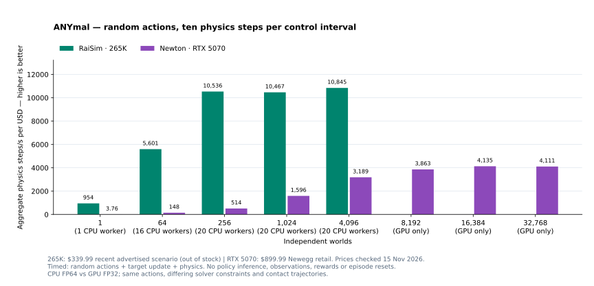
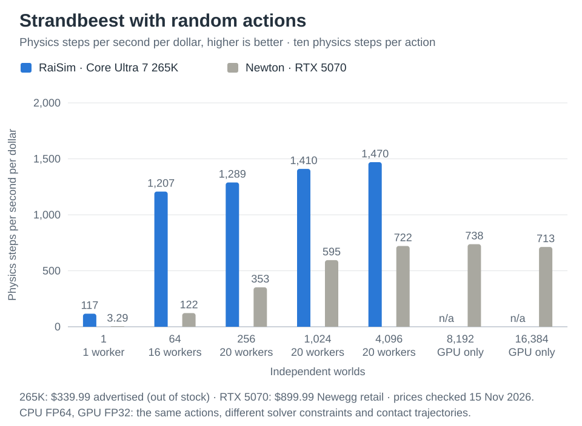
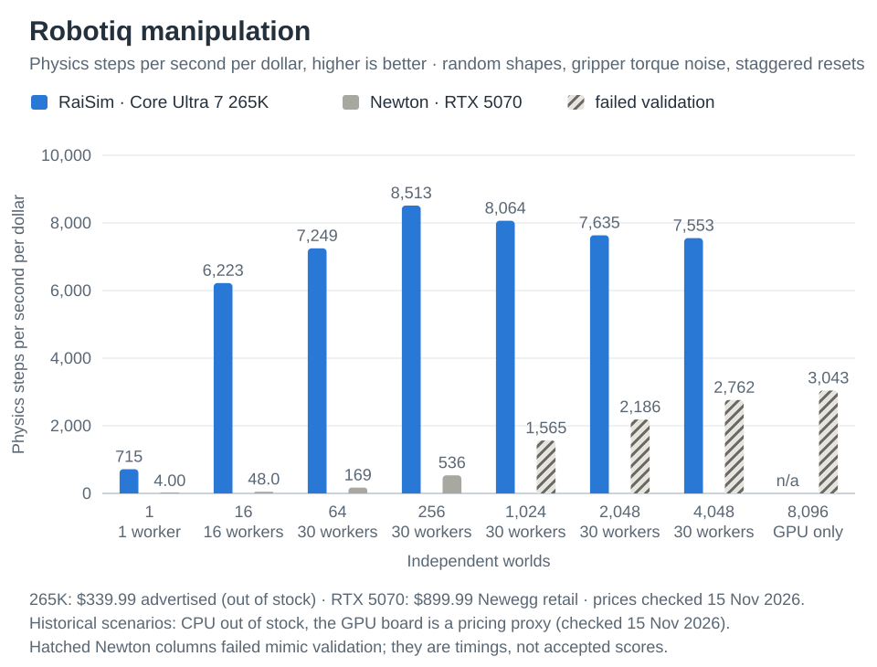
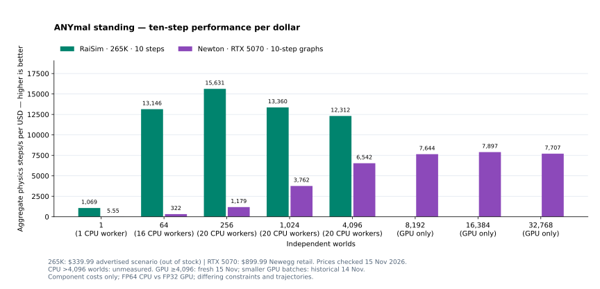

# RaiSim vs Newton

**At the recorded hardware prices, RaiSim delivers about 2× or more physics
performance per dollar at every scale measured for both engines.** With
**1–64 worlds**, the advantage grows to **9.89–253.51×** across ANYmal and
Strandbeest with independent random actions: **about 10× or more in both**.

The gap is largest at smaller, practical batch sizes, where fast simulation
supports frequent policy updates without waiting to fill a massive batch.

- **Fast from one environment.** In the random-action ANYmal and Strandbeest benchmarks below,
  one CPU worker is **95.77× and 13.43× faster**, respectively, than Newton on the
  GPU. At 64–256 environments, RaiSim still delivers **1.38–14.26× higher throughput**.
  It scales efficiently without needing a massive batch to become competitive.
- **Update the policy sooner.** [Rollout-based learners such as PPO](https://spinningup.openai.com/en/latest/algorithms/ppo.html#pseudocode)
  collect experience before updating. Increasing that collection batch to fill a GPU
  can delay the next update. RaiSim's small-batch speed lets you choose rollout size
  for the learning algorithm and update frequently, rather than for GPU occupancy.
- **Handle uneven workloads.** Different robots, contacts, resets, and solver work
  make environments take different amounts of time. Independent CPU worlds can be
  scheduled separately; divergent GPU work and batch synchronization can leave
  resources waiting. This makes CPU execution a flexible fit for heterogeneous tasks.
  See [CUDA's control-flow guidance](https://docs.nvidia.com/cuda/cuda-programming-guide/02-basics/writing-cuda-kernels.html#basics-of-simt)
  and [MJWarp's batch solver behavior](https://mujoco.readthedocs.io/en/latest/mjwarp/index.html#solver-iterations).

Choose environment count by **time per policy update and time to target reward**.
The results below measure physics throughput; training speed also depends on
rollout scheduling, data transfers, inference, and optimization.

The primary results below use random targets refreshed every ten physics steps.
At **4,096 worlds**, RaiSim provides **3.40× / 2.04×** Newton's FPS/USD for ANYmal /
Strandbeest, using **$339.99 CPU / $899.99 GPU** price assumptions. The GPU costs
**2.65×** as much as the CPU. Costs are component-only; the GPU also requires a host.
These measurements include random target generation, updates and physics, and exclude
policy inference, observations, rewards and episode resets.

Prices checked 15 November 2026: **265K $339.99**, a recent
[Newegg advertised-price scenario](https://www.newegg.com/Intel-x-Newegg-Anniversary-Deals/EventSaleStore/ID-10632)
from an index crawled last month; the
[direct CPU listing](https://www.newegg.com/intel-core-ultra-7-265k-arrow-lake-lga-1851-desktop-cpu-processor/p/N82E16819118506?Item=N82E16819118506)
is now out of stock, so this is not a verified currently buyable quote.
**RTX 5070 $899.99** comes from the
[new MSI Ventus listing sold/shipped by Newegg](https://www.newegg.com/msi-geforce-rtx-5070-12g-ventus-2x-oc-video-card/p/N82E16814137994?Item=N82E16814137994),
shown with Add to cart. That board is a pricing proxy for the measured RTX 5070.
Tax, host system, RAM, motherboard, cooling, energy and licensing are excluded;
the GPU also needs a host CPU. Prices are editable in the interactive report.

## Random-actuation performance per USD {#random-actuation}

This workload changes each environment's control targets independently every ten physics
steps, instead of holding a standing pose or a constant crank speed. It measures
**random action generation, target updates and physics**, with a CPU worker barrier at
each control interval and ordered GPU graph execution. It does **not** include a
learned policy, observations, rewards, episode resets or rendering, so it is not a
full RL-training throughput measurement. Each control transition contains ten physics
steps: divide the reported physics FPS/USD by **10** for control transitions/s/USD.

- **ANYmal:** 12 joint-position targets, sampled uniformly within ±0.15 rad of the
  nominal pose, with position gain 200 and damping 10. Actions update every 20 ms.
- **Strandbeest:** the single actuated crank's velocity target varies by ±25% around
  2π rad/s, with damping 200. The linkage joints remain passive. Actions update every 10 ms.
- Seed **20261115**, keyed by environment, control interval and joint. CPU and GPU
  targets use the same float32 hash-to-action calculation and canonical joint mapping.
  Cross-engine target checks matched bit-for-bit; serial and multi-threaded RaiSim
  checks matched final state hashes. Action-on versus action-off checks changed trajectories.

[Open the interactive random-action report](/raisim_newton_random_actions.html)
· [Download random-action measurements, per-trial timings, contacts and validation](/raisim_newton_random_actions.json).
Component-price assumptions remain **$339.99 CPU / $899.99 GPU**, with the availability
limitations described above. Higher FPS/USD is better; missing CPU results are unmeasured.

### ANYmal with random actions

<figure>

<figcaption>Ten physics steps per action; random generation, target update and physics are timed. CPU values beyond 4,096 worlds are unmeasured.</figcaption>
</figure>

| Worlds | CPU workers | RaiSim FPS/USD | Newton FPS/USD | RaiSim / Newton FPS-per-dollar |
| ---: | ---: | ---: | ---: | ---: |
| 1 | 1 | 954.41 | 3.76 | 253.51× |
| 64 | 16 | 5,600.58 | 148.35 | 37.75× |
| 256 | 20 | 10,535.55 | 514.19 | 20.49× |
| 1,024 | 20 | 10,466.75 | 1,596.15 | 6.56× |
| 4,096 | 20 | 10,845.10 | 3,188.73 | 3.40× |
| 8,192 | — | Not measured | 3,862.81 | — |
| 16,384 | — | Not measured | 4,134.67 | — |
| 32,768 | — | Not measured | 4,111.08 | — |

### Strandbeest with random actions

<figure>

<figcaption>Ten physics steps per action; random generation, target update and physics are timed. CPU values beyond 4,096 worlds are unmeasured.</figcaption>
</figure>

| Worlds | CPU workers | RaiSim FPS/USD | Newton FPS/USD | RaiSim / Newton FPS-per-dollar |
| ---: | ---: | ---: | ---: | ---: |
| 1 | 1 | 117.02 | 3.29 | 35.56× |
| 64 | 16 | 1,207.31 | 122.08 | 9.89× |
| 256 | 20 | 1,289.24 | 352.62 | 3.66× |
| 1,024 | 20 | 1,410.19 | 595.12 | 2.37× |
| 4,096 | 20 | 1,470.17 | 721.71 | 2.04× |
| 8,192 | — | Not measured | 737.88 | — |
| 16,384 | — | Not measured | 712.86 | — |

### Random-action validation and limits

All **25 benchmark cases** passed the finite-state, contact, timing and target-sequence
checks. GPU cases reported zero solver overflow; all Strandbeest closure gaps were below
1 mm. At 4,096 worlds, trajectory-mean contacts/world were **2.683 / 2.336** for ANYmal
(RaiSim / Newton) and **0.945 / 0.696** for Strandbeest. These differences are retained in
the dataset rather than treated as equal contact work.

Both engines warm with nominal actions: 1,100 ANYmal steps or 100 Strandbeest steps.
Each timed trial then restores the post-warmup ANYmal state or the initial Strandbeest
state, resets solver warm starts and the action counter, and replays the same action
sequence. Trials contain **5,000 ANYmal steps** or **3,000 Strandbeest steps** at every
world count. Results use medians of three trials, except single-world RaiSim uses seven.
No trials are discarded. Processes run serially; CPU workers are pinned, with one
independent world per environment and no engine-internal threading.

An extra untimed replay measures trajectory-mean contacts and checks finite states,
solver overflow and Strandbeest closure gaps. RaiSim closure gaps and finite states
are sampled at ten-step boundaries; Newton gaps/overflow are checked every physics
step, and its finite state is checked at the end. These are different validation
sampling rates, not a claim of identical accuracy. Full trial times and contact means
are included in the downloadable records. Equal action targets do not imply equal
contact trajectories, because the solvers, precision and constraint formulations differ.

The earlier fixed-target numbers use a different driver protocol (no CPU control-interval
barrier and varying CPU trial horizons). Differences between the two workloads therefore
include synchronization, action-update overhead and changed physics; they do not isolate
random actuation cost alone. No episode resets are timed, and no claim is made about
policy or full training throughput. The larger-world GPU memory safeguard is unchanged.

## Robotiq manipulation: randomized shapes and resets {#manipulation}

This manipulation workload uses a six-axis Kinova arm with a Robotiq 2F-85
mimic gripper to pick, lift, transfer and release a 100 g object. Independent
worlds contain randomized boxes, spheres or cylinders, with dimensions from
36–44 mm. The single gripper driver receives additive uniform torque noise in
**±0.25 Nm** every ten physics steps. Its five mimic followers remain passive.
Object yaw and pickup position change on reset; independently seeded phase
delays and **23–26 s reset periods** keep worlds in different states.

<figure>
<video class="doc-video" src="../../rsc/docs/video/raisim_newton_manipulation.mp4" controls loop muted playsinline preload="metadata" aria-label="Recorded Kinova and Robotiq manipulation benchmark: approach, grasp, lift, transfer, release and randomized reset"></video>
<figcaption>Representative RaiSim world at 2× playback, recorded from the actual randomized controller and contacts. The complete cycle and reset are shown. Visual meshes are enabled for the video; joint coordinates, velocities and object poses/velocities matched a headless collision-only replay at every recorded frame. Rendering and encoding are excluded from the benchmark.</figcaption>
</figure>

### Side-by-side timings

Fresh measurements on **17 November 2026 (Asia/Seoul, UTC+9)**: RaiSim on an **Intel Core Ultra 7
265K**, using **30 persistent CPU workers** where the world count permits;
Newton **SolverMuJoCo / MuJoCo Warp** on an **NVIDIA GeForce RTX 5070**.
CPU workers are capped by world count, not CPU affinity. This host exposes
20 logical CPUs, so the 30-worker cases oversubscribe it. Workers own disjoint
worlds, are not pinned, and synchronize only at trial boundaries.

Values are **aggregate physics steps/s**, calculated as worlds × 30,000 steps
÷ median elapsed time across **three trials**, at **1 ms per step**. No trial
is discarded. Cases run serially. Timed work includes random controls, collisions,
physics and asynchronous resets. Model loading, compilation, rendering, policy
inference, observations, rewards and optimization are excluded. These values are
raw FPS; the value comparison below uses the page’s recorded component-price assumptions.

**† A dagger marks a completed Newton run that failed the untimed 0.01 rad
mimic-error check. Those timings describe unvalidated trajectories, not accepted
benchmark scores; speed ratios are shown only for passing pairs.**

| Worlds | CPU workers | RaiSim FPS | Newton timed FPS | Validated RaiSim / Newton |
| ---: | ---: | ---: | ---: | ---: |
| 1 | 1 | 243,072 | 3,599 | 67.54× |
| 16 | 16 | 2,115,594 | 43,211 | 48.96× |
| 64 | 30 | 2,464,676 | 152,420 | 16.17× |
| 256 | 30 | 2,894,461 | 482,703 | 6.00× |
| 1,024 | 30 | 2,741,697 | 1,408,736† | — |
| 2,048 | 30 | 2,595,724 | 1,967,063† | — |
| 4,048 | 30 | 2,567,821 | 2,485,519† | — |
| 8,096 | — | Not measured | 2,739,018† | — |

RaiSim was measured through **4,048 worlds** and Newton through **8,096 worlds**.
These are the chosen endpoints, 4,048 and 8,096, rather than powers of two.
The missing CPU result at 8,096 is unmeasured and is not extrapolated.
[Download raw timings, diagnostics, provenance and video metadata](/raisim_newton_manipulation.json).

### Manipulation performance per USD

FPS/USD divides aggregate world physics steps/s by the full component price:
**$339.99 CPU / $899.99 GPU**, matching the existing comparisons above. These
are the **historical price scenarios checked 15 November 2026**, not fresh quotes.
The CPU listing was out of stock, and the GPU board is a pricing proxy. The same
availability limitations and exclusions above apply; this is component cost,
not total system cost. Higher FPS/USD is better. Divide by ten for control
transitions/s/USD.

<figure>

<figcaption>Random shapes, noisy gripper torque and staggered resets are timed. Hatched bars (†) are failed-validation timings, not accepted scores. No ratio is reported for those cases. The scene video above is untimed.</figcaption>
</figure>

| Worlds | CPU workers | RaiSim FPS/USD | Newton timed FPS/USD | Validated RaiSim / Newton FPS-per-dollar |
| ---: | ---: | ---: | ---: | ---: |
| 1 | 1 | 714.94 | 4.00 | 178.77× |
| 16 | 16 | 6,222.52 | 48.01 | 129.60× |
| 64 | 30 | 7,249.26 | 169.36 | 42.80× |
| 256 | 30 | 8,513.37 | 536.34 | 15.87× |
| 1,024 | 30 | 8,064.05 | 1,565.28† | — |
| 2,048 | 30 | 7,634.71 | 2,185.65† | — |
| 4,048 | 30 | 7,552.64 | 2,761.72† | — |
| 8,096 | — | Not measured | 3,043.39† | — |

At **256 worlds**, the largest batch where both engines passed validation,
RaiSim provides **15.87× Newton’s FPS/USD** at the recorded prices. Newton’s larger-batch timings
remain visible for transparency, with no validated value claim.

### Accuracy checks and solver differences

All RaiSim cases passed the finite-state, contact, bilateral-grasp, lift and
mimic checks. The two engines received exactly matching torque checksums and
reset counts at every shared world count. Newton failed the mimic check at
1,024, 2,048, 4,048 and 8,096 worlds. Every completed Newton run remained finite and reported
zero internal or contact-buffer overflow. The failed check concerns soft mimic
coupling accuracy, rather than a measured memory or world-count limit:

| Newton worlds | Maximum mimic error (rad) | 0.01 rad check |
| ---: | ---: | --- |
| 1 | 0.004175 | Passed |
| 16 | 0.005094 | Passed |
| 64 | 0.007183 | Passed |
| 256 | 0.008842 | Passed |
| 1,024 | 0.011755 | Failed |
| 2,048 | 0.011853 | Failed |
| 4,048 | 0.010998 | Failed |
| 8,096 | 0.011393 | Failed |

RaiSim's recorded maximum mimic error was approximately
**2.8e-16 rad**. The checks are performed in a separate replay; grasp and lift
requirements are batch-wide, not a guarantee of successful placement in every
world. Contact counts and all raw trial durations are retained in the download.
The contact-overflow observable includes pipeline truncation and solver contact
capacity. A regression test in the benchmark repository limits the solver to one
contact and verifies rejection.

Each diagnostic maximum is taken over all worlds and steps in **one replay per
case**. Larger batches sample more grasps. The recorded Newton maxima are not
monotonic with batch size: identical per-world inputs do not guarantee identical
FP32 contact trajectories across batches or reruns. Cases near 0.01 rad may
change validation status on repetition; the limit was not relaxed for this sweep.

Both engines use the same public robot description, collision dimensions,
controller poses/gains, random seed **20261117**, and 100 g object masses.
Arm capsule `length` is also supplied as `height` because Newton's importer requires
that spelling. Sliding friction is 1.0 for pad/object, 0.5 for arm/object and
0.8 for table/object and ground/object. Robot self-collision and sleeping are off.

RaiSim uses FP64 and hard mimic coupling. Newton uses FP32, soft mimic equalities,
and the Newton collision pipeline with body variants for mixed primitive types.
Its settings are 100 solver iterations, 50 line-search iterations, 128 contacts
per world, `implicitfast`, elliptic friction, tolerance 1e-8 and zero contact gap.
Contact solref is [0.002, 1] and solimp is [0.99, 0.999, 0.001, 0.5, 2]; mimic
solref is [0.002, 1] and solimp is [0.9999, 0.99999, 0.00001, 0.5, 2].
RaiSim enforces the URDF velocity limits (15 rad/s arm, 2 rad/s fingers);
SolverMuJoCo does not implement those limits. Contact manifolds and trajectories
therefore differ. Equal random inputs do not establish equal numerical work,
accuracy, or full RL-training performance.

The driver used the public RaiSim **2.16.0** SDK at
`d9df2c979c9ddc44ec6b6727ff72c660688fdb62`, Newton
`c552d3653352a472dcc1f7e74e004aacac202f74`, Warp 1.19.0, and MuJoCo/MuJoCo Warp
3.17.0. The CPU driver was built with Clang 20.1.8, C++20, Release, `-O3`,
`-ffp-contract=off` and `BENCHMARK_X86_64_V3=OFF`. Full source/library hashes and
package versions accompany the raw records.

### Reproduce the manipulation workload

These commands use the local companion `raisim-vs-newton` benchmark checkout.
The downloaded dataset includes its source hashes and exact commands; this page
does not distribute that driver. The CPU launcher creates the prepared
`assets/` directory used by both engines:

```sh
cmake -S . -B build-manipulation -DCMAKE_CXX_COMPILER=clang++-20 \
  -DCMAKE_BUILD_TYPE=Release -DBENCHMARK_X86_64_V3=OFF
cmake --build build-manipulation -j12
.venv/bin/python manipulation.py --build build-manipulation --backend raisim \
  --threads 30 --worlds 1,16,64,256,1024,2048,4048 \
  --steps 30000 --repeats 3 --timing-only --output results/manipulation-cpu-new
.venv/bin/python newton_manipulation.py \
  --assets results/manipulation-cpu-new/assets --worlds 8096 \
  --steps 30000 --repeats 3
```

Newton was measured at **1, 16, 64, 256, 1,024, 2,048, 4,048 and 8,096 worlds**.
Repeat the per-case Newton command for those counts to retain its
`RESULT` line even when validation fails. It exits nonzero on a failed check;
its raw timings are not an accepted throughput claim. The initial GPU launcher
stopped after the 1,024-world failure, so the larger cases were continued
individually with the same assets and settings, as recorded in the dataset. A RaiSim license and a
supported CUDA GPU are required. See the [Robotiq mimic example](./examples/server/robotiq_gripper_mimic.md)
for the original model and motion sequence.

::: details Earlier fixed-target measurements

## Fixed-target ten-step performance per USD

RaiSim runs on a Core Ultra 7 265K; Newton SolverMuJoCo / MuJoCo Warp runs on an
RTX 5070. Each environment has its own world, ground, and robot. At the recorded
component prices, RaiSim provides **1.88–192.43× more steps per dollar** across
all ten paired comparisons. GPU throughput can lead at large batches; CPU
performance above 4,096 environments has not been measured here.

[Explore throughput and change prices](/raisim_newton_ten_step_value.html)
· [Download recorded results](/raisim_newton_ten_step_value.json).

FPS/USD is aggregate world physics steps/s divided by the full component price:
**$339.99 for the CPU and $899.99 for the GPU**. The GPU costs 2.65× as much;
at 4,096 worlds, RaiSim retains **1.88× / 2.08×** the FPS/USD for ANYmal / Strandbeest.

### ANYmal standing

<figure>

<figcaption>Ten-step performance per USD at $339.99 for the CPU and $899.99 for the GPU; the GPU costs 2.65× as much. CPU values above 4,096 worlds are unmeasured. Prices and comparison limits are described above and below.</figcaption>
</figure>

| Worlds | CPU workers | RaiSim FPS/USD | Newton FPS/USD | RaiSim / Newton FPS-per-dollar |
| ---: | ---: | ---: | ---: | ---: |
| 1 | 1 | 1,068.60 | 5.55 | 192.43× |
| 64 | 16 | 13,146.06 | 321.84 | 40.85× |
| 256 | 20 | 15,630.98 | 1,178.54 | 13.26× |
| 1,024 | 20 | 13,360.45 | 3,761.72 | 3.55× |
| 4,096 | 20 | 12,312.24 | 6,542.08 | 1.88× |
| 8,192 | — | Not measured | 7,644.33 | — |
| 16,384 | — | Not measured | 7,897.44 | — |
| 32,768 | — | Not measured | 7,706.77 | — |

### Strandbeest

<figure>

<figcaption>Ten-step performance per USD at $339.99 for the CPU and $899.99 for the GPU; the GPU costs 2.65× as much. CPU values above 4,096 worlds are unmeasured. Prices and comparison limits are described above and below.</figcaption>
</figure>

| Worlds | CPU workers | RaiSim FPS/USD | Newton FPS/USD | RaiSim / Newton FPS-per-dollar |
| ---: | ---: | ---: | ---: | ---: |
| 1 | 1 | 117.60 | 3.30 | 35.67× |
| 64 | 16 | 1,493.57 | 127.10 | 11.75× |
| 256 | 20 | 1,553.38 | 365.93 | 4.25× |
| 1,024 | 20 | 1,513.19 | 606.58 | 2.49× |
| 4,096 | 20 | 1,511.11 | 725.41 | 2.08× |
| 8,192 | — | Not measured | 740.77 | — |
| 16,384 | — | Not measured | 714.88 | — |

<details>
<summary>Scaling beyond 4,096 worlds</summary>

### Scaling beyond 4,096 worlds

Newton supports more than 4,096 environments; this was a benchmark sweep endpoint,
not a solver limit. Fresh runs retain the same ten-step graphs, solver parameters,
precision, time horizons and three-trial protocol. Larger batches can increase
aggregate throughput while reducing steps/s per environment. Once the GPU is
saturated, additional environments mainly consume memory and can reduce throughput.

- **ANYmal:** best measured FPS/USD was **7,897.44** at **16,384 worlds**, 1.21× the fresh 4,096-world value. Largest tested batch: **32,768**, sampled process GPU-memory peak **2,438 MiB**.
- **Strandbeest:** best measured FPS/USD was **740.77** at **8,192 worlds**, 1.02× the fresh 4,096-world value. Largest tested batch: **16,384**, sampled process GPU-memory peak **5,770 MiB**.

The fresh 4,096-world throughput is within 1.1% of the previous historical value
for both robots. Among the fresh ANYmal trials, FPS/USD ranged from **7,792.52–7,898.03** at 16,384 worlds and
**7,603.89–7,715.17** at 32,768 worlds.
The small decline at 32,768 worlds is an observed result, not proof of a universal
optimum. The downloadable records include all three trial timings for every fresh case.

All reported fresh cases passed finite-state, constraint-quality and zero-overflow
checks. Sampled GPU-memory peaks come from periodic nvidia-smi process readings,
not allocator-exact peaks. The RTX 5070 has 12 GB VRAM; the sweep avoids doubling
a workload once sampled usage exceeds 5,000 MiB because it could approach or exceed available VRAM.
This safeguard does not establish a maximum supported world count.

RaiSim was not measured above 4,096 worlds in this comparison; missing CPU values
are not zero or extrapolated. GPU results through 1,024 worlds remain historical
14 November measurements; GPU results at 4,096 and above are fresh 15 November runs.
[Download full scaling measurements, validation and GPU-memory samples](/raisim_newton_large_worlds.json).

</details>

<details>
<summary>Hardware prices, measurement protocol, and limits</summary>

Prices checked 15 November 2026: **265K $339.99**, a recent
[Newegg advertised-price scenario](https://www.newegg.com/Intel-x-Newegg-Anniversary-Deals/EventSaleStore/ID-10632)
from an index crawled last month; the
[direct CPU listing](https://www.newegg.com/intel-core-ultra-7-265k-arrow-lake-lga-1851-desktop-cpu-processor/p/N82E16819118506?Item=N82E16819118506)
is now out of stock, so this is not a verified currently buyable quote.
**RTX 5070 $899.99** comes from the
[new MSI Ventus listing sold/shipped by Newegg](https://www.newegg.com/msi-geforce-rtx-5070-12g-ventus-2x-oc-video-card/p/N82E16814137994?Item=N82E16814137994),
shown with Add to cart. That board is a pricing proxy for the measured RTX 5070.
Tax, host system, RAM, motherboard, cooling, energy and licensing are excluded;
the GPU also needs a host CPU. Prices are editable in the interactive report.

### Protocol and limits

CPU workers integrate each world ten times before visiting the next world. Newton
uses graphs of ten GPU steps. Workers own disjoint world ranges and are CPU-pinned;
integration inside each world is single-threaded. Worker counts are recorded
configurations, not a demonstrated optimum. Setup, warmup, validation and external
policy computation are excluded. Time steps are 2 ms for ANYmal and 1 ms for Strandbeest.
CPU throughput uses median elapsed wall time; single-world cases have 21 trials
across three processes and multiworld cases have 10 across two, except ANYmal
4,096/20 scores six of ten after the prespecified first-two-per-process exclusion.
Processes ran serially; timed horizons vary with world count.

RaiSim CPU measurements are from 15 November 2026 and use FP64. Newton GPU measurements
use FP32: counts through 1,024 are from 14 November, and counts from 4,096 onward
were rerun on 15 November for the larger-world sweep.
The scenes/controllers were matched, but solvers, constraint formulations and
trajectories differ; these ratios do not compare identical numerical work. ANYmal
has four contacts/world. Historical Strandbeest trajectory means are approximately
0.959 contacts/world for RaiSim and 0.686–0.700 for Newton; the current RaiSim ending
count of one/world is a different statistic. RaiSim merges fixed links (74 bodies),
while Newton retains them (92). All 18 CPU scheduling cases matched final state hashes
and contacts against one-step scheduling, with six extra partial-block/uneven-range checks.
The tables retain the ten primary CPU comparison cases and add the measured larger GPU batches.

</details>

:::

For the single-threaded CPU comparison, see [RaiSim vs MuJoCo](./Benchmark.md).
