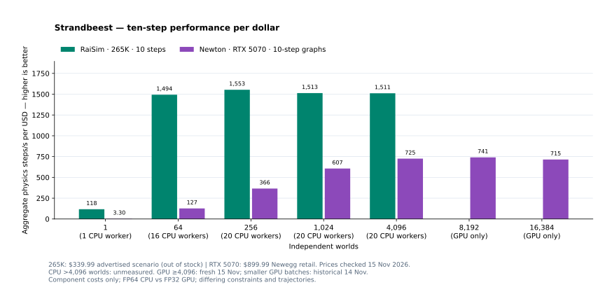

# RaiSim vs Newton

## Ten-step performance per USD

This benchmark compares **ten-step RaiSim scheduling on a Core Ultra 7 265K**
with **Newton SolverMuJoCo / MuJoCo Warp on an RTX 5070**. Higher is better.
FPS/USD means aggregate world physics steps per second divided by the entire component
price, including when only one CPU worker is used. Each environment has its own world, ground and robot.

[Open the interactive ten-step FPS/USD report](/raisim_newton_ten_step_value.html)
· [Download the recorded data](/raisim_newton_ten_step_value.json).

Prices checked 15 November 2026: **265K $339.99**, a recent
[Newegg advertised-price scenario](https://www.newegg.com/Intel-x-Newegg-Anniversary-Deals/EventSaleStore/ID-10632)
from an index crawled last month; the
[direct CPU listing](https://www.newegg.com/intel-core-ultra-7-265k-arrow-lake-lga-1851-desktop-cpu-processor/p/N82E16819118506?Item=N82E16819118506)
is now out of stock, so this is not a verified currently buyable quote.
**RTX 5070 $899.99** comes from the
[new MSI Ventus listing sold/shipped by Newegg](https://www.newegg.com/msi-geforce-rtx-5070-12g-ventus-2x-oc-video-card/p/N82E16814137994?Item=N82E16814137994),
shown with Add to cart. That board is a pricing proxy for the measured RTX 5070.
Tax, host system, RAM, motherboard, cooling, energy and licensing are excluded;
the GPU also needs a host CPU. Prices are editable in the interactive report.

### Reading the price-normalized results

At the prices above, the RTX 5070 costs **2.65× as much as the 265K**
($899.99 / $339.99). Its throughput must therefore be 2.65× higher to match
RaiSim's FPS/USD. Dividing GPU throughput by the higher price reduces its value score.

At 4,096 worlds, Newton's measured throughput is **1.42× higher for ANYmal** and
**1.28× higher for Strandbeest**. These gains are smaller than the 2.65× price difference,
so RaiSim provides **1.86× and 2.06× the FPS/USD**, respectively.
The last column below is a **performance-per-dollar ratio**, not a hardware-price ratio
or a raw-throughput ratio:

`RaiSim / Newton FPS-per-dollar = (RaiSim FPS / Newton FPS) × ($899.99 / $339.99)`.

### ANYmal standing

<figure>

<figcaption>Ten-step performance per USD at $339.99 for the CPU and $899.99 for the GPU; the GPU costs 2.65× as much. Prices and comparison limits are described above and below.</figcaption>
</figure>

| Worlds | CPU workers | RaiSim FPS/USD | Newton FPS/USD | RaiSim / Newton FPS-per-dollar |
| ---: | ---: | ---: | ---: | ---: |
| 1 | 1 | 1,068.60 | 5.55 | 192.43× |
| 64 | 16 | 13,146.06 | 321.84 | 40.85× |
| 256 | 20 | 15,630.98 | 1,178.54 | 13.26× |
| 1,024 | 20 | 13,360.45 | 3,761.72 | 3.55× |
| 4,096 | 20 | 12,312.24 | 6,609.44 | 1.86× |

### Strandbeest

<figure>

<figcaption>Ten-step performance per USD at $339.99 for the CPU and $899.99 for the GPU; the GPU costs 2.65× as much. Prices and comparison limits are described above and below.</figcaption>
</figure>

| Worlds | CPU workers | RaiSim FPS/USD | Newton FPS/USD | RaiSim / Newton FPS-per-dollar |
| ---: | ---: | ---: | ---: | ---: |
| 1 | 1 | 117.60 | 3.30 | 35.67× |
| 64 | 16 | 1,493.57 | 127.10 | 11.75× |
| 256 | 20 | 1,553.38 | 365.93 | 4.25× |
| 1,024 | 20 | 1,513.19 | 606.58 | 2.49× |
| 4,096 | 20 | 1,511.11 | 732.23 | 2.06× |

### Protocol and limits

CPU workers integrate each world ten times before visiting the next world. Newton
uses graphs of ten GPU steps. Workers own disjoint world ranges and are CPU-pinned;
integration inside each world is single-threaded. Worker counts are recorded
configurations, not a demonstrated optimum. Setup, warmup, validation and external
policy computation are excluded. Time steps are 2 ms for ANYmal and 1 ms for Strandbeest.
CPU throughput uses median elapsed wall time; single-world cases have 21 trials
across three processes and multiworld cases have 10 across two, except ANYmal
4,096/20 scores six of ten after the prespecified first-two-per-process exclusion.
Processes ran serially; timed horizons vary with world count.

RaiSim CPU measurements are from 15 November 2026 and use FP64. Newton GPU measurements
are historical results from 14 November, use FP32, and were not rerun for this experiment.
The scenes/controllers were matched, but solvers, constraint formulations and
trajectories differ; these ratios do not compare identical numerical work. ANYmal
has four contacts/world. Historical Strandbeest trajectory means are approximately
0.959 contacts/world for RaiSim and 0.686–0.700 for Newton; the current RaiSim ending
count of one/world is a different statistic. RaiSim merges fixed links (74 bodies),
while Newton retains them (92). All 18 CPU scheduling cases matched final state hashes
and contacts against one-step scheduling, with six extra partial-block/uneven-range checks.
The tables select the ten primary comparison cases.

For the single-threaded CPU comparison, see [RaiSim vs MuJoCo](./Benchmark.md).
