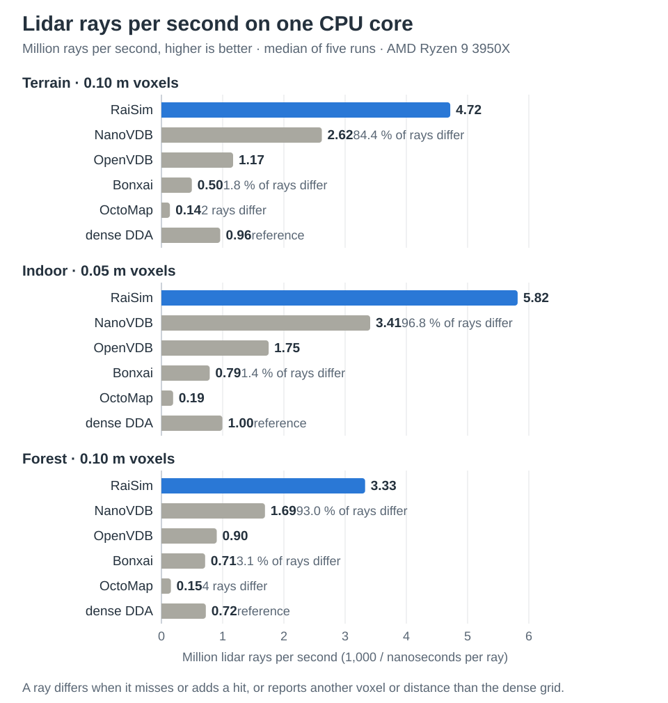
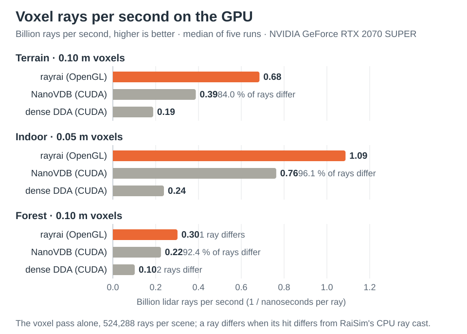
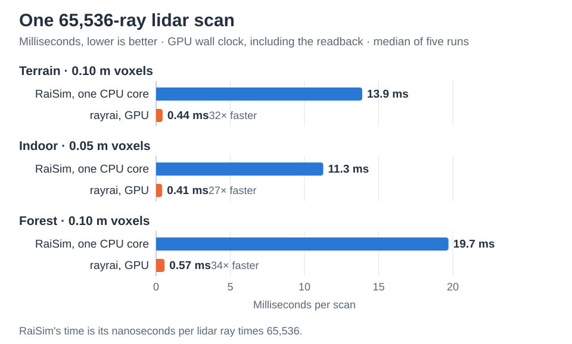
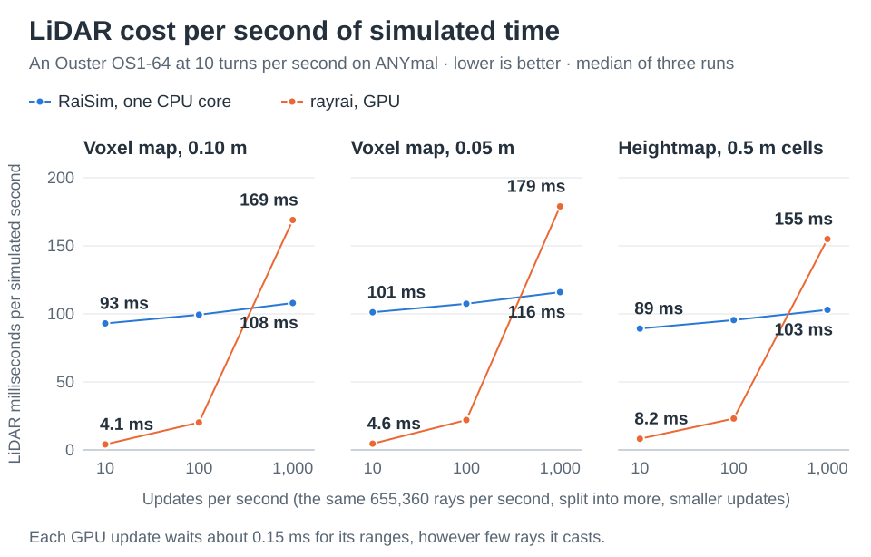
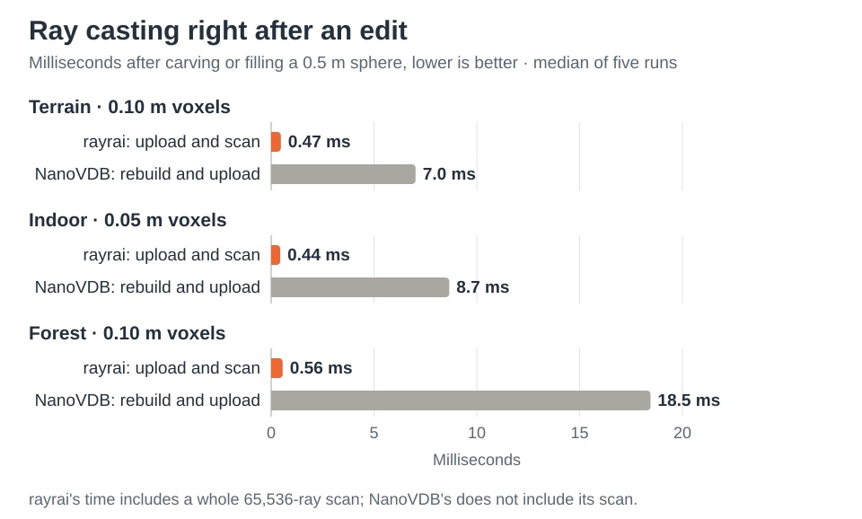

# Voxel Ray Casting

RaiSim's [voxel map](./VoxelMap.md) ray cast is compared with the voxel libraries robotics and
graphics code commonly use, on the CPU and on the GPU, with the same scenes and the same rays.

- **CPU:** RaiSim casts a lidar ray in **172–301 ns**, **1.7–2.0×** faster than
  NanoVDB, **3.3–4.0×** faster than OpenVDB, **4.7–9.5×** faster than Bonxai and **22–34×**
  faster than OctoMap. RaiSim and OpenVDB return every hit exactly; NanoVDB's ray marcher reports a
  different voxel or distance for 84–97 % of the rays.
- **GPU:** [rayrai](./Rayrai.md)'s GPU LiDAR casts a ray in **0.9–3.3 ns**, **1.3–1.8×**
  faster than NanoVDB in CUDA, and returns the CPU's points ray by ray.
- **CPU and GPU:** a 65,536-ray scan takes **11–20 ms** on one CPU core and **0.41–0.57 ms**
  with rayrai, **27–34×** faster.
- **Edits:** after carving or filling a sphere, rayrai uploads only the parts of the map that
  changed. The next scan takes **0.44–0.56 ms**, about as long as any other scan. NanoVDB has to
  rebuild and upload the whole grid, which takes **7.0–18.5 ms**.

## Setup

| | |
| --- | --- |
| CPU | AMD Ryzen 9 3950X, one thread pinned to one core, Linux x86-64, Clang 20 Release (`-O3 -march=x86-64-v3`) |
| GPU | NVIDIA GeForce RTX 2070 SUPER, driver 580.178.04, OpenGL 4.3 (rayrai) and CUDA 13.3 |
| Libraries | OpenVDB 14.0.0 and the NanoVDB 32.11.0 it ships, Bonxai 0.8.0, OctoMap 1.10.0 |

Each library casts rays with its own ray routine: OpenVDB's `VolumeRayIntersector` with its
`DDA` inside leaves, NanoVDB's `firstActive` (its hierarchical DDA, the same code on the CPU and
in CUDA), Bonxai's `ExactRayIterator` and OctoMap's `castRay`. A dense bit grid stepped voxel by
voxel (`dense DDA`) is the reference: every other result is compared with it, ray by ray. The
grids are built from the same list of occupied voxels.

| Scene | Voxel | Size | Occupied voxels | Contents |
| --- | ---: | --- | ---: | --- |
| terrain | 0.10 m | 51 m × 51 m × 10 m | 7.6 M | hills, 40 buildings, 10 platforms on legs, 6 tunnels |
| indoor | 0.05 m | 30 m × 30 m × 9 m | 6.2 M | three storeys of 25 rooms with doors, windows, stairs and furniture |
| forest | 0.10 m | 100 m × 100 m × 13 m | 9.7 M | 600 trees with hollow crowns and 200 boulders on rolling ground |

Each scene is scanned by eight lidars at random free positions, 1,024 × 64 rays each over pitch
−25° to 15° with a 100 m range (524,288 rays), and by 200,000 rays from random free points in
random directions with a 50 m range.

## CPU



**Nanoseconds per ray, one thread; lower is better.** Median of five runs.

<!--@include: ./_voxel_ray_casting_results.md#cpu-time-->

**Lidar rays that differ from the reference** (a missed or extra hit, another voxel, or another
distance):

<!--@include: ./_voxel_ray_casting_results.md#cpu-differ-->

NanoVDB's `firstActive` returns where its DDA steps into a voxel rather than the voxel's face, one to
two voxels too far on average, and it steps into a voxel beside the ray at some edges and corners.
Bonxai's iterator does the same at 1–3 % of the rays. OctoMap works in single precision. RaiSim
reports the face the ray enters, and a ray along an edge or through a corner enters only the voxels
beyond it (see [Ray tests](./VoxelMap.md#ray-tests)).

**Building the grid and its memory:**

<!--@include: ./_voxel_ray_casting_results.md#cpu-build-->

The dense grid's memory grows with the volume of its domain; the others grow with the occupied
voxels.

## GPU



**Nanoseconds per ray for the voxel pass alone; lower is better.** Median of five runs, rayrai and
CUDA taking turns, 524,288 lidar rays per scene. rayrai's pass is timed with an OpenGL timer query,
the CUDA kernels with CUDA events.

<!--@include: ./_voxel_ray_casting_results.md#gpu-time-->

**Rays that differ from RaiSim's CPU ray cast:**

<!--@include: ./_voxel_ray_casting_results.md#gpu-differ-->

rayrai works in single precision, so a ray that passes within rounding of a voxel edge can enter
or skip the voxel beside it; one ray in 1.5 million did.

## CPU and GPU

A full 65,536-ray scan through rayrai's GPU LiDAR (`measureSpinningLidarSingleDrawGPU`) includes
building the ray table, drawing every body and reading the ranges back (median of five runs, in the
same runs as the [edits](#edits)):



<!--@include: ./_voxel_ray_casting_results.md#scan-->

On a robot, `rayrai_lidar_benchmark` scans an 84 m × 84 m terrain with 200 obstacles with an
Ouster OS1-64 (512 × 64 rays per turn, 10 turns per second) on ANYmal. The two lidars are twins
and return the same points; no return differs. The chart adds up the time per second of simulated
time; the table gives it per update. Medians of three runs:



<!--@include: ./_voxel_ray_casting_results.md#robot-->

A GPU update waits for its ranges to come back, about 0.15 ms, however few rays it casts. Updated
every 1 ms physics step, each update casts 328 rays, which the CPU does faster; at 100 updates per
second (3,277 rays each) the GPU is 4 to 5 times faster.

## Edits

A sphere of 0.5 m radius is carved out of or filled into the map 3 to 7 m from the sensor, and the
next scan is timed (median of five runs, rayrai and NanoVDB taking turns):



<!--@include: ./_voxel_ray_casting_results.md#edits-->

rayrai uploads only the 16³-voxel bricks the edit changed. A NanoVDB grid cannot be edited in
place, so the time is that of NanoVDB's grid builder adding the sphere's voxels, converting the
grid and copying it to the GPU; removing voxels needs a build from the source data. On the robot
above, a turn right after an edit takes 0.44 ms with 0.10 m voxels and 0.51 ms with 0.05 m voxels.

## Reproduce

[Download the recorded results](/voxel_ray_casting_results.json), from which the tables and charts
on this page are made. The comparisons with other libraries use an internal harness that is not
distributed. RaiSim's
own measurements come from the benchmark runner of the RaiSim source repository, which the binary
package does not ship (see [Build, Test, and Benchmark](./BuildAndTest.md#timing-examples)):

```sh
taskset -c 2 ./build-benchmark/benchmark/benchmarks -b voxel_lidar -b voxel_contacts -b voxel_edit --raisim
taskset -c 2 ./build-benchmark/visualizer/rayrai/rayrai_lidar_benchmark --voxel-size=0.1
taskset -c 2 ./build-benchmark/visualizer/rayrai/rayrai_lidar_benchmark --voxel-size=0.05
taskset -c 2 ./build-benchmark/visualizer/rayrai/rayrai_lidar_benchmark
```

`voxel_lidar` times lidar scans of a terrain as a voxel map and as a heightmap, `voxel_contacts`
a pile of bodies on voxel rubble and `voxel_edit` carving spheres out of a map.
`rayrai_lidar_benchmark` prints the robot table above; without `--voxel-size` it scans the
heightmap. Timings depend on the machine, compiler and driver.
