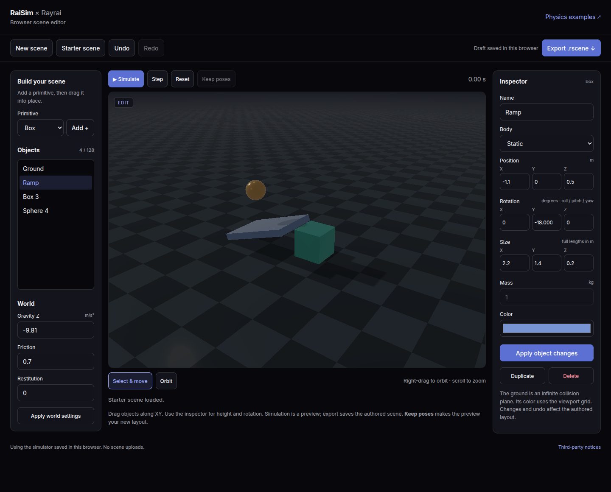

# Browser scene editor

Build a scene interactively with RaiSim physics and the genuine Rayrai renderer using WebGPU. Add primitives, select and drag them in the viewport, edit their properties, preview dynamics, and download a `.rscene` file. Everything runs locally; scene data is not uploaded.

<BrowserSceneEditor />

## Build and edit

Choose **Box**, **Sphere**, **Cylinder** or **Capsule**, then **Add**. Click an object or select its name in the object list. Drag a selected object to move it along the XY plane at its current height. Use the inspector to set its name, XYZ position, roll/pitch/yaw rotation, dimensions, mass, static/dynamic mode and RGB color. Press **Apply changes** to commit the edit.

The editor opens full screen. The object list and world settings float on the left and the inspector on the right; hide either panel from the top bar to see more of the scene. Select **Orbit** in the bottom dock or right-drag to rotate the camera; scroll to zoom. **Duplicate**, **Delete**, **Undo** and **Redo** work on the authored scene. Keyboard shortcuts outside text fields: Ctrl/Cmd+Z to undo, Ctrl/Cmd+Shift+Z or Ctrl/Cmd+Y to redo, Delete to remove the selection, and Escape to cancel a drag.

The ground is an infinite static collision plane, displayed by Rayrai. Its height is editable in the inspector. The scene supports up to 128 objects within −20 to 20 metres on each axis. Values too small for the native scene format are rejected instead of silently rounded to zero. Sphere size is its radius; cylinder height is its full axial length; capsule height is the distance between the hemisphere centres. Box sizes are full side lengths. World settings expose vertical gravity, friction and restitution; the physics step is 2 ms.

## Robots

Open **Robots** in the left panel to browse the robots of raisim2Lib: quadrupeds, Atlas, arms and grippers, wheeled robots, chains and mechanisms, and YCB objects. Each card shows the robot's default preview, the image saved next to its URDF as `<name>.preview.png`. Search filters the cards. Clicking a card downloads the robot's web asset pack, with a progress bar, and places the robot at the origin at a height where a floating base stands on the ground. A fixed-base robot keeps the placement its URDF gives it.

To add your own robot, drag a URDF onto the scene. Drop the URDF together with its mesh files, or drop the robot's folder; the editor keeps the folder layout, so relative and `package://` mesh paths resolve as they do in RaiSim and Rayrai. The files are stored in this browser, so a saved draft reloads the robot; clearing site data removes them.

Robots can be moved, rotated, renamed, duplicated and deleted like primitives. Simulate drops and settles them; **Keep poses** also keeps their joint configuration. The editor holds up to 16 robots.

## Render settings

The render button in the top bar opens every Rayrai setting the browser renderer supports, grouped into image, lighting, shadows, ambient occlusion, sky and fog, post effects and stylized filters. Choose the **Fast**, **Balanced**, **High** or **Ultra** preset, then adjust individual settings; the preset reads **Custom** after a change. Settings apply immediately and are remembered in this browser. They are a viewing preference and are not exported.

## Preview and keep poses

**Simulate** runs the scene and becomes **Pause**. **Step** advances one physics step. Geometry and property editing remain disabled in preview. **Reset** returns to the authored layout. Export always uses the authored layout, so running a preview cannot change the scene you save.

**Keep poses** adopts the preview's current positions and orientations as the new authored layout and resets velocities. It is undoable. Hidden tabs pause advancement; under heavy load the simulation advances more slowly than wall time instead of changing its physics step.

## Export and persistence

**Export .rscene** downloads `scene.rscene` using the existing [RaiSim Engine scene format](./RsceneFile.md), including primitive geometry, transforms, body modes, masses, materials and physics settings. A scene without robots contains no external asset references. A robot is written as an [`articulated_resource` and `articulated` record pair](./RsceneFile.md#articulated-record) whose source is `rsc/<robot>/….urdf` for a library robot (raisim2Lib's `rsc` folder) or `robots/<folder>/….urdf` for a dropped robot; place the scene next to those folders. Open it in RaiSim Engine 2, or load it directly:

```cpp
raisim::World world("scene.rscene");
```

Edits are also saved as a draft in this browser's local storage. If a saved draft cannot be loaded, **Download previous draft** preserves access to its original JSON. Before a replacement scene is saved, that original is retained as a recovery copy. Draft loading checks its text size before parsing and retains only the versioned editor fields. After graphics device loss, **Retry** restores the authored layout using the loaded simulator. Clearing site data or storage eviction can remove a draft; export the file to retain it. When storage is unavailable the editor still works and reports that an export is needed to save. A scene file stores its layout, rather than an undo history or simulation checkpoint.

The editor has its own stripped WASM module and the same verified content-hash cache as the [browser examples](./WebAssembly.md#local-browser-cache). Matching saved binaries load locally without another WASM download. It can run on any HTTPS host with the required [isolation headers](./WebAssembly.md#hosting-and-source-confidentiality), WebGPU, WebAssembly JavaScript Promise Integration, exception handling and shared memory.



## Build and validate

`./update_doc.sh --no-publish` builds this page and the editor alongside the examples without uploading anything. The standalone page is `web-examples/editor.html` in the generated documentation site. The editor's C++ source is `examples/src/web/browser_editor.cpp` in the adjacent examples checkout; its backend and UI live in `web/` in the RaiSim source checkout. Native renderer and simulation hot paths remain separate.

The web CTest suite checks editing, viewport selection and dragging, undo/delete during a drag, second-pointer events, cached-page restoration, corrupt/oversized draft recovery, singular Euler orientations, preview isolation, pose adoption, downloads, draft recovery, mobile layout and warm-cache reuse. Native round-trip tests load generated `.rscene` files using the desktop loader, checking every supported primitive, UTF-8 names, transforms, dimensions, masses, colors and physics settings. Shared native/WASM backend tests cover invalid input, transactional loads, body motion and contact settling.

```bash
node web/test_scene_model.mjs
node web/test_editor_export.mjs /path/to/native/testWebEditor
ctest --test-dir /tmp/raisim-wasm -j1 --output-on-failure
/path/to/native/testWebEditor --benchmark
RAISIM_WEB_EDITOR_PERF=1 node web/test_browser.mjs \
  /tmp/raisim-wasm/web-bundle /tmp/raisim-editor-performance
```

The native benchmark measures scene construction and stepping for 1, 32 and 128 objects, plus a 128-object contact pile. The optional browser benchmark records editor load, move and synchronized render timings serially for the same sizes and contact pile. Step-batch timings include one completed render per 1000 physics steps. Browser timings use headless software rendering and do not predict hardware GPU frame rates. No benchmark is run during normal page use.
