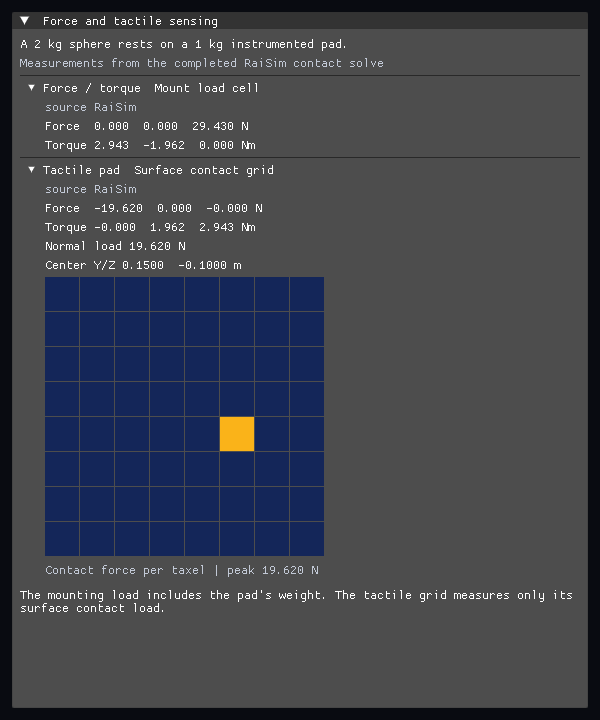

# Sensors

RaiSim supports these sensor workflows:

- **URDF-attached sensors** for robots. Sensor metadata is loaded from a sensor
  XML file attached to a URDF link. This is the right workflow for IMU, RGB,
  depth, and spinning LiDAR sensors that should move with an articulated system.
- **rayrai-rendered RGB/depth sensors** for camera observations. When rayrai is
  available, use in-process rayrai rendering with
  `Sensor::MeasurementSource::MANUAL` for RGB/depth sensor buffers. This is
  the recommended path for rendered images, screenshots, and dataset generation.
- **World-level CPU depth-camera capture** only as a deterministic headless
  fallback. `World::captureDepthCamera` casts CPU rays from an arbitrary camera
  pose and returns depth, object segmentation, optional hit points, and a
  timestamp without requiring a renderer.

The CPU ray-query paths are single-threaded and deterministic. Use in-process
rayrai rendering for RGB/depth images when it is available. A connected TCP
visualizer can also render due `MANUAL` cameras and return their images to
`RaisimServer`; the server applies the sensor noise when committing those buffers.

## Sensor frames and camera convention

Camera and LiDAR sensors use the RaiSim sensor-frame convention:

- `+X`: forward
- `+Y`: left
- `+Z`: up

Camera depth is the distance along the camera `+X` axis, not the Euclidean ray
length. This matches the existing `DepthCamera` convention and is convenient for
pinhole camera models.

## How to attach a sensor to a link

Before further explanations, we clarify some terms used throughout this page.
**sensor** means one measurement stream, such as an RGB camera, a depth camera,
an IMU, or a LiDAR scan. **sensor_set** means a set of sensors contained in one
link. For example, an Intel RealSense-like link can contain RGB, depth, and IMU
sensors.

Create a link for a sensor set and give it a `sensor` attribute:

```xml
<link name="realsense_d435" sensor="realsense435.xml"/>
```

Such a link must be empty: its inertial, visual and collision elements are
defined in the sensor XML file. The sensor XML file should be stored in the same
directory as the URDF file. If it is not found, RaiSim searches
`[urdf_dir]/sensor`, `[urdf_dir]/sensors`, `[urdf_dir]/..`, and
`[urdf_dir]/../sensors`. For a URDF given as a string, the resource directory
passed to `World::addArticulatedSystem()` takes the place of `[urdf_dir]`.
An example sensor file is
[realsense435.xml](https://github.com/raisimTech/raisim2Lib/blob/master/rsc/anymal_c/sensors/realsense435.xml).
An example URDF is
[anymal_sensored.urdf](https://github.com/raisimTech/raisim2Lib/blob/master/rsc/anymal_c/urdf/anymal_sensored.urdf).

## Measurement source and update modes

The update method is selected with `raisim::Sensor::setMeasurementSource`:

- `RAISIM`: measurement is computed by RaiSim. The owning articulated system
  refreshes it during `World::integrate()` on a fixed grid of deadlines
  `1 / update_rate` apart, at the first step that reaches each deadline
  (see [Update timing](#update-timing)). This is the default for IMU
  and spinning LiDAR sensors. `DepthCamera` supports RaiSim-side CPU ray
  updates, but use this for headless fallback rather than for rendered camera
  images when rayrai is available. `RGBCamera` cannot use it.
- `MANUAL`: user code writes the buffers. This is the default for RGB and
  depth cameras. Use it for in-process rayrai RGB/depth rendering or real
  hardware integration.

### Update timing

RaiSim-sourced IMUs, depth cameras and LiDARs count their deadlines in physics
steps: the time of a deadline is the sum of the time steps since the grid
started, not the world time. A sensor takes each deadline at the first step
that reaches it and drops the deadlines a step goes past, without shifting the
grid. It takes at most one sample per step, so its long-run rate equals
`update_rate` up to the physics rate, even when the period is not a multiple of
the time step. A 30 Hz depth camera at 1000 Hz is updated 34, 33, 33, 34, 33,
33, ... steps apart, 30 times per simulated second, and a 500 Hz IMU at
2000 Hz exactly every fourth step, without slipping.

The world time stamps the samples (`getUpdateTimeStamp()`). Changing it with
`World::setWorldTime()` between steps does not move the grid, so a world clock
that disagrees with the time step (time kept in whole nanoseconds at 3000 Hz)
does not slip the samples. A step that ends before the last step the sensor
counted starts a new episode: the grid starts again with an update at once.
Setting the world time back by more than one step does this; setting it back
by one step or less goes unnoticed, as the next step then ends at or after the
last one (at the same time, it counts as already done). The grid also starts
again, with an update at once, when `setUpdateRate()` changes the rate. When the
world time moves forward by more than one and a half time steps between two
steps the sensor counts (it was not updated for some steps, for example while
its source was `MANUAL`, or the world time was set forward), that time counts
as physics time. A spinning LiDAR's head still turns
by the world time between its updates (see [Spinning LiDAR](#spinning-lidar)).
Force and tactile sensors keep their own acquisition clock.

`Sensor::isUpdateDue()` serves sensors with a `MANUAL` source, such as cameras a
viewer renders: an update is due one period after `getUpdateTimeStamp()`.

There is no `VISUALIZER` measurement source in the RaiSim API. TCP camera
requests use `MANUAL` sensors: a connected visualizer renders requested frames,
and `RaisimServer` writes the returned images and acquisition timestamps.

Recommended RGB/depth usage with rayrai sets camera sensors to `MANUAL` and
lets the renderer fill or read back the buffers. See [Using sensors with rayrai](#using-sensors-with-rayrai)
for a complete example. Use `RAISIM` CPU depth updates only when rayrai is not
available or when a deterministic headless ray-query fallback is required.

For RGB sensors, RaiSim does not synthesize color in the physics engine. Write
the buffer manually, preferably from in-process rayrai rendering when it is
available, or from real hardware:

```cpp
auto* rgb = sensorSet->getSensor<raisim::RGBCamera>("color");
rgb->setMeasurementSource(raisim::Sensor::MeasurementSource::MANUAL);
std::vector<char> rgba(size_t(rgb->getProperties().width) *
                       size_t(rgb->getProperties().height) * 4);
rgb->setImageBuffer(rgba);
```

When reading sensor buffers from another user-managed thread, use
`std::scoped_lock`:

```cpp
{
  std::scoped_lock lock(*depth);
  const auto& image = depth->getDepthArray();
  // read image here
}
```

## Depth camera

`raisim::DepthCamera` stores a float array with `width * height` entries.
Finite values are plane depth in meters. CPU ray captures use `NaN` for
missing pixels; clean raw renderer captures may retain a different missing-return
encoding. Active noise models normalize invalid depths to `NaN`.

CPU-only fallback update:

```cpp
auto* depth = anymal->getSensorSet("depth_camera_front_camera_parent")
                ->getSensor<raisim::DepthCamera>("depth");
depth->setMeasurementSource(raisim::Sensor::MeasurementSource::RAISIM);

world.integrate();     // refreshes the image at the sensor's update rate
depth->update(world);  // optional: ray-cast a new image now

const auto& z = depth->getDepthArray();
const int w = depth->getProperties().width;
const int h = depth->getProperties().height;
float centerDepth = z[(h / 2) * w + (w / 2)];
```

Convert depth to a point cloud:

```cpp
std::vector<raisim::Vec<3>> pointsWorld;
depth->depthToPointCloud(depth->getDepthArray(), pointsWorld, false);

std::vector<raisim::Vec<3>> pointsSensor;
depth->depthToPointCloud(depth->getDepthArray(), pointsSensor, true);
```

The camera intrinsics are defined by width, height, horizontal field of view
(`hFOV`), and optional pixel offsets. If you modify camera properties after
loading, call `updateRayDirections()` before the next update.

## RGB camera

`raisim::RGBCamera` stores an image buffer with `width * height * 4` bytes
(4 bytes per pixel, rows contiguous). RaiSim itself does not render RGB and does
not interpret the channel order; rayrai's `Camera::getRawImage()` writes BGRA.
Use rayrai or manual hardware input; `update()` is a fatal error for an RGB
camera.

Manual buffer update:

```cpp
auto* rgb = anymal->getSensorSet("depth_camera_front_camera_parent")
              ->getSensor<raisim::RGBCamera>("color");

auto& prop = rgb->getProperties();
std::vector<char> rgba(size_t(prop.width) * size_t(prop.height) * 4);

// Fill rgba as R, G, B, A bytes.
for (int y = 0; y < prop.height; ++y) {
  for (int x = 0; x < prop.width; ++x) {
    const size_t k = 4 * (size_t(y) * size_t(prop.width) + size_t(x));
    rgba[k + 0] = char(255);
    rgba[k + 1] = char(0);
    rgba[k + 2] = char(0);
    rgba[k + 3] = char(255);
  }
}

rgb->setImageBuffer(rgba);
```

## Spinning LiDAR

`raisim::SpinningLidar` uses RaiSim ray casting and returns hit points in the
sensor frame. The world helper `rayTestLidar` performs one frustum-style
broadphase for the scan, then raycasts only the candidate bodies.

Typical robot-attached LiDAR update:

```cpp
auto* lidar = anymal->getSensorSet("lidar_link")
                ->getSensor<raisim::SpinningLidar>("lidar");
lidar->setMeasurementSource(raisim::Sensor::MeasurementSource::RAISIM);  // the default

world.integrate();     // refreshes the scan at the sensor's update rate
lidar->update(world);  // optional: scan now

const auto& scanS = lidar->getScan(); // points in sensor frame
lidar->updatePose();
const auto& p_WS = lidar->getPosition();
const auto& R_WS = lidar->getOrientation();

std::vector<raisim::Vec<3>> scanW;
scanW.reserve(scanS.size());
for (const auto& p_S : scanS) {
  scanW.push_back(p_WS + R_WS * p_S);
}
```

For custom scanning patterns, use `World::rayTestLidar` directly. Yaw and
pitch are each specified as `start angle, signed increment, count`. See
[Ray Test](./RayTest.md) for the exact signature, sampling order, compact-output behavior,
and performance considerations.

`update()` first advances the spinning head with `advanceSweep(worldTime)`,
which returns the yaw columns swept since the last update (`first`, `count`
and `direction`; a sweep longer than one turn repeats columns) and sets the
current yaw and timestamps, and then casts those columns. The first update after the
sensor is created or loaded, or after `World::setWorldTime()` moved the time back
before the last update, sweeps the time since world time 0, at most one update
interval (`1 / update_rate`). The rays ignore the collision bodies of the body
the LiDAR is mounted on (a link fixed to its parent is part of the parent's body),
so a LiDAR inside its link's housing sees past it. Another ray tracer can
call `advanceSweep()` itself, cast the columns against
`World::getRayCastBodies()` (the collision bodies the ray tests see, with
their world poses) and store the points with `setScan()`. rayrai's GPU LiDAR
does exactly this and returns the same points as `update()`.

<a id="sensor-noise-models"></a>

## Sensor noise

Robot-mounted RGB, depth, and spinning LiDAR sensors support optional measurement
noise. Defaults preserve the clean measurements. Each sensor owns a random stream;
`resetNoise()` restarts it. Seed zero derives a deterministic stream from the
sensor's full name and its owning object's stable World id, decorrelating sensors
on one or several robots. An unnamed detached sensor has no identity to mix.
Nonzero `seed` values select explicit streams, so matching explicit seeds and
models replay the same draws, independently of sensor names.

`World::setSensorNoiseSeed(uint64_t)` mixes an environment seed into all attached
sensor streams. Call it before adding robots, or between complete physics steps
to restart existing random streams. Measurements, IMU bias and filters, the
acquisition clock and delayed samples are preserved. Use `imu->reset()` when
restarting the complete IMU model is intended. The default World seed is zero;
cloned Worlds with the same seeds and object creation order deliberately replay. In parallel environments,
set a distinct World seed from the environment index. All 64 seed bits participate;
this does not alter individual sensor property seeds. World XML and checkpoints
save the environment seed, and checkpoint restoration resumes the saved streams.
Resetting properties also resets the stream; for depth, call
`updateRayDirections()` after editing properties. Repeatability is for the same
build and sequence of captures; floating-point math can differ between platforms.

**Measurement models**

| Sensor | Properties | Meaning |
| --- | --- | --- |
| RGB | `noiseType`, `mean`, `std` | Independent Gaussian or uniform read noise per color channel, in normalized intensity units: 0 is black, 1 is full scale. Alpha is preserved. |
| RGB | `shotNoise`, `rowNoiseStd` | Independent signal-dependent Gaussian noise with variance `shotNoise * intensity`, plus a Gaussian offset shared across each row and its three color channels. |
| Depth | `noiseType`, `mean`, `std`, `stdDepthSquared` | Bias in meters and Gaussian/uniform noise with standard deviation `std + stdDepthSquared * z * z`, where `z` is clean optical depth in meters. |
| Depth | `resolution`, `dropoutProbability` | Quantization step in meters and independent per-valid-pixel dropout probability. Dropped or out-of-range measurements become NaN. |
| LiDAR | `rangeBias`, `rangeNoiseStd`, `angularNoiseStd` | Range bias and Gaussian range noise in meters; independent Gaussian yaw and pitch errors in radians, applied to the returned sensor-frame hits. |
| LiDAR | `resolution`, `dropoutProbability` | Range quantization in meters and independent per-hit dropout. Dropped and out-of-range hits are omitted, preserving the order of surviving hits. |

The legacy `World::captureDepthCamera` has a separate, reseeded-per-capture
noise API and uses a uniform half-range; see [Optional deterministic depth noise](#optional-deterministic-depth-noise).
For attached sensors, Gaussian and uniform `std` both mean standard deviation: the uniform interval
has half-width `sqrt(3) * std`. `NO_NOISE` ignores the additive `mean`/`std`
parameters; RGB shot/row effects and depth quantization/dropout remain independently
configurable. RGB is rounded and clamped to byte values after all noise is added.
Depth and LiDAR are quantized after noise, then checked against their configured
range. Noisy depths outside the finite float32 storage range become NaN before
conversion. Non-finite and missing returns never turn into valid hits. Noise does
not change the acquisition timestamp, pose, scan sweep, or alpha channel.

RGB `shotNoise` is a high photon-count Gaussian approximation in the **rendered
intensity space**, rather than a calibrated photon/electron simulation. It does
not model low-light Poisson statistics or an image signal processor. LiDAR angle
noise perturbs a hit's reported direction; it does not widen the beam or cast a
second ray. These models do not add rolling shutter, motion distortion, multipath,
material-dependent return probabilities, or camera/LiDAR latency.

Noise is reproducible on the same platform and build when the scene, capture
order, properties and seed match. Floating-point Gaussian transforms may differ
between platforms. LiDAR draws are assigned in retained-hit order: a missing or
extra hit shifts the draws of subsequent hits, so CPU/GPU scans with different
hit sets need not share per-ray errors.

Shipped RealSense sensor definitions explicitly disable camera noise to preserve
clean robot captures. Set `type="gaussian"` or `type="uniform"` with a nonzero
`stddev` to enable it. Third-party files with existing nonzero noise settings
now activate those settings; use `type="none"` to retain clean captures.
Unknown camera noise types raise `std::invalid_argument`.

Disabled depth models preserve raw input bytes, including the renderer's missing
return encoding. Active models normalize non-positive and out-of-clip inputs to
NaN. Depth `resolution` is a quantization step in meters, independent of image
`width` and `height`.

Configure a depth camera in C++:

```cpp
auto& p = depth->getProperties();
p.noiseType = decltype(p.noiseType)::GAUSSIAN;
p.std = 0.002;                 // 2 mm at zero distance
p.stdDepthSquared = 0.001;     // sigma is 18 mm at 4 m
p.resolution = 0.001;          // 1 mm depth steps
p.dropoutProbability = 0.01;
p.seed = 101;
depth->updateRayDirections();
```

For RGB, copy the immutable properties and pass them to `setProperties()`:

```cpp
auto p = rgb->getProperties();
p.noiseType = decltype(p.noiseType)::GAUSSIAN;
p.std = 0.01;                 // about 2.55 byte levels
p.shotNoise = 0.0001;
p.rowNoiseStd = 0.002;
p.seed = 43;
rgb->setProperties(p);
```

In URDF sensor XML, camera noise settings belong on an optional
`<camera><noise>` element; LiDAR takes an optional `<noise>` child of
`<sensor>`. Omitted attributes retain their clean defaults, so effect-only
settings such as `<noise shot_noise="0.001"/>` or
`<noise dropout_probability="0.01"/>` need no dummy read-noise fields.
Read noise defaults to `NO_NOISE`; set `type="gaussian"` or `type="uniform"`
when configuring additive read noise. Unknown noise types are rejected.

```xml
<!-- Inside a depth sensor's <camera>: -->
<noise type="gaussian" mean="0" stddev="0.002"
       std_depth_squared="0.001" resolution="0.001"
       dropout_probability="0.01" seed="101"/>
<!-- Inside an RGB sensor's <camera>: -->
<noise type="gaussian" mean="0" stddev="0.01"
       shot_noise="0.0001" row_noise_std="0.002" seed="43"/>
<!-- Inside a spinning_lidar sensor: -->
<noise range_bias="0.002" range_noise_std="0.01"
       angular_noise_std="0.001" resolution="0.001"
       dropout_probability="0.01" seed="987"/>
```

Noise is assigned to physical pixels in top-left image order. For a raw
bottom-left buffer, call `applyNoise(data, size, false)`; Rayrai passes its
`flipVertical` choice automatically. Resetting the stream before captures in
opposite layouts produces the same seeded measurements with reversed row storage.
Depth point-cloud conversion expects top-left rows; fisheye rays with a nonpositive
forward component have no valid positive optical depth and produce NaN points.

CPU depth/LiDAR `update()` and Rayrai's sensor-aware `getRawImage()` / GPU
LiDAR capture apply noise automatically, including custom output buffers. CPU
`DepthCamera::get3DPoints()` follows the noisy depth image, including its NaNs.
For Rayrai, use `depthToPointCloud()` to reconstruct measured points; readback
does not populate `get3DPoints()`. The point conversion handles pinhole and
fisheye optical depth.

Manual setters such as `setImageBuffer()`, `setDepthArray()`, and `setScan()`
keep hardware/playback data unchanged. Call `applyNoise()` explicitly after a
manual setter to synthesize one measurement. Do not call it again after an
automatic capture. Raw `Camera` readbacks without a RaiSim sensor remain clean.
Asynchronous raw readbacks can be processed explicitly with the sensor's
`applyNoise(pointer, size)` overload when the returned frame is consumed.

For TCP cameras, the visualizer sends clean pixels and RaiSim applies the model
when it commits the received image. The protocol is unchanged; the visualizer's
preview remains clean while the sensor buffer contains the noisy measurement.
There are no per-pixel allocations; all-disabled models return before processing
pixels. Rendering resolution, materials, lighting, and shadow quality are unchanged.

See [the sensor noise example](./examples/rayrai/rayrai_sensor_noise.md) for
reproducible RGB/depth comparison images and the exact capture calls.

<a id="imu-sensor-model"></a>

## IMU

`raisim::InertialMeasurementUnit` produces accelerometer and gyroscope
measurements for a frame attached to an articulated system. The default is an
ideal sensor; bias, noise, bandwidth, quantization, saturation and delivery
latency (0 to 60 seconds) are configurable. Sensor measurements do not require enabling inverse
dynamics on the robot.

Start with the runnable [Example: IMU Sensor Model](./examples/server/imu_sensor_model.md) example. It
compares an ideal sensor and a modeled sensor at the same mounting point and
writes CSV without a viewer. [Server Example: Sensor Suite](./examples/server/sensor_suite.md) demonstrates
using an IMU alongside rendered cameras and LiDAR.

### Reading measurements

With `MeasurementSource::RAISIM` (the default), read the IMU after
`world.integrate()`. Getters hold the latest delivered sample between updates;
a changed measurement value is not a reliable way to detect a new sample.

```cpp
auto* imu = robot->getSensorSet("base")
                ->getSensor<raisim::InertialMeasurementUnit>("imu");
double lastAcquisition = -1.0;

// Inside the simulation loop:
world.integrate();
const double acquired = imu->getUpdateTimeStamp();
if (acquired >= 0.0 && acquired != lastAcquisition) {
  lastAcquisition = acquired;
  const Eigen::Vector3d acc = imu->getLinearAcceleration(); // IMU frame, m/s^2
  const Eigen::Vector3d gyro = imu->getAngularVelocity();   // IMU frame, rad/s
  const double delivered = imu->getDeliveryTimeStamp();   // simulation seconds
  // Consume acc/gyro with their acquisition timestamp, not the current world time.
}
```

With `MANUAL`, RaiSim leaves the measurements unchanged. User code can write
hardware data with `setLinearAcceleration()`, `setAngularVelocity()` and
`setOrientation()`, and manage its timestamps through `setUpdateTimeStamp()`.

### How the ideal reading is computed

The IMU uses the completed physics step's pose and angular velocity. Generalized
acceleration is obtained from the solver's velocity change over a physics step
of duration $h$:

$$
\dot v \simeq \frac{v_{\mathrm{after}}-v_{\mathrm{before}}}{h}.
$$

A forward acceleration pass through the joint tree adds joint motion, rotational
and Coriolis terms. For an IMU at world-frame offset $r$ from its body's
reference point, the resulting acceleration is

$$
a_{\mathrm{IMU}} = a_{\mathrm{body}}
  + \alpha\times r + \omega\times(\omega\times r).
$$

The last two terms account for tangential and centripetal acceleration. A sensor
away from a rotation axis therefore measures acceleration even when the body's
reference point is stationary.

Let $R_{WS}$ map sensor coordinates into world coordinates. The ideal
accelerometer reports **specific force**, and the gyro reports angular velocity,
both expressed in the IMU's own axes:

$$
f = R_{WS}^{T}(a_{\mathrm{IMU}}-g), \qquad
\omega_S = R_{WS}^{T}\omega_W.
$$

For an aligned, upright sensor with gravity $g=(0,0,-9.81)$:

**Ideal accelerometer checks**

| Motion | Expected reading |
| --- | --- |
| Stationary and supported | $(0,0,9.81)$ m/s² |
| Free fall without rotation | $(0,0,0)$ m/s² |
| Constant rotation about +Z, zero gravity, sensor 0.1 m along the body's +X axis, $\omega_Z=2$ rad/s | $(-0.4,0,0)$ m/s²; the gyro reads $(0,0,2)$ rad/s |

Rotating the sensor mount rotates these vectors into the sensor frame. The
accelerometer is not a gravity-removed linear-acceleration output.

`getOrientation()` and `getGroundTruthOrientation()` return the same
**ground-truth** sensor-to-world quaternion in `(w, x, y, z)` order. It belongs
to the delivered sample's acquisition time, including when delivery is delayed.
It is not an attitude estimate derived from noisy accelerometer and gyro data;
adding channel noise does not make this quaternion noisy. Validate an attitude
estimator using the raw accelerometer and gyro channels instead.

### Sampling and delivery

Acquisitions follow the step-counted grid of [Update timing](#update-timing):
when a deadline falls between physics steps, acquisition takes place at the
first completed step at or after it, and the next deadline keeps the grid's
phase rather than following the rounded acquisition time. There is at most one
acquisition per physics step, so a requested rate above the physics rate cannot
create additional motion data.

For a simulation starting at time zero with 1 ms physics, a 400 Hz IMU and 3 ms
latency, the first samples are:

**Simulation times in milliseconds**

| Acquisition | Delivery |
| --- | --- |
| 1 | 4 |
| 4 | 7 |
| 6 | 9 |
| 9 | 12 |
| 11 | 14 |

The acquisition intervals alternate between 2 ms and 3 ms. The mean rate remains
400 Hz. `getUpdateTimeStamp()` is the **acquisition** time of the most recently
delivered sample. `getDeliveryTimeStamp()` is when that sample became available.
Both are simulation times, not wall-clock times.

For latency $L$, a sample becomes available at the first physics step that
ends at least $L$ of physics time after its acquisition, counted in time steps
like the sampling grid. Delivery is checked every physics step, including steps
without a new acquisition. Latency is therefore rounded up to whole steps. Acceleration, gyro and ground-truth orientation
are queued together. Before the first delivery, timestamps are negative and the
quaternion is the identity; do not treat those initial buffers as measurements.

Queue storage grows with acquired samples, up to 65,536 pending measurements
(about 6.5 MiB per IMU). If this capacity is exhausted, or growth cannot allocate
memory, new samples are dropped until room becomes available. Existing queued
samples keep their acquisition times and delivery latency. A warning is emitted
on the first loss after `reset()`; `getDroppedMeasurementCount()` reports the
cumulative loss and is preserved by checkpoints. Reduce latency or update rate if
this count is nonzero. The physics timestep continues normally.

Sleeping and fixed bodies continue to produce samples, including specific force
from gravity and the configured stochastic errors. With filtering enabled, the
filter advances every physics step, even when no new output sample is due.

Python RGB, LiDAR and IMU `getProperties()` return independent copies. Edit the
copy and call `setProperties()` to validate and apply it; a rejected edit leaves
the sensor unchanged. Depth retains mutable properties and requires
`updateRayDirections()` after edits.

### Configuring the sensor model

Accelerometer and gyro settings are independent. Prefer const access when copying
properties, then apply the complete configuration with `setProperties()`:

```cpp
#include <utility> // std::as_const

auto properties = std::as_const(*imu).getProperties();
properties.seed = 43;
properties.accelerometer.bias = Eigen::Vector3d(0.01, -0.02, 0.03);
properties.accelerometer.noiseDensity = 0.002;
properties.accelerometer.biasRandomWalk = 0.0001;
properties.accelerometer.cutoffFrequency = 30.0;
properties.accelerometer.resolution = 0.001;
properties.gyroscope.bias = Eigen::Vector3d(0.001, -0.002, 0.003);
properties.gyroscope.noiseDensity = 0.0002;
properties.gyroscope.biasRandomWalk = 0.00001;
properties.gyroscope.cutoffFrequency = 50.0;
properties.gyroscope.resolution = 0.0001;
properties.maxAcc = 16.0 * 9.81; // 16 g, independently on each axis
properties.maxAngVel = 34.906585; // approximately 2000 degrees/s, in rad/s
properties.latency = 0.003;
imu->setProperties(properties);
imu->setUpdateRate(400.0);
```

These are illustrative settings, not a calibrated preset for a specific device.
In the table below, a "channel unit" is m/s² for the accelerometer and rad/s for
the gyro. All channel error settings default to zero (disabled).

**Model parameters**

| Property | Unit | Meaning |
| --- | --- | --- |
| `bias` | Channel units, three axes | Initial offset in sensor coordinates. |
| `noiseDensity` | Channel units / sqrt(Hz) | Continuous white-noise strength; not the per-sample standard deviation. |
| `biasRandomWalk` | Channel units / sqrt(s) | Strength of the Brownian bias increments. |
| `cutoffFrequency` | Hz | First-order low-pass cutoff; zero bypasses filtering. |
| `resolution` | Channel units | Quantization step; zero disables quantization. |
| `maxAcc`, `maxAngVel` | m/s², rad/s | Positive symmetric per-axis clipping ranges. Defaults are effectively unlimited. |
| `latency` | Seconds | Delay between acquisition and availability, from 0 to 60 seconds, shared by all reported channels. |
| `seed` | Unsigned 32-bit integer | Zero derives a stream from sensor identity; nonzero selects an explicit stream. The World environment seed is mixed into both. |

### Bias and unfiltered noise

For each axis, the initial bias is the configured `bias`. With bias random-walk
strength $\sigma_b$, a bias update over elapsed time $\Delta t$ is

$$
b_{k+1}=b_k+\sigma_b\sqrt{\Delta t}\,\xi_k,
\qquad \xi_k\sim\mathcal N(0,1).
$$

Bias is stepped at physics rate for filtered channels and at acquisition times
for unfiltered channels, using the corresponding elapsed time. Its uncertainty
grows with elapsed time; it is not independent additive noise at each sample.
`getAccelerometerBias()` and `getGyroscopeBias()` expose the current simulated
bias state for diagnostics. Those diagnostic states are not delayed to match a
previously acquired measurement.

When `cutoffFrequency` is zero, the ideal signal is sampled at acquisition and
the output before quantization/clipping is

$$
u_k=x_k+b_k+\frac{\sigma_n}{\sqrt{\Delta t_s}}\,\eta_k,
\qquad \eta_k\sim\mathcal N(0,1),
$$

where $\sigma_n$ is `noiseDensity` and $\Delta t_s$ is the actual
acquisition interval. This noise-variance convention assumes ideal noise
averaging/decimation, as in
[Kalibr's IMU noise model](https://github.com/ethz-asl/kalibr/wiki/IMU-Noise-Model).
It does not average the ideal motion signal over that interval. Enable a
suitable cutoff when signal bandwidth and filtering before downsampling matter.

For example, noise density 0.002 m/s²/sqrt(Hz) at a uniform 400 Hz acquisition
rate gives a sample standard deviation of 0.04 m/s² without the explicit filter.
With rounded acquisition intervals, the variance follows each actual interval.
Accelerometer and gyro axes use independent random draws, with separate channel
parameters.

### Low-pass filtering and filtered noise

For a positive cutoff $f_c$, define $\lambda=2\pi f_c$ and
$a=\exp(-\lambda h)$, where $h$ is the physics step. The signal and
bias are filtered together:

$$
s_{k+1}=a\,s_k+(1-a)(x_{k+1}+b_{k+1}).
$$

This is the exact first-order response for a held input over the step. The signal
filter initializes from the first input to avoid an artificial startup transient.
White noise passing through the same bandwidth is advanced separately:

$$
z_{k+1}=a\,z_k+
  \sigma_n\sqrt{\frac{\lambda}{2}(1-a^2)}\,\eta_k.
$$

The filtered reading is $u=s+z$. This is the exact discrete
Ornstein–Uhlenbeck transition for that continuous white-noise model. Its
steady-state variance is $\sigma_n^2\pi f_c$, and its one-physics-step
correlation is $\exp(-2\pi f_c h)$. Unlike drawing independent output noise,
it preserves the temporal correlation created by the sensor bandwidth. The noise
state starts at zero and approaches this stationary distribution after reset.

Filtering advances before output downsampling. Coefficients are cached for a
constant physics timestep and recomputed when the step changes. "Exact" here
refers to these filter transitions; the simulated motion and stepped bias remain
limited by the physics resolution and the held-input assumption.

### Quantization and saturation

At acquisition, each output axis is quantized to step $q$, when configured,
then independently clipped to range $[-M,M]$:

$$
y_i=\operatorname{clip}\left(q\operatorname{round}(u_i/q),-M,M\right).
$$

With `resolution=0`, the rounding stage is skipped. `maxAcc` and `maxAngVel`
are axis limits, so saturation on one axis does not reduce another axis. This
replaces the previous vector-norm scaling behavior.

The legacy `noiseType`, `mean` and `std` settings now add output sample noise
to both channels after the explicit filter and before quantization. Uniform noise
has half-width `sqrt(3) * std`. Prefer the independent channel noise densities
for new models; configuring both mechanisms adds both noise contributions.

### Reset, replay and XML

`setProperties()` rejects invalid model parameters before applying them and
resets measurements, bias, filters, sampling clock, pending delivery queue and
random stream. Sensor `name` and `full_name` are immutable after construction;
changing them through `setProperties()` is rejected.
`resetNoise()` restarts only the random stream, preserving measurements and model
history. `reset()` restarts the current model from its configured biases
and seed; it does not rewind the robot or an application controller. Legacy
mutable `getProperties()` access is supported: valid edits reset the model on
the next update. Invalid edits, including identity changes, restore the last valid
configuration and emit a warning, so they cannot interrupt a world step. Use
`setProperties()` for immediate validation and exceptions before stepping.
Obtaining a mutable reference permanently enables property comparisons on each
update, even when it was obtained only to copy the settings. References remain
tracked after checkpoint restore. Prefer `std::as_const(*imu).getProperties()`
for reading, or call through a const reference.

Repeated motion with the same seed on the same platform/build reproduces the
stochastic output. Cross-platform floating-point results need not be bit-identical.
The IMU uses the same full-width seeded stream and Gaussian sampler as the
camera/LiDAR models, so high seed bits also select different streams. World
checkpoints preserve the complete random state,
bias, filter state, acquisition clock, pending delayed samples and delivery timestamps.
For replay of a running simulation, restore a world checkpoint rather than merely
reapplying the same seed. Application controller and random state still belong to
the application.

URDF declarations support the same configuration:

```xml
<sensor name="imu" type="imu" update_rate="400" seed="43" latency="0.003">
  <origin xyz="0.1 0 0" rpy="0 0 0"/>
  <limit acc_limit="156.96" ang_vel_limit="34.906585"/>
  <accelerometer bias="0.01 -0.02 0.03" noise_density="0.002"
                 bias_random_walk="0.0001" cutoff_frequency="30" resolution="0.001"/>
  <gyroscope bias="0.001 -0.002 0.003" noise_density="0.0002"
             bias_random_walk="0.00001" cutoff_frequency="50" resolution="0.0001"/>
</sensor>
```

Use the channel child elements above as the canonical URDF form. Prefixed
`acc_*`/`gyro_*` attributes remain accepted for serialized world XML; avoid
mixing those attributes with child elements in authored URDF. Legacy additive
sample noise can be configured with a `<noise type="gaussian" mean="0" stddev="0.01"/>` child.

World XML export preserves this configuration, not the evolving stochastic state.
The model fields require matching RaiSim headers and binaries that provide
`InertialMeasurementUnit::ChannelProperties`; older binary packages do not
implement this API.

### Accuracy and performance limits

- Contact impulses contribute acceleration averaged over one physics step.
  Smaller timesteps may be required to resolve short impacts or vibration.
- A first-order filter is a configurable sensor approximation. There is no
  device-specific transfer function, temperature dependence, scale-factor error,
  cross-axis calibration error or attitude-estimation algorithm in this model.
- Delivery occurs only on physics steps. There is no wall-clock scheduling jitter
  or packet-loss model.
- The ideal path bypasses random draws and filtering. The zero-latency path needs
  no delay buffer; positive latency uses reusable queue storage. Acceleration is
  propagated once per articulated system when needed by its IMUs, without the
  inverse-dynamics force sweep.

For engine-side timing, the `imu_sensor_benchmark` target compares baseline
integration, ideal IMUs and the full model on one thread:
`build-benchmark/benchmark/imu_sensor_benchmark --steps=500000 --robots=16`.

## CPU depth camera fallback

Prefer rayrai sensor rendering for RGB/depth observations when rayrai is
available. `World::captureDepthCamera` is a world-level CPU depth camera for
deterministic headless fallback and ray-query validation. It does not require a
robot-mounted sensor, renderer, or visualizer.
It casts one ray per pixel and can return:

- depth image as `std::vector<float>`
- object segmentation ids as `std::vector<int>`
- optional world-frame hit points
- capture timestamp from `World::getWorldTime()`
- optional deterministic Gaussian or uniform depth noise

The segmentation value is the hit object's `getIndexInWorld()`. Background is
`-1`. Depth and points are `NaN` for background pixels.

The camera frame follows the same convention as RaiSim depth sensors:
`+X` is forward, `+Y` is left, and `+Z` is up. The rotation passed to
`captureDepthCamera` maps camera-frame vectors into the world frame.

CPU fallback scene and capture setup:

```cpp
raisim::World world;
world.setWorldTime(1.25);
world.addGround(0.0);
auto* sphere = world.addSphere(0.5, 1.0);
sphere->setPosition(0.0, 0.0, 0.5);

raisim::World::DepthCameraProperties prop;
prop.width = 64;
prop.height = 48;
prop.clipNear = 0.01;
prop.clipFar = 10.0;
prop.hFOV = M_PI / 2.0;
prop.captureDepth = true;
prop.captureSegmentation = true;
prop.capturePoints = true;

// Camera at z=2 looking down. Columns are camera axes in world frame:
// camera +X -> world -Z, camera +Y -> world +Y, camera +Z -> world +X.
raisim::Mat<3, 3> R_WC;
R_WC.setZero();
R_WC(0, 2) = 1.0;
R_WC(1, 1) = 1.0;
R_WC(2, 0) = -1.0;

raisim::World::DepthCameraFrame frame;
world.captureDepthCamera({0.0, 0.0, 2.0}, R_WC, prop, frame);
```

### Depth image

Enable `captureDepth` and read `frame.depth`. The vector has
`frame.width * frame.height` entries in row-major order. Each value is the
distance along the camera forward axis, not the Euclidean ray length. Pixels
with no hit or hits outside `[clipNear, clipFar]` are `NaN`.

```cpp
const int center = (prop.height / 2) * prop.width + (prop.width / 2);
if (std::isfinite(frame.depth[center])) {
  float centerDepthMeters = frame.depth[center];
}
```

### Segmentation object id

Enable `captureSegmentation` and read `frame.segmentation`. A valid pixel
stores the hit object's `getIndexInWorld()`. Background pixels store `-1`.
You can compare this value to object ids kept by the application.

```cpp
prop.captureSegmentation = true;
raisim::World::DepthCameraFrame frame;
world.captureDepthCamera(cameraPos, cameraRot, prop, frame);

const int center = (frame.height / 2) * frame.width + (frame.width / 2);
int objectId = frame.segmentation[center];
if (objectId == static_cast<int>(sphere->getIndexInWorld())) {
  // The center pixel hit the sphere.
}
```

### Optional hit point per pixel

Set `capturePoints` to `true` to fill `frame.points`. Each entry is the
world-frame hit point for the corresponding pixel. This is optional because it
uses more memory than depth-only or segmentation-only capture.

```cpp
prop.capturePoints = true;
raisim::World::DepthCameraFrame frame;
world.captureDepthCamera(cameraPos, cameraRot, prop, frame);

const int center = (frame.height / 2) * frame.width + (frame.width / 2);
const raisim::Vec<3>& hitPointW = frame.points[center];
if (std::isfinite(hitPointW[0])) {
  std::cout << "hit point in world: "
            << hitPointW[0] << ", "
            << hitPointW[1] << ", "
            << hitPointW[2] << std::endl;
}
```

### Timestamp

Each frame stores the current `World` time in `frame.timeStamp`. This is
useful when camera captures are interleaved with control, logging, or dataset
generation.

```cpp
world.setWorldTime(1.25);

raisim::World::DepthCameraFrame frame;
world.captureDepthCamera(cameraPos, cameraRot, prop, frame);

double captureTimeSeconds = frame.timeStamp;  // 1.25 in this example.
```

### Optional deterministic depth noise

Depth noise is disabled by default.

This legacy world-level capture API is separate from the attached
[Sensor noise](#sensor-noise) above. In this API, uniform `depthNoiseStd` is the
**half-range**, while attached `DepthCamera::DepthCameraProperties::std` is a
**standard deviation** (uniform half-range `sqrt(3) * std`). Its generator is
reseeded on each capture: repeat captures with the same input repeat the noise,
rather than advancing an attached sensor's stream. The legacy standard-library
distributions reproduce within a platform/build; their Gaussian samples can differ
between C++ standard libraries. Use attached depth sensors for the shared model,
quantization, dropout, environment seeds and an advancing stream.

To enable it, set `depthNoiseType`, `depthNoiseMean`, `depthNoiseStd`, and
`depthNoiseSeed`. The same world state, camera pose, properties, and seed
produce the same noisy depth image.

```cpp
prop.depthNoiseType =
    raisim::World::DepthCameraProperties::DepthNoiseType::GAUSSIAN;
prop.depthNoiseMean = 0.0;
prop.depthNoiseStd = 0.002;
prop.depthNoiseSeed = 42;

raisim::World::DepthCameraFrame noisyA;
raisim::World::DepthCameraFrame noisyB;
world.captureDepthCamera(cameraPos, cameraRot, prop, noisyA);
world.captureDepthCamera(cameraPos, cameraRot, prop, noisyB);

const int center = (prop.height / 2) * prop.width + (prop.width / 2);
assert(noisyA.depth[center] == noisyB.depth[center]);
```

Use `DepthNoiseType::UNIFORM` for bounded uniform noise in
`[mean - std, mean + std]`.

Self-filtering uses the same `objectId` and `localId` convention as
`rayTest`. This is useful for cameras mounted on a robot:

```cpp
world.captureDepthCamera(cameraPos,
                         cameraRot,
                         prop,
                         frame,
                         robot->getIndexInWorld(),
                         cameraParentLocalBodyId);
```

## Using sensors with rayrai

rayrai can render RaiSim camera sensors in process. This is the recommended
RGB/depth sensor path when rayrai is available because it uses the same sensor
pose and intrinsics while producing renderer-backed color and depth buffers.
Use the CPU camera capture API only when rayrai is unavailable or when a
CPU-only deterministic ray-query result is specifically required.

Current runnable coverage:

- [Rayrai RGB camera](./examples/rayrai/rayrai_rgb_camera.md) uses the Go1
  `d455_front/color` RGB sensor and renders it through `raisin::Camera`.
- [Rayrai depth camera](./examples/rayrai/rayrai_depth_camera.md) uses the Go1
  `d455_front/depth` depth sensor, renders the linear depth plane, reads
  a `float` depth buffer back to the CPU, and draws the projected points as
  instanced cubes.
- [Rayrai LiDAR point cloud](./examples/rayrai/rayrai_lidar_pointcloud.md)
  shows a robot-mounted `SpinningLidar` and visualizes its scan as a rayrai
  point cloud.
- [Rayrai ArUco marker](./examples/rayrai/rayrai_aruco_marker.md) covers
  marker rendering and camera-facing visual output.

Use the package examples above as public reference programs for sensor
rendering workflows.

A typical RGB/depth setup has four parts: load a URDF with sensors, switch the
camera sensors to manual measurements, create rayrai camera objects from those
sensors, and render the sensor views every frame.

```cpp
auto world = std::make_shared<raisim::World>();
world->addGround();

std::vector<std::string> modules = {"d455"};
auto* robot = world->addArticulatedSystem(go1Urdf, modules, go1ResourceDir);

auto* rgbCam = robot->getSensorSet("d455_front")
               ->getSensor<raisim::RGBCamera>("color");
auto* depthCam = robot->getSensorSet("d455_front")
                 ->getSensor<raisim::DepthCamera>("depth");

rgbCam->setMeasurementSource(raisim::Sensor::MeasurementSource::MANUAL);
depthCam->setMeasurementSource(raisim::Sensor::MeasurementSource::MANUAL);

auto viewer = std::make_shared<raisin::RayraiWindow>(world, 1280, 720);
auto rgbCamera = std::make_shared<raisin::Camera>(*rgbCam);
auto depthCamera = std::make_shared<raisin::Camera>(*depthCam);

const auto& rgbProp = rgbCam->getProperties();
const int rgbWidth = std::max(1, rgbProp.width);
const int rgbHeight = std::max(1, rgbProp.height);
std::vector<char> rgbBuffer(size_t(rgbWidth) * size_t(rgbHeight) * 4);

const auto& depthProp = depthCam->getProperties();
const int depthWidth = std::max(1, depthProp.width);
const int depthHeight = std::max(1, depthProp.height);
std::vector<float> depthBuffer(size_t(depthWidth) * size_t(depthHeight));

while (running) {
  world->integrate();

  viewer->renderWithExternalCamera(*rgbCam, *rgbCamera, {});
  viewer->renderWithExternalCamera(*depthCam, *depthCamera, {});
  viewer->renderDepthPlaneDistance(*depthCam, *depthCamera);

  rgbCamera->getRawImage(*rgbCam,
                         raisin::Camera::SensorStorageMode::CUSTOM_BUFFER,
                         rgbBuffer.data(),
                         rgbBuffer.size(),
                         /*flipVertical=*/false);
  depthCamera->getRawImage(*depthCam,
                           raisin::Camera::SensorStorageMode::CUSTOM_BUFFER,
                           depthBuffer.data(),
                           depthBuffer.size(),
                           /*flipVertical=*/false);
}
```

`renderWithExternalCamera` renders from the sensor pose; the `raisin::Camera`
constructed from the sensor carries its intrinsics and resolution.
`renderDepthPlaneDistance` converts the depth camera render into a linear
plane-distance texture and the `float` readback buffer contains one depth
value per pixel. The RGB readback buffer contains four bytes per pixel in BGRA
order.

For LiDAR, `rayrai_lidar_pointcloud` computes the scan of the robot-mounted
`SpinningLidar` on the CPU with `update(world)`, transforms the sensor-frame
points to world coordinates and displays them as a rayrai point cloud. To
measure the scan on the GPU instead, call `measureSpinningLidarSingleDrawGPU`,
which casts the same rays against the same collision geometry and stores the
same sensor-frame points in the LiDAR with `setScan()`:

```cpp
auto* lidar = robot->getSensorSet("livox_lidar_0")
              ->getSensor<raisim::SpinningLidar>("lidar");

lidar->updatePose();
// toGlm(): small conversion helper defined in rayrai_lidar_pointcloud.cpp
const glm::dvec3 posW = toGlm(lidar->getPosition());
const glm::dmat3 rotW = toGlm(lidar->getOrientation());
viewer->measureSpinningLidarSingleDrawGPU(*lidar, posW, rotW);
```

## Examples

- Use the dedicated rayrai RGB, depth, LiDAR, and ArUco examples above for
  robot-attached rendered sensor buffers.
- Use `rayrai_complete_showcase` when you need one runnable scene that
  combines RGB/depth cameras, LiDAR visualization, and custom visuals.
- `World::captureDepthCamera` supports depth, segmentation, optional hit
  points, and timestamps without a visualizer, but it is the CPU fallback path.

## Parent Class API

- [`raisim::Sensor`](/api/raisim/Sensor.md)

## Depth Camera API

- [`raisim::DepthCamera`](/api/raisim/DepthCamera.md)

## RGB Camera API

- [`raisim::RGBCamera`](/api/raisim/RGBCamera.md)

## Inertial Measurement Unit API

- [`raisim::InertialMeasurementUnit`](/api/raisim/InertialMeasurementUnit.md)

## Force/torque and tactile sensors

`ForceSensor` is a six-axis joint load cell. Its force is the force exerted by the
parent on the child subtree, expressed in the sensor frame. Its torque is about
the sensor origin, also in the sensor frame. It includes gravity, inertial loads
and contact loads. No `setComputeInverseDynamics(true)` setting is required.

Use `type="force"` (or `force_torque`) in a link's sensor XML. The incoming joint
of that original link is selected automatically; `joint="wrist_joint"` selects an
explicit joint. Fixed-joint boundaries preserve the original child subtree when
the loader merges fixed bodies. Sensor position and orientation determine the
measurement frame and moment origin; they do not change the selected boundary. For a sensor
added programmatically after robot construction, an empty `joint` selects its
attachment's moving parent subtree. Reattaching it to another moving parent
updates that implicit selection. Set `joint` explicitly to keep the boundary
independent of reattachment.

```xml
<sensor name="wrist_load" type="force" update_rate="500">
  <origin xyz="0 0 0.03" rpy="0 0 0"/>
</sensor>
```

`TactileSensor` aggregates external contact forces over a rectangular pad and a
row-major grid of sensing elements (taxels). Its **+X axis points out of the
pad**; +Y spans its width and +Z its height. Contact force on a loaded pad has a
negative X component. `getNormalForce()` reports positive compressive load.
Only contacts within the pad's width, height and distance `depth` on either side
of its surface plane contribute. The pad observes the owning original link's
collision geometries. Optional `collision` matches a declared URDF collision name
or its generated `link/index` alias. It selects every matching geometry on that
original link, including duplicate names or overlapping aliases. Generated names
remain available to existing APIs. A
programmatically attached pad with an empty `link` observes its moving parent
body. The pad must have matching collision geometry.

```xml
<sensor name="finger_pad" type="tactile" update_rate="500"
        width="0.04" height="0.03" depth="0.005" columns="8" rows="6">
  <origin xyz="0.01 0 0" rpy="0 0 0"/>
</sensor>
```

```cpp
auto* force = robot->getSensorSet("wrist")->getSensor<raisim::ForceSensor>("wrist_load");
auto* pad = robot->getSensorSet("finger")->getSensor<raisim::TactileSensor>("finger_pad");
world.integrate();
const auto& wrenchForce = force->getForce(); // N, in the sensor frame
const auto& wrenchTorque = force->getTorque(); // Nm, about the sensor origin
const auto& taxels = pad->getTaxelForces(); // rows * columns sensor-frame force vectors, N
if (pad->hasCenterOfPressure()) {
  const auto& yz = pad->getCenterOfPressure(); // Y/Z coordinates in metres
}
const auto& slip = pad->getTaxelSlipVelocities(); // load-weighted Y/Z surface velocity, m/s
```

Headers are `raisim/sensors/ForceSensor.hpp` and
`raisim/sensors/TactileSensor.hpp`. Python exposes the same classes, properties
and measurement methods. `getTaxelForces()` returns a copied `(rows * columns, 3)`
NumPy array; `getTaxelSlipVelocities()` returns `(rows * columns, 2)`.

Both sensors collect after the final contact solve, before position integration.
They average impulses over the actual acquisition interval and include every
physics step and deformable substep. The first sample covers the first completed
step. Later acquisitions follow a phase-preserving clock, with at most one sample
per completed physics substep; requesting a higher rate does not fabricate
additional samples. `getAcquisitionStartTime()` and `getUpdateTimeStamp()` delimit
the delivered sample's interval; `getDeliveryTimeStamp()` gives its availability.
Clocks stay negative until a sample is delivered. Moving world time away from
the last collected physics time resets acquisition history before the next
collection or explicit `update()`, including forward jumps and rewinds. Repeated
updates at the current physics time preserve the last reading. Checkpoints
preserve the full history for exact replay.

Changing the registered attachment frame or its fixed offset/orientation clears
accumulation, filtering and queued measurements before the next collection or
explicit `update()`. The delivered timestamp returns to its negative initial
state until a new sample arrives. The sensor noise stream continues across a
remount; ordinary robot motion leaves acquisition history intact. Checkpoints
preserve the attachment signature with the measurement history, including a
checkpoint taken after reattachment but before the next update.

The optional `model` properties apply bias, Gaussian sample noise, first-order
bandwidth, per-axis force/torque saturation and latency to the six net wrench
channels. XML names are `force_bias`, `torque_bias`, `force_noise_std`,
`torque_noise_std`, `cutoff_frequency`, `max_force`, `max_torque`, `latency` and
`seed`. All effects are disabled by default. Taxel readings, center of pressure
and slip remain ideal contact diagnostics. With a noisy or saturated net wrench,
the sum of the ideal grid need not equal that wrench.

Latency is between 0 and 60 seconds. Queue storage grows on demand and retains at
most 1,048,576 channel values. Overflow drops new samples, reports a warning and
increments `getDroppedMeasurementCount()`. `reset()` clears measurements,
accumulators, filters, pending deliveries and random state; `resetNoise()` only
restarts the random stream. World reseeding and checkpoint restoration include
both sensor types. World XML export/import preserves their configuration.

Active physics-backed load sensors keep their contact islands awake so a resting
grasp continues to report its load. The physics implementation is single-threaded
and needs no renderer. The TCP viewer displays net wrenches and tactile grids in
the selected robot's Sensors tab.

The grid reports **contact forces in newtons**, not a calibrated elastomer
pressure field. Its spatial detail is limited by the solver's contact manifold;
increasing grid resolution does not create additional contact information.

For a fixed-joint cut inside a merged body, changing the merged body's inertia
loses the individual link mass distribution. Such edits are rejected during
measurement. Likewise, a direct body-level force or constraint on that partially
selected merged body has no original-link identity and is rejected. Apply those
loads to a distinct moving body below the sensor. External contact loads retain
their original collision-link identity and are supported across fixed cuts.

Run `testWrenchSensors` for analytical-load, contact, sampling, XML and replay
tests. `wrench_sensor_benchmark --steps 100000 --pads 1 --grid 8` measures complete
integration with sensing. Compare `--disabled`, `--force-only`, larger `--grid`
values and `--pads 16` to measure overhead and scaling; run benchmarks on one thread.

The `force_tactile_sensors` example supports `--steps=5000`, an explicit
`--activation-key=/path/to/activation.raisim`, and `--server` for the TCP viewer.
A 2 kg sphere rests on a 1 kg instrumented pad: its tactile load is 19.62 N and
the mounting load is 29.43 N. After one second a lateral force produces motion.



The showcase uses actual measurements from a 2 kg sphere on a 1 kg pad. Regenerate it from a source build with:

```bash
./build-benchmark/visualizer/rayrai/rayrai_tcp_viewer_test --wrench-showcase /tmp/force_tactile.png /path/to/activation.raisim
```

Rigid, deformable and granular surface contacts contribute to the readings. Granular contact forces retain their collision-geometry identity even across a merged fixed-joint cut. Fluid loading is included in joint reactions, including fixed mounts.

Invalid joint names, missing sensing geometry, geometry on a different moving body, and unsupported merged-body load assignments are rejected before integration advances. Correcting the configuration leaves the world usable, including checkpoints and substepping. Change sensor configuration between complete integration steps. Changing pad dimensions or restoring a checkpoint refreshes the connected viewer sensor description automatically.

Net torque includes rolling/spinning friction couples on fixed sensing geometry.
A pure couple has no unique distribution over point-force taxels, so reconstructing
torque from taxel forces alone can differ from the net torque channel. For rigid
solver contacts, dynamic articulated bodies do not currently support rolling/spinning angular impulses;
sensor readings follow the loads that model actually applies. Granular contact
torques are applied as external loads and remain included for moving pads.

Activate new sensors between complete integration steps so their contact islands
wake and granular contact metadata is captured. A valid pad resize on an already
instrumented system between `integrate1()` and `integrate2()` rebinds before
collection, and disabling a sensor to `MANUAL` stops that acquisition.

The TCP protocol negotiates support for load sensors. Older viewers still receive the physics scene and their supported sensor types; use an updated viewer for the wrench and tactile panels.

Add `--granular` to `wrench_sensor_benchmark` to measure granular contact sensing.

A single-threaded Linux x86 benchmark on a Ryzen 9 3950X, using a Clang 20.1.8
Release build, measured these medians over three serial runs pinned to one CPU.
Times cover the complete integration step, including contact solving and sensor
collection, in microseconds. Python grid copies and viewer serialization are
outside the timed interval. The comparison isolates attachment-history checks,
sparse delayed snapshots, and single-pass external-load routing.

| Scene | Before | After |
| --- | ---: | ---: |
| One pad, 8 x 8, one rigid contact | 1.42 | 1.38 |
| One pad, 64 x 64, one rigid contact | 1.40 | 1.39 |
| One pad, 64 x 64, 20 ms sensor latency | 9.33 | 1.55 |
| 32 links, 256 external loads, 8 force sensors | 86.98 | 88.17 |
| 64 links, 512 external loads, 16 force sensors | 466.36 | 224.46 |
| 64 links, 512 external loads, sensors disabled | 137.84 | 153.34 |
| One pad, 2 x 2, 64 contacts, 20 ms latency | 43.33 | 48.90 |

Runs shared the host with other work; the disabled control also changed, so
smaller timing differences are inconclusive. The large reductions in delayed
sparse-grid work and heavily loaded sensor chains remain visible. That
benchmark matrix has 46 configurations, including disabled controls, force-only
and tactile-only cases, sampling rates, latency, scene clutter, contacts, grids,
multiple pads and multiple joint sensors. The benchmark checks finite readings
and the expected supported load once a measurement has been delivered.

Both sensor types are active in pad rows. Force-only chain rows attach one load
cell at each of the first specified links. Root mounting loads are 333.54 N for
32 links, 647.46 N for 64 links, and 29.43 N for one link. External benchmark
loads act transversely to the joints and do not change these vertical loads.

The immediate tactile path averages and clears touched taxels only. Each taxel
uses three force channels and two load-weighted slip channels; its normal weight
comes from the ideal negative X force. Delayed snapshots contain active taxels
when that representation is smaller, and retain dense storage for dense samples.
This storage change preserves the dense-grid-based queue capacity and drop
policy. Resetting or resizing a pad clears queued samples before its cell layout
changes. Grid serialization and Python copies still scale with the full grid.

Force acquisition sums inertial/fluid loads per selected body and traverses each
external force, constraint load, pin endpoint and spatial tendon site once per
sensor. Body membership selects the appropriate subtree; ambiguous loads on a
partially selected merged body remain rejected.

The benchmark supports `--surfaces N` to place multiple pads on separate fixed
links of one articulated system. Use `--no-contact` to isolate validation and idle
collection, and compare `--disabled` with `--tactile-only`. Matching geometry is
validated using a retained index that rechecks live ownership and names on every
step and rescans when the match changes. Checkpoints preserve the index.

The benchmark supports `--tactile-only`, `--force-only`, `--disabled`, `--rate`,
`--latency`, `--links`, `--contacts`, `--background`, `--loads`, `--force-cells`,
and `--dt`, plus `--epoch` (nonnegative initial world time), in addition to `--pads`, `--grid`, `--steps`, and `--granular`.
`--loads` requires at least two links; `--force-cells` must not exceed the link
count. For many small grains, use a suitable physical time step: the 64-grain
comparison uses `--dt 0.0001`. Examples:

```bash
./build-benchmark/benchmark/wrench_sensor_benchmark --grid 64 --latency 0.02 --steps 15000
./build-benchmark/benchmark/wrench_sensor_benchmark --links 64 --loads 512 --force-cells 16 --force-only --steps 500
./build-benchmark/benchmark/wrench_sensor_benchmark --granular --contacts 64 --dt 0.0001 --steps 4000
```

A further geometry-validation audit measured the workloads below in a Clang 20
Release build. Values are medians of three serial repetitions pinned to one CPU,
in microseconds per complete physics step. The 30-case matrix also checks loaded
force chains, sparse and dense grids, sampling rates, latency and granular loads.

| Pads on one articulated system | Before | After |
| --- | ---: | ---: |
| 64 idle pads, 1 x 1 grids | 15.63 | 9.22 |
| 256 idle pads, 1 x 1 grids | 123.18 | 39.26 |
| Same 256 geometries, sensors disabled | 10.58 | 10.68 |
| 64 loaded pads, 1 x 1 grids | 91.52 | 81.47 |

The retained geometry index removes repeated prefix scans while preserving
validation against live body ownership and both collision-name forms. It is an
existence hint; each contact still checks every applicable sensor's selector.
The disabled control changed by about 1%, whereas the idle 256-pad workload fell
by 68%. Small timing differences in the other workloads remain host-dependent.
Benchmark load, finite-value and grid-sum checks run outside the timed interval.

Regression coverage includes deformable-terrain row-impulse balance against
joint and tactile forces/torques, grid sums and pressure center, with rotated
scenes, both object orders, off-center external loads and checkpoint replay.
Named-geometry tests cover fixed-link merging, XML reload, duplicate aliases,
live ownership/name changes, recovery after rejected configurations and replay.

Load-sensor clock discontinuities are tracked independently of floating-point
world-time magnitude. Even a small explicit clock edit at a large epoch clears
old samples; changing time away and back also clears them. A missed collection
while sensing is disabled starts a fresh interval when sensing resumes, including
when all load sensors were disabled. Repeated reads, an unchanged-time setter,
variable timesteps and normal deformable substeps preserve acquisition history.
Checkpoint restoration restores the clock identity with the complete history.
Finite positive update rates above the physics frequency remain capped to one
new sample per physics substep, including rates near the floating-point maximum.

Contact collection uses sorted original-link groups to find the applicable
pads. Programmatic pads with an empty link and all joint force sensors still
receive each applicable contact once. Every callback retains the live body,
original-link and collision-name checks. Changing link properties or active
sensor membership rebuilds routing; checkpoints restore the routing with sensor
properties. Rigid and granular contacts use the same routing rules.

That benchmark matrix has 46 configurations. Additional cases cover 256
loaded pads, many granular-contact pads, maximum finite update rates, large
initial world times and delayed high-rate grids. Zero-latency samples requested
at or above the physics frequency must carry the current completed-step timestamp;
a finite but stale load therefore cannot pass validation. Examples:

```bash
./build-benchmark/benchmark/wrench_sensor_benchmark --surfaces 256 --grid 1 --tactile-only --steps 1000
./build-benchmark/benchmark/wrench_sensor_benchmark --rate 1.7976931348623157e308 --dt 2 --no-contact --force-only --steps 20000
./build-benchmark/benchmark/wrench_sensor_benchmark --epoch 1000000000 --no-contact --force-only --steps 20000
```

A contact-routing comparison used interleaved old/new runs on one CPU, three
repetitions per binary and configuration, in a Clang 20 Release build. Times are
medians in microseconds per complete physics step. Runs shared the host with
other work; interleaving reduces timing drift but small differences remain
inconclusive.

| Contact-routing workload | Before | After |
| --- | ---: | ---: |
| 64 loaded pads, 1 x 1 grids | 126.56 | 82.77 |
| 256 loaded pads, 1 x 1 grids | 971.93 | 380.82 |
| 64 pads with granular contacts | 157.53 | 113.04 |
| 256 geometries without sensors (idle control) | 12.60 | 12.64 |

The 256-loaded-pad workload is about 2.6 times faster. Sensor sets of four or
fewer retain direct dispatch, avoiding the index lookup for small sets. Larger
sets rebuild the sorted routing only when active identities or link properties
change. The property setter invalidates cached keys; ordinary idle steps do not
repeat string-key comparisons. Regression tests cross the direct/indexed
threshold in both directions and verify fresh samples after reactivation.
That comparison covered 35 configurations; numerical-edge configurations verify
maximum finite rates, large epochs and delayed large grids. Every timed run
checks supported loads and grid consistency after timing.

The wrench measurement model preserves small loads after large transients and
uses stable interpolation for opposite-sign loads and near-unit bandwidth
coefficients. Ordinary representable values keep their physical units internally.
If a finite bias/noise calculation exceeds the double range, an internal power-of-two
exponent retains that intermediate until filtering brings it back into range.
Output saturation still follows filtering. Exact cancellation of a large load and
bias therefore retains a tiny noise term rather than erasing it through a fixed
normalization. Checkpoints preserve the exponent with the filter and random state.
Stable arithmetic can change the last bits of a filtered result; deterministic
replay remains exact within the same platform and build.

Bandwidth coefficients retain finite cutoff-times-duration products, including
extreme cutoffs with very short steps and representable subnormal products.
The ideal path bypasses optional model arithmetic while retaining saturation.
Rigid-body inertia rotation and gyroscopic terms are skipped only when angular
velocity and acceleration are exactly zero; the rotated COM force moment and
all fluid terms are retained.

When a larger physics step makes several delayed samples available together,
only the newest due snapshot is decoded. This produces the same public reading,
acquisition interval and availability time as delivering that due prefix in order.
Earlier due entries are consumed without increasing the capacity-drop counter.
The queue retains its existing memory bound and overflow policy. Wrapped,
partially due and fully due queues share the same behavior for force and tactile
sensors, including dense, sparse and empty tactile payloads.

The benchmark accepts `--noise STD` (force noise STD in N; torque noise STD is
one tenth as large in Nm), `--cutoff HZ`, and `--delivery-batch N`. Sampling uses
an explicit seed for repeatability. The delivery-batch workload alternates N fine
steps with one step N times as long; it reports `microseconds_per_burst` as well
as average step time. This workload supports rigid contacts; granular workloads
retain their configured fixed step. Noise-aware load bounds and ideal grid/normal
checks are evaluated outside timing. That numerical comparison has 61 configurations: 53 standard comparisons and eight numerical edge cases; the latest expanded matrix is described below.

```bash
./build-benchmark/benchmark/wrench_sensor_benchmark --grid 64 --latency 0.032 --delivery-batch 32 --steps 33000
./build-benchmark/benchmark/wrench_sensor_benchmark --noise 0.1 --cutoff 25 --steps 50000
```

The sensor suite contains 78 regressions. Added coverage includes runtime mass,
COM and rotated anisotropic inertia edits checked against Newton-Euler balance,
checkpoint replay, rejection/recovery for ambiguous partial fixed cuts, numerical
signal extremes, tiny bias/noise residuals and overdue-frame delivery across
variable steps and queue wrap. Queue replay is checked from checkpoints captured
both before and after a batch becomes due.

The final Clang 20 Release comparison interleaved old/new binaries on one CPU,
with three repetitions per configuration. Average complete-step time is shown
separately from the coarse step that releases a delivery burst, in microseconds.

| Workload | Metric | Before | After |
| --- | --- | ---: | ---: |
| 64 links, 512 external loads, 16 joint sensors | Average step | 193.42 | 183.06 |
| Same loaded chain, sensors disabled | Average step | 136.29 | 137.32 |
| 16 pads, 64 x 64 grids, 32-sample delivery bursts | Burst step | 31.40 | 20.57 |
| Same 16-pad burst workload | Average step | 19.69 | 19.11 |
| One 8 x 8 pad, 64 contacts, delivery bursts | Burst step | 48.51 | 42.48 |
| One pad, noise STD 0.1 N and cutoff 25 Hz | Average step | 1.51 | 1.61 |

The 16-pad delivery spike fell by about 35%, and the heavily loaded joint-sensor
chain improved by about 5%. The corrected noisy/filter arithmetic costs roughly
4-8% in the measured optional-model cases (around 0.1 microseconds for the small
combined-sensor scene). Most ideal/control cases differ by only a few percent;
the host was shared, so those small differences are inconclusive. The final
46-case matrix includes all load, grid, finite-value and freshness checks after
timing, including noise-aware bounds where the net wrench is stochastic.


Joint boundary resolution uses linear passes through the original link preorder
and body membership. Editing only the measurement model retains that boundary;
changing the joint or the host of an implicit boundary resolves it again. The
benchmark reports `first_step_microseconds` and `reconfigure_step_microseconds`
in addition to steady-state timing. The latter measures the first step after
reapplying force-sensor properties; it excludes the property setter itself.

```bash
./build-benchmark/benchmark/wrench_sensor_benchmark --force-only --no-contact --links 256 --force-cells 256 --steps 1000
```

Representable tiny pin reactions are retained without squaring impulses for zero
checks. Ambiguous external or constraint loads on a partial fixed-joint cut are
rejected even at very small magnitudes. Invalid registered frame parents,
nonfinite poses and improper rotations are rejected before physics advances.
The attachment setter requires its supplied pose to match the registered frame;
register a separate `CoordinateFrame` for a custom sensor offset. Tactile contact
coordinates are checked before grid indexing, and rectangular bounds retain
their meaning for subnormal positive dimensions. Regressions cover rejection and
recovery, custom mounts, tiny pin/load reactions, both subnormal grid axes and
mixed fixed/moving branches through model edits and checkpoint replay.


Fixed-cut inertia is accumulated about the selected center of mass,
preserving small intrinsic terms at large offsets from the body origin. The
large-offset regression covers 100 km and 100,000 km mounts and model-edit replay.
Preflight frame validation leaves acquisition history intact when another sensor
is invalid; repeated failures and successful repair are checked explicitly.

The preceding 49-case comparison interleaved three runs per binary on CPU 3,
with one benchmark thread. Setup timing includes one complete integration step.

| Links / joint sensors | Metric | Before (us) | After (us) |
| --- | --- | ---: | ---: |
| 64 / 64 | First step | 783.05 | 507.91 |
| 64 / 64 | Reconfigured step | 410.95 | 67.82 |
| 64 / 64 | Steady step | 64.90 | 66.18 |
| 128 / 128 | First step | 3723.53 | 1737.82 |
| 128 / 128 | Reconfigured step | 2494.20 | 225.96 |
| 128 / 128 | Steady step | 223.70 | 226.22 |
| 256 / 256 | First step | 20409.19 | 7016.84 |
| 256 / 256 | Reconfigured step | 15856.34 | 836.73 |
| 256 / 256 | Steady step | 821.64 | 826.87 |

The validation checks add measurable cost in some many-pad workloads:

| Workload | Before (us/step) | After (us/step) |
| --- | ---: | ---: |
| 64 idle pads | 8.91 | 9.96 |
| 256 idle pads | 38.03 | 42.11 |
| 64 loaded pads, granular contacts | 69.13 | 76.02 |

Finite/proper-pose checks reuse the exact validated attachment signature until
the pose changes; frame and parent bounds are checked every time. The 256-idle-pad
case adds 4.08 us per step (10.7%). Small differences in other steady-state
workloads remain sensitive to this shared host. All 294 timed runs passed their
load, grid and timestamp checks.


Acquisition now retains scaled per-channel integrals when a finite force times
its duration, a contact moment, or a weighted tactile numerator would overflow
or underflow. Normal inputs use a bounded ordinary-arithmetic path; the scaled
buffer is allocated only when needed and its capacity is reused. Partial
acquisitions, both arithmetic paths and their transition state are checkpointed.
Granular loads carry their actual substep duration through contact routing,
without first converting force to a potentially unrepresentable impulse.
Tiny rolling couples use exact component checks in articulated-body dynamics.

Tactile pressure centers and slip are normalized by raw normal impulses before
conversion to ordinary doubles and before queueing. This avoids overflowing an
intermediate weighted numerator even when its final ratio is finite. Each active
taxel needs two fewer divisions; local contact point/force vectors are reused
when accumulating torque. Packed and dense queue layouts retain their size, and
public measurements and wire units are unchanged.

Sampling uses a compensated phase countdown, and delayed samples use a private
compensated physics clock. Both accumulate the specified physics steps rather
than differences between rounded absolute world-clock tags. Floating-point
allowances scale with the period/delay and cannot consume an entire requested
period, step or positive delay. Public timestamps remain world-clock tags. A
positive delay below the resolution of a large epoch still waits for physics
progress. The queue uses one threshold per search, preserving its monotone due
prefix and newest-due delivery behavior. Repeated subtraction, long latency,
large epochs and coarse/fine step transitions are covered by release-step tests.

Fluid activation is checked once per joint-sensor preparation, and fluid scratch
loads are constructed only when needed. Cached whole-body loads remain available
when the current fluid configuration is inactive. Analytical buoyancy tests cover
whole bodies and original fixed-link cuts through checkpoint replay.

The force/tactile numerical regressions include signed continuous-load extremes, tiny
clock intervals, large epochs, delayed weighted-slip replay, subnormal rounding,
granular substeps, tiny rolling couples checked against inverse dynamics, and
transitions between ordinary and scaled accumulation.

The benchmark adds `--gravity G` and `--explicit-updates` for acquisition and
delivery checks. Tiny supported loads are checked with relative bounds, and
completed acquisitions and delayed readings are checked against the configured
period and latency outside timing. `--fluid-density RHO` adds an ambient medium
to force-only, no-contact, single-surface workloads with analytical buoyancy checks.

```bash
./build-benchmark/benchmark/wrench_sensor_benchmark --force-only --no-contact --gravity 1e-300 --dt 1e-30 --rate 1e30
./build-benchmark/benchmark/wrench_sensor_benchmark --force-only --no-contact --gravity 1e308 --dt 2
./build-benchmark/benchmark/wrench_sensor_benchmark --force-only --no-contact --epoch 1e12 --latency 1e-13 --explicit-updates
./build-benchmark/benchmark/wrench_sensor_benchmark --tactile-only --grid 1 --contacts 256
./build-benchmark/benchmark/wrench_sensor_benchmark --force-only --no-contact --fluid-density 1 --links 16 --force-cells 16
```

The earlier numerical comparison interleaved three old/new runs for 53 configurations on
CPU 3 with one benchmark thread. Eight additional numerical configurations were
run three times with the corrected library; their baseline outcome is recorded
separately rather than treating invalid readings as performance measurements.

| Workload | Before (us/step) | After (us/step) |
| --- | ---: | ---: |
| One joint force sensor | 1.27 | 1.30 |
| Joint sensor and 8 x 8 pad | 1.42 | 1.48 |
| 256 idle pads | 42.02 | 40.14 |
| 64 loaded granular pads | 72.00 | 78.23 |
| Joint sensor and 8 x 8 pad, 64 granular contacts | 12.45 | 14.17 |
| 256-link joint-sensor chain without fluid | 827.59 | 488.04 |
| 64 contacts on one taxel | 40.20 | 41.31 |
| 256 contacts on one taxel | 172.39 | 176.55 |
| One joint sensor with ambient fluid | 1.02 | 1.05 |
| 16-link sensor chain with ambient fluid | 10.01 | 9.89 |

All 342 comparison/current numerical runs passed their physical, grid and timestamp checks. The baseline failed correctness checks in 7 of the eight numerical cases. Small timing differences remain sensitive to the shared host; the table includes validation overhead as well as the arithmetic savings.


Joint load cells retain an immutable reference to the core's initialized merged
mass, COM and central inertia. Partial fixed-link cuts reject any changed value,
including nextafter-sized, subnormal and nonfinite edits, before the first
acquisition or a later integration. Signed-zero edits are accepted, and restoring
the original properties makes the cut usable again. Whole-body cuts continue to
use live properties. A compact body/index list stores inertia caches only for
partial cuts and skips unused recomposition during boundary setup. Inactive-fluid
work is gated once per sensor; zero COM offsets skip rotation arithmetic, and
rotation matrices for angular inertia are loaded only when needed.

Internal pin, tendon and self-contact forces cancel as pairs before being added
to a small supported wrench. Real point-offset moments and applied angular
impulses are retained. Tendon pairs use the solver's stored tangent gradients,
including wrapping and pulley scaling. A tactile pad still measures the local
contact even when both contact participants lie inside a joint sensor's cut.

`integrateNoContactDetection()` followed by `integrate2()` performs the same
sensor preflight and acquisition lifecycle as ordinary stepping. It validates
before changing the split-step state, collects fresh sensors and discards removed
systems from the collection registry. Change sensor and fluid configuration
between completed integration steps. Latency, source changes and checkpoint
replay are covered on this path.

The force/tactile suite now has 78 regressions. New checks cover the no-contact
lifecycle and removal crash, microscale and pre-acquisition property edits,
rotated XML reload, large internal pins and tendons, wrapped/pulley paths,
static and moving self-contacts, tactile loads and replay. Mutation checks confirm
that disabling paired cancellation fails the wrapped-tendon and self-contact tests.

The benchmark adds `--fixed-chain` for original-link cuts inside merged bodies
and `--no-contact-detection` for split stepping (requires `--no-contact`).
`--com-offset X` (meters) checks offset moments, and `--angular-speed W` (rad/s)
checks centripetal forces in rotating fixed chains. Both use `--force-only
--no-contact`; rotation also requires `--fixed-chain`. `--internal-tension T`
adds an internal multi-leg tendon preload in force-only, no-contact scenes.
Partial merged cuts with a tendon are rejected.

```bash
./build-benchmark/benchmark/wrench_sensor_benchmark --fixed-chain --links 256 --force-cells 256 --force-only --no-contact --steps 5000
./build-benchmark/benchmark/wrench_sensor_benchmark --no-contact-detection --no-contact --grid 64 --latency 0.02 --steps 30000
./build-benchmark/benchmark/wrench_sensor_benchmark --internal-tension 1e12 --gravity 5e-8 --force-only --no-contact --steps 30000
./build-benchmark/benchmark/wrench_sensor_benchmark --fixed-chain --links 256 --force-cells 256 --com-offset 0.1 --angular-speed 3 --force-only --no-contact --steps 5000
```

The latest matrix has 80 configurations, run serially on CPU 3 with one
benchmark thread. Values below are medians of three interleaved old/new
Clang 20 Release runs, in microseconds. First-step timing includes integration
and boundary setup. Physical, taxel and timestamp checks run outside timing.

| Workload | Metric | Before (us) | After (us) |
| --- | --- | ---: | ---: |
| One joint force sensor | Steady step | 1.31 | 1.29 |
| Joint sensor and 8 x 8 pad | Steady step | 1.49 | 1.47 |
| 64 links / 64 joint sensors | First step | 492.61 | 131.78 |
| 256 links / 256 joint sensors | First step | 6523.20 | 1320.38 |
| 256 links / 256 joint sensors | Steady step | 488.25 | 313.58 |
| 256-link chain, COM offset 0.1 m | Steady step | 488.64 | 350.63 |
| 256 merged fixed links / 256 cuts | First step | 1663.78 | 1054.52 |
| 256 merged fixed links / 256 cuts | Steady step | 38.04 | 38.02 |
| 256 idle pads | Steady step | 40.11 | 40.58 |
| Joint sensor and 8 x 8 pad, 64 granular contacts | Steady step | 14.00 | 14.14 |
| Internal tendon preload, ordinary gravity | Steady step | 1.05 | 1.03 |
| 256 original cuts on a rotating body | Steady step | 45.22 | 47.05 |

All 462 successful comparison/current runs passed their checks. The baseline
failed correctness in 6 configurations: five active no-contact stepping
cases and the tiny supported load under a large tendon preload. Invalid baseline
readings are excluded from timing comparisons. Small timing differences remain
sensitive to the shared host.

Rotating multi-cut workloads were 4–7% slower in this run. The disabled
no-contact-detection control increased from 0.257 to 0.307 us/step with the
required sensor-registry preflight. These costs are retained in the comparison.
