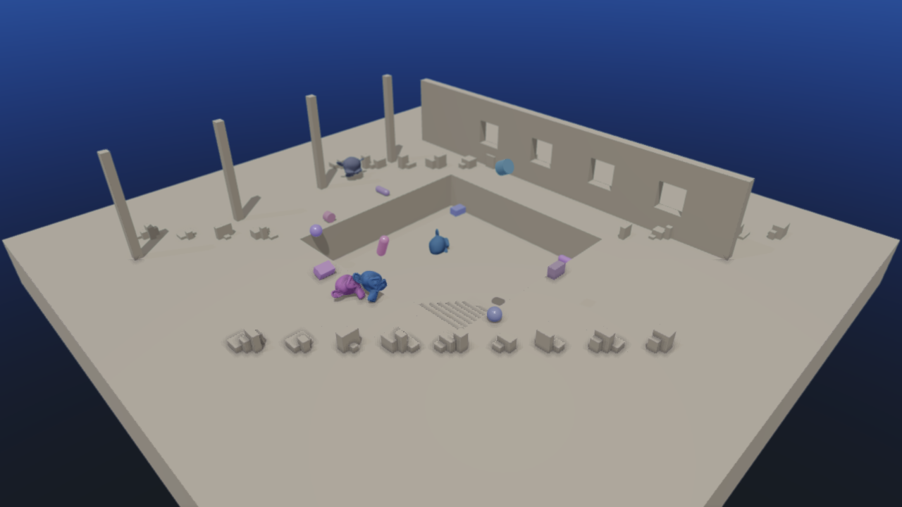

# Voxel Map

A voxel map is a static 3D occupancy map of cubic voxels. Unlike a [height map](./HeightMap.md), it
can hold overhangs, caves, tunnels, rooms and floors above each other, and every voxel can be added
or removed while the simulation runs. Bodies collide with it, and rays, lidars and depth cameras see
it.



```cpp
// a 30 m x 30 m x 8 m domain of 0.1 m voxels, starting at key (-150, -150, -10)
auto* voxels = world.addVoxelMap(0.1, {-150, -150, -10}, {300, 300, 80});
voxels->fillBox({-150, -150, -10}, {149, 149, -1}, true);   // a 1 m thick floor below z = 0
voxels->fillBox({20, -10, 0}, {40, 10, 30}, true);          // a block on it
voxels->fillSphere(raisim::Vec<3>{3.0, 2.0, 0.0}, 1.0, false);  // a crater
```

## Voxels, keys and the map frame

Voxel key $(i, j, k)$ occupies the cube $[i s, (i + 1) s) \times [j s, (j + 1) s) \times [k s, (k + 1) s)$
of the map frame, $s$ being the voxel size (`getVoxelSize()`). Keys can be negative. A map holds
the keys of its domain, `[minKey, minKey + size)` along each axis, chosen when it is created
(`getMinKey()`, `getDomainSize()`); every voxel outside the domain is empty and edits there are
ignored. A domain can span up to $2^{24}$ voxels along an axis, and its keys must lie in
$[-2^{30}, 2^{30})$. Only the occupied regions use
memory: about one bit per voxel inside the occupied 16 x 16 x 16 blocks, and nothing for empty ones.

The map frame is placed by the pose of the object, like every other object: `setPosition()` moves
its origin and `setOrientation()` rotates it about that origin. A new map has the identity pose, so
key $(i, j, k)$ covers the cube above at that place in the world. `getKey()` returns the key of a
point given in the map frame, `getKeyAtWorldPosition()` that of a world point, and
`getVoxelCenter()` the world position of a voxel's center.

## Creating and editing

| Method | Effect |
| --- | --- |
| `setVoxel(x, y, z, occupied)` | Sets or clears one voxel. |
| `setVoxels(keys, occupied)` | Sets or clears a list of voxels. |
| `fillBox(lo, hi, occupied)` | Sets or clears the key box `[lo, hi]`, both corners included. |
| `fillSphere(center, radius, occupied)` | Sets or clears every voxel whose center lies within a sphere given in the map frame. |
| `setOccupancy(occupancy)` | Replaces everything with a dense array over the domain, x fastest. |
| `clear()` | Clears every voxel. |

Each returns how many voxels changed. Edits take effect at once, for contacts and ray tests alike.
Sleeping bodies that reach an edited region wake at the next step, so a box resting on a floor that
is carved away falls, and a body buried by filled voxels is pushed back out. `isOccupied()`,
`getOccupiedCount()` and `getOccupiedKeys()` read the occupancy, and `getRevision()` changes with
every change, to a value no other occupancy has had, also after a checkpoint is restored.

A `VoxelMapResource` (`fromKeys()`, `fromOccupancy()`, or `makeResource()` of an existing map) holds
an occupancy that any number of maps, in one world or many, can share with
`World::addVoxelMap(resource)`. A map that shares a resource copies it only when it is first
edited. World checkpoints (`captureCheckpoint()`, `restoreCheckpoint()`) restore the occupancy along
with the rest of the world state without copying it at capture time.

## Collisions

Bodies collide with the surface of the occupied voxels: the faces, edges and corners that border
empty space. A face that two occupied voxels share is inside the solid and never produces a contact,
so a flat voxel floor is a flat floor: a body slides or rolls across the seams between its voxels
without catching on them, and a body resting on it has exactly the contacts it would have on a
ground plane at the same height. At a step, a body touches the step's edge with a normal that turns
from the top face to the side face as it rounds the edge, and in a corner it touches both walls.

Every collidable shape collides with a voxel map: spheres, boxes, capsules, cylinders, convex
meshes, triangle meshes, compounds, the collision bodies of articulated systems, and the particles
of deformable objects. A body that ends up inside the solid, because it was placed there or the
voxels around it were filled, is pushed out toward the nearest free side.

A voxel map is static (or kinematic): `setBodyType(BodyType::DYNAMIC)` is an error, and two voxel
maps do not collide with each other. Granular media, swept continuous collision detection and the
scene collision queries (`World::queryProximity()` and the like) do not see voxel maps yet.

## Ray tests

`World::rayTest()`, `World::rayTestLidar()` and the lidar, depth and segmentation sensors hit a voxel
map at the first face of an occupied voxel along the ray. The reported position lies exactly on that
face and the normal is the face's normal, facing the ray's origin. A ray that runs exactly along an
edge or through a corner between voxels enters only the voxels beyond it, not those beside it. A ray that starts inside the
solid reports where it leaves the solid, as rays starting inside a primitive do.

## Performance

A ray costs in proportion to the occupied voxels it passes close to, not to the size of the map:
it skips empty space in large steps. Spinning-lidar scans of a 48 m x 48 m terrain
of 0.1 m voxels take about 250 ns per ray on an AMD Ryzen 9 3950X, half the time of the same
terrain stored as a [height map](./HeightMap.md).

A body resting on a flat voxel floor costs about four times as much contact detection as one on a
ground plane: about 0.35 µs for a sphere and 0.7 µs for a box on 5 cm voxels. Rough ground costs
more, since every edge and corner a body touches is tested: a box on voxel rubble takes about
2.4 µs, and a detailed convex mesh tens of microseconds. Carving or filling a
sphere of radius 0.3 m out of 5 cm voxels takes about 10 µs.

## Visualization

The [rayrai TCP viewer](./RayraiTcpViewer.md) and rayrai windows that draw a `World` directly show
voxel maps as their surface. The TCP viewer receives the occupancy through the
`PROTOCOL_FEATURE_VOXEL_MAPS` feature (see [RaisimServer](./RaisimServer.md)); the server sends it
again only after the map changes. `setAppearance()` takes a color.

## Python

```python
voxels = world.addVoxelMap(0.1, [-150, -150, -10], [300, 300, 80])
voxels.fillBox([-150, -150, -10], [149, 149, -1], True)
voxels.setVoxels(np.array([[0, 0, 0], [1, 0, 0]]), True)  # any integer dtype
occupied = voxels.getOccupiedKeys()   # (n, 3) int32 array
voxels.setOccupancy(dense)            # array of shape (size_z, size_y, size_x); nonzero is occupied
```

## Examples

- `voxel_map_ray_casting`: a spinning lidar and a probe ray scan a voxel map with hills, a hut, an
  arch and a tunnel.
- `voxel_map_collision`: spheres, boxes, capsules, cylinders, convex meshes and triangle meshes fall
  onto voxel stairs, walls, rubble and a pit, while craters are carved into the floor and refilled.
