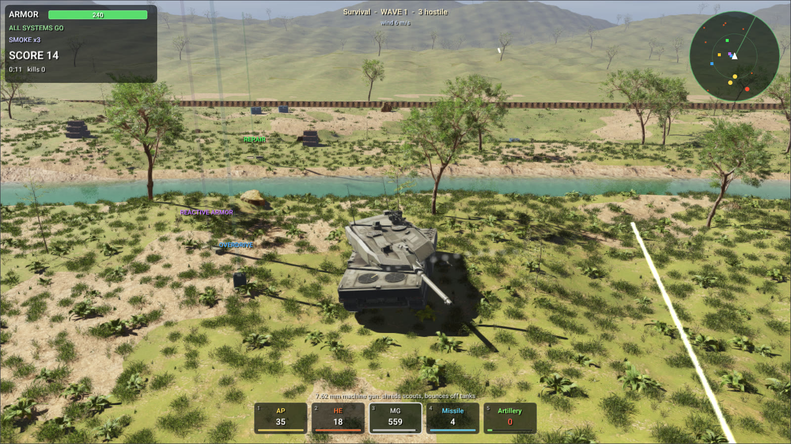

# WebAssembly SDK

The RaiSim WebAssembly SDK lets you build your own browser programs on RaiSim and Rayrai: games,
interactive demos, teaching tools, robot visualizations. You write ordinary C++ and compile it with
[Emscripten](https://emscripten.org). The same source builds for the desktop against the native packages.



The SDK holds RaiSim and Rayrai as prebuilt WebAssembly objects, with:

- their public headers;
- the CMake packages `raisim` and `rayrai`;
- a small page runtime that runs your program on a canvas.

Its libraries are compiled WebAssembly objects: the SDK excludes private C++ implementation files, built-in shader implementation headers, LLVM bitcode and debug information. Required public API headers, inline functions and templates remain available. The page
runtime and the CMake files are the interface code, and you are free to read them.

## Requirements

- Emscripten **4.0.0**, the version the SDK was built with. Other versions are refused at configure time:
  the C++ library and the exception-handling and threading ABIs must match.
- CMake 3.20 or newer.
- A browser with WebGPU, WebAssembly JavaScript Promise Integration, exception handling and shared memory:
  current Chrome or Edge.
- An HTTP server that sends the cross-origin isolation headers. `serve.py` in the SDK sends them.

## Quick start

Starting with v2.14.0, the full `webassembly-<version>.zip` release includes this SDK in `sdk/`. Use that folder directly, or download the smaller `webassembly-sdk-<version>.zip`. Both contain `libraisim.a`, `librayrai.a`, public headers, CMake packages and the runtime. Only the public `rayrai/shaders/Shader.hpp` interface is installed; built-in shader implementations remain in the compiled library.

The example project is [`raisim2Lib/wasm`](https://github.com/raisimTech/raisim2Lib/tree/master/wasm):

| Example | What it shows |
| --- | --- |
| `tank_survival` | The [Tank Survival](examples/rayrai/rayrai_tank_survival.md) game, drawn by Rayrai in six levels (valley, desert, town, snow ridges, fortress and an endless survival), each with its own weather. Six kinds of enemy vehicle arrive in waves around your Leopard 2; you fight them with armor-piercing and high-explosive shells, a machine gun, guided missiles and artillery strikes, and pick up ammunition, repair kits, reactive armor, missiles and radios. Shells are RaiSim projectiles that drift with the wind and slow down in water; hits are resolved against front, side, rear and roof armor with ricochets. Blasts push tanks, wrecks, crates and barrels and dig craters, wrecks burn, and a river crosses the rough, wooded terrain: tanks wade through it and push its water aside. |
| `crate_blast` | RaiSim alone, run with Node.js: a shell blows a crate stack apart. |

```bash
# Emscripten 4.0.0
git clone https://github.com/emscripten-core/emsdk.git
cd emsdk && ./emsdk install 4.0.0 && ./emsdk activate 4.0.0 && source ./emsdk_env.sh

# The SDK from the release, unpacked as raisim2Lib/wasm/sdk
cd raisim2Lib/wasm
unzip webassembly-sdk-<version>.zip && mv webassembly-sdk-<version> sdk

emcmake cmake -S . -B build -DCMAKE_BUILD_TYPE=Release
cmake --build build --parallel
node build/crate_blast.js
python3 sdk/share/rayrai/web/serve.py --directory build
```

Open `http://localhost:8000/tank_survival.html`. Controls:

- W/S drive and A/D turn.
- The mouse aims the turret; click or press Space to fire.
- 1–5 pick a weapon, Q/E cycle through them, and F lays a smoke screen.
- The mouse wheel zooms and dragging with the right button turns the camera.
- P pauses, R restarts and H shows the help.

A program's arguments come from the page's `?arg=` parameters: `tank_survival.html?arg=--autopilot` lets the tank play itself, and `&arg=--level&arg=3` starts the third level.

The game's models and textures (vehicles from Sketchfab under CC BY 4.0, props, plants and textures from
Poly Haven under CC0; see `rsc/tank_survival/ATTRIBUTION.md`) are 273 files, 110 MB, that the page downloads
before the game starts (`ASSETS`). The desktop build also plants broadleaf trees, whose mesh alone would be
a 95 MB download. The game is published on this website: [play Tank Survival](https://raisim.com/games/tank-survival/).

## Your own program

```cmake
cmake_minimum_required(VERSION 3.20)
project(my_game CXX)
find_package(rayrai CONFIG REQUIRED PATHS "${CMAKE_CURRENT_SOURCE_DIR}/sdk" NO_DEFAULT_PATH NO_CMAKE_FIND_ROOT_PATH)

add_executable(my_game main.cpp)
rayrai_add_web_app(my_game TITLE "My game")
target_link_options(my_game PRIVATE "--embed-file=${CMAKE_CURRENT_SOURCE_DIR}/assets@/assets")
```

| CMake | Meaning |
| --- | --- |
| `raisim::raisim` | RaiSim. It adds the compile and link options its library was built with: `-pthread`, `-fwasm-exceptions`, `-msimd128`, WasmFS, and the OpenUSD plugin files under `/usd`. |
| `rayrai::rayrai` | Rayrai, ImGui, glbinding, GLM and stb; it links `raisim::raisim` and SDL2 (Emscripten's port). |
| `rayrai_add_web_app(<target> [TITLE <title>] [DESCRIPTION <text>] [URL <url>] [IMAGE <file>] [ASSETS <path>@<mount> ...] [EXCLUDE <glob> ...] [MAXIMUM_MEMORY <bytes>])` | Builds `<target>.mjs` and `<target>.wasm`, writes `<target>.html`, and copies the page runtime, the license and the third-party notices next to them. `ASSETS` and the link card are described below. |
| `raisim_web_add_license(<target>)` | Copies the license and the third-party notices next to a program that is not a page. |

A Rayrai program opens its window with `ExampleApp` from `rayrai/example_common.hpp`, as on the desktop.
In the browser, `main()` owns the page's main thread: `ExampleApp::endFrame()` presents the frame and
yields to the browser until the next animation frame, so input, timers and network messages keep flowing.
Programs that only simulate link `raisim::raisim` and choose their own Emscripten options, for example
`-sENVIRONMENT=node` for Node.js.

Files reach a program through Emscripten's `--embed-file` (compiled into the `.wasm`), `--preload-file` (a
`.data` file loaded with the page), `ASSETS`, or by writing them into its file system from JavaScript.

### Assets

`ASSETS` takes files and folders as `<path>@<mount>`, as `--preload-file` does. They are copied next to the
page in `<target>-assets/` and listed in `<target>.assets.json`, and the page downloads them into the
program's file system at `<mount>` before `main()` starts. Each file is fetched and cached on its own, so
assets need not fit in one file: GitHub Pages, for one, refuses files over 100 MB. `EXCLUDE` leaves out
files whose names match a glob.

```cmake
rayrai_add_web_app(my_game TITLE "My game"
    ASSETS "${CMAKE_CURRENT_SOURCE_DIR}/models@/assets/models" EXCLUDE "*.blend")
```

### Link cards

When a link to a page is shared on a social network or in a messenger, the site reads the page's
[Open Graph](https://ogp.me) and Twitter Card tags and shows a card with a picture, a title and a short
description; without them it shows the bare address. The sites do not run the page's scripts, so the tags
must be in its HTML, and the picture needs its absolute address. `DESCRIPTION`, `URL` (the address the page
is published at) and `IMAGE` write them:

```cmake
rayrai_add_web_app(my_game TITLE "My game"
    DESCRIPTION "A short line about the game, shown under its title."
    URL "https://example.org/my-game/" IMAGE "${CMAKE_CURRENT_SOURCE_DIR}/card.jpg")
```

The image is copied next to the page. Make it 1200×630 pixels (about 1.9:1) and smaller than 5 MB; JPEG
or PNG. Publish the page at `URL` exactly, and serve the image from the same folder. Sites keep a card for
a while after reading it: Facebook's [Sharing Debugger](https://developers.facebook.com/tools/debug/) and
LinkedIn's [Post Inspector](https://www.linkedin.com/post-inspector/) show the card and read the page again.

## The page runtime

`rayrai_add_web_app()` copies these files next to the program:

| File | Role |
| --- | --- |
| `<target>.html` | Runs the program on a full-window canvas and reports problems on the page. |
| `rayrai-app.mjs` | The loader. `startRayraiPage(moduleUrl)` runs a program on the page's `#canvas`; `runRayraiApp({moduleUrl, canvas, args})` runs it on any canvas of your own page; `ensureCrossOriginIsolation()` and `requireRayraiSupport()` check the browser. |
| `graphics.mjs` | Rayrai's WebGPU backend (compiled). |
| `touch-input.mjs` | Touch gestures reach the program as mouse input; the device pixel ratio is capped at 2. |
| `isolation-worker.js` | A service worker that adds the cross-origin isolation headers for hosts that cannot send them (GitHub Pages). |

The page sets `data-state` on its `<body>`: `loading`, `running`, `closed` when `main()` returns 0, and
`error` otherwise, with the message in `data-error`.

The program's WebAssembly and its assets download together, while the scripts load and the browser starts
its GPU, and the page shows how much has arrived. The asset manifest holds the size of the WebAssembly,
which a host that compresses it (GitHub Pages does) does not state; a page without `ASSETS` asks the server
for it and shows an indeterminate bar when the answer is unknown. Assets that arrive before the program is
instantiated wait in memory; the rest go straight into its file system. The page copies each file into the
program's memory at once and writes it from there with `_rayrai_web_write_file`, which
`rayrai_add_web_app()` exports with `_malloc`, `_free` and `wasmMemory` (a program that sets
`EXPORTED_FUNCTIONS` or `EXPORTED_RUNTIME_METHODS` itself must keep them): Emscripten's `FS.writeFile`
copies byte by byte, which took Tank Survival's 110 MB of assets 1.6 s.

Rayrai's WebGPU backend compiles a shader program the first time a frame draws with it, which makes the
first seconds of a first visit stutter. The loader keeps the compiled programs in the browser's Cache
Storage (`rayrai-programs`), under the hash of the program's WebAssembly, so a returning visitor starts
without compiling them again; a new build of the program starts a new set and removes the old one. Pass
`onProgress(loaded, total, finished)` and `onStart()` to `runRayraiApp()` to show the progress on a page of
your own: `total` is 0 while it is unknown.

## Hosting

- Serve over HTTPS, or from `localhost` while developing.
- Send `Cross-Origin-Opener-Policy: same-origin` and `Cross-Origin-Embedder-Policy: require-corp`, and
  serve `.wasm` as `application/wasm`. Without the headers, the page installs `isolation-worker.js` and
  reloads once.
- Deploy the `.html`, `.mjs`, `.wasm` (and `.data`) files of a build together.

## Size and performance

A program carries the parts of RaiSim and Rayrai it uses: `crate_blast.wasm` is 10 MB (3 MB with gzip) and
`tank_survival.wasm` 26 MB (8 MB with gzip). The libraries are optimized
(`-O3`, WebAssembly SIMD) and the final link optimizes the whole program again with `wasm-opt`. On an
RTX 5070 in Chrome, `tank_survival` draws a 1600×900 frame of a battle with its physics in about 6.4 ms
(127 fps), and RaiSim steps as fast as in RaiSim's own browser examples.

## License

The SDK is part of the WebAssembly edition and is under the
[WebAssembly license](./License.md#webassembly-edition). For programs built with it (clause 4):

- **Who may distribute them:** academic users only (the eligibility requirements of the academic
  license), and only for academic research or teaching. Commercial users may build programs to evaluate
  RaiSim within the evaluation allowance but may not distribute them.
- **What may be distributed:** the program, including the parts of RaiSim and Rayrai compiled into it and
  the runtime files beside it. Never RaiSim or Rayrai themselves: not the SDK, its libraries, headers or
  other files, and not RaiSim or Rayrai extracted from a program.
- **Notice:** every distribution must state clearly that the program is built with RaiSim and Rayrai and
  is subject to the RaiSim WebAssembly license, and must include the license and the third-party notices.
  A program on a web page must show the notice, with a link to the license, on that page.
- **Users** of a distributed program get no rights beyond the license.

`rayrai_add_web_app()` does this for you: it copies `raisim-license.txt` and
`raisim-third-party-notices.txt` next to the program, and the page it writes shows "Built with RaiSim and
Rayrai, subject to the RaiSim WebAssembly license" with links to both. Programs that are not pages call
`raisim_web_add_license(<target>)`. Any other distribution needs a separate license from RaiSim Tech Inc.
(raisim@raionrobotics.com).
