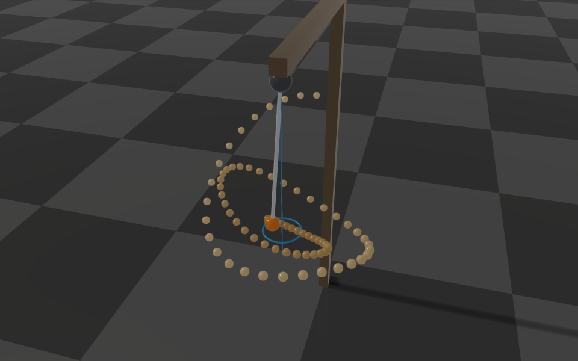

# Joint Damping and Friction

Every revolute, prismatic and spherical joint can have viscous damping and Coulomb friction. They
model bearings, seals, gears and ball-and-socket joints. They are passive: they only
remove energy, they are not part of the generalized force you set, and they act whether or not the
joint is controlled.

Set them with the standard URDF `<dynamics>` attributes. Both default to zero:

```xml
<joint name="knee" type="revolute">
    <parent link="thigh"/>
    <child link="shank"/>
    <axis xyz="0 1 0"/>
    <dynamics damping="0.5" friction="2.0"/>
</joint>
```

| Joint type | `damping` $b$ | `friction` $\tau_c$ |
| --- | --- | --- |
| revolute | $Nm\,s/rad$ | $Nm$ |
| prismatic | $N\,s/m$ | $N$ |
| spherical | $Nm\,s/rad$, on each of the three angular velocity components | $Nm$, the largest magnitude of the friction torque, in any direction (see [Spherical joints](#spherical-joints)) |

The MJCF loader reads the joint `damping` attribute but not `frictionloss`.

Both are measured at the joint, i.e., after any gear. If the joint is driven by an actuator, the
actuator's `output_damping` and `output_friction` add to them (see [Actuators](../Actuators.md)).

## Damping

Damping is the torque $\tau_d = -b\,u$ on the joint velocity $u$ (relative to the
parent body, see [Joints](./StateAndKinematics.md#joints)). RaiSim integrates it implicitly with the
trapezoidal rule, i.e., at the average velocity of the time step $\Delta t$:

$$
\tau_d = -b\,\frac{u_t + u_{t+1}}{2}.
$$

For example, a free joint with inertia $I$ under a constant torque $\tau$ and no gravity
accelerates as

$$
I\,\frac{u_{t+1} - u_t}{\Delta t} = \tau - b\,\frac{u_t + u_{t+1}}{2}
$$

and converges to the velocity $\tau / b$. The implicit integration keeps a joint with a large
damping stable at any time step. The d gain of the PD controller is integrated the same way. The
difference is that damping pulls the velocity to zero, while the d gain pulls it to the velocity
target.

To read the current joint damping, call `getJointDamping()`. It returns a const
`raisim::VecDyn` reference in generalized velocity order, with `getDOF()`
entries. These are the values loaded from the model or last supplied to
`setJointDamping()`; actuator output damping and PD gains are separate.
Copy `getJointDamping().e()` into an `Eigen::VectorXd` to preserve a baseline
before adding temporary damping, such as wheel braking.

To change the damping at runtime, call `setJointDamping()` with one coefficient per degree of
freedom (`getDOF()` entries). The new values act from the next step. Leave the six entries of a
floating base at zero: they are not joints, and their damping would not be integrated implicitly.

The URDF `effort` limit bounds only the commanded torque (PD plus feedforward). The damping torque
is passive and is never clipped. Actuator torques (see [Actuators](../Actuators.md)) are not bounded by the
effort limit either: they are limited by the operating regions of their motors and are added after
the effort clamp.

## Friction

Friction is Coulomb friction with stiction. It opposes the motion with the constant torque
$\tau_c$, and it holds a joint at rest as long as the other torques on it (actuation,
gravity, contacts and the motion of the other bodies) stay below $\tau_c$:

$$
\tau_f = -\tau_c\,\mathrm{sgn}(u_{t+1}) \ \text{if} \ u_{t+1} \neq 0,
\qquad |\tau_f| \le \tau_c \ \text{if} \ u_{t+1} = 0.
$$

Once the other torques exceed $\tau_c$, the joint accelerates with their sum minus
$\tau_c$. For the free joint above, that is
$I\,(u_{t+1} - u_t)/\Delta t = \tau - \tau_c\,\mathrm{sgn}(u_{t+1})$.

RaiSim solves friction as a joint impulse bounded by $\tau_c\,\Delta t$ in the contact
solver, together with the contacts and the joint limits. A joint therefore stops exactly instead
of chattering around zero velocity, and the friction torque is consistent with the contact forces
on the robot. A robot with friction adds one row to the contact
solver; robots without friction do not pay for it.

### Spherical joints

A spherical joint takes the same `<dynamics>` attributes:

```xml
<joint name="shoulder" type="spherical">
    <parent link="torso"/>
    <child link="upper_arm"/>
    <dynamics damping="0.2" friction="1.5"/>
</joint>
```

The friction of a spherical joint (a ball-and-socket joint) acts on its three entries of the
generalized velocity, $\boldsymbol{u}_j \in \mathbb{R}^3$: the angular velocity of the child body
relative to the parent body (see [Joints](./StateAndKinematics.md#joints)). Its friction torque
$\boldsymbol{\tau}_f \in \mathbb{R}^3$ is bounded in magnitude by the same $\tau_c$ in every
direction. It holds the joint at rest while the other torques on it stay below $\tau_c$, and
otherwise opposes the relative rotation with the full $\tau_c$:

$$
\boldsymbol{\tau}_f = -\tau_c\,\frac{\boldsymbol{u}_{j,t+1}}{\|\boldsymbol{u}_{j,t+1}\|} \ \text{if} \ \boldsymbol{u}_{j,t+1} \neq \boldsymbol{0},
\qquad \|\boldsymbol{\tau}_f\| \le \tau_c \ \text{if} \ \boldsymbol{u}_{j,t+1} = \boldsymbol{0}.
$$

The friction torque is opposite to the joint's angular velocity at the end of the step, whatever the
inertia of the bodies, so it removes as much energy as the bound allows. Some consequences:

- **It is isotropic.** A torque of $0.98\,\tau_c$ is held in every direction, and a torque of
  $1.05\,\tau_c$ turns the joint in every direction. The friction does not depend on the joint
  frame. Three revolute joints in a row (a gimbal), each with friction $\tau_c$, behave
  differently. They hold up to $\sqrt{3}\,\tau_c$ about a diagonal, and their
  components stop at different times, which turns the axis of a rotation as it slows down.
- **A spin slows down about a fixed axis.** A body with isotropic inertia $I$ spinning about any axis
  slows down along that axis at the constant rate $\tau_c / I$ and stops.
- **A swing stops off the vertical.** A pendulum of mass $m$ whose center of mass is a distance $d$
  from the joint comes to rest wherever gravity's torque, $m g d \sin\theta$ at the tilt $\theta$, is
  at most $\tau_c$. The resting points form a cone around the vertical, as the figure shows. With only
  viscous damping, it would keep creeping toward the bottom.
- **A planar swing stays planar.** A pendulum on a spherical joint whose mass is symmetric about its
  plane of swing, under loads in that plane, moves exactly like a revolute joint with the same
  friction about the plane's normal. (Without that symmetry, the body's own dynamics can turn it out
  of the plane, which a revolute joint would prevent.)



*A spherical pendulum ($m = 1\,kg$, $d = 0.5\,m$, $\tau_c = 0.6\,Nm$) released at a tilt of
$1.1\,rad$ on a conical swing. The bob's positions (light to dark) spiral down as friction removes
energy, and the bob comes to rest $5.5°$ off the vertical, inside the ring where gravity's torque
equals $\tau_c$ (a tilt of $7.0°$).* The [Spherical Joint Friction](../examples/rayrai/rayrai_spherical_joint_friction.md)
example shows three such pendulums, with no, a little and a lot of friction.

Like the friction of a revolute or prismatic joint, it is solved together with the contacts, the joint
limits and the other joints' friction. A contact pushing a link therefore cannot slip a joint unless
the total torque on the joint exceeds $\tau_c$. In a [closed loop](./ClosedLoopSystems.md), the friction
acts only in the directions the loop lets the joint turn. In the other directions the loop's forces
alone carry the load, and they are reported in full. For example, if the link's tip is pinned, only
twisting the link about its own axis meets the friction.

### Accuracy

The friction of each joint is exact for the motion of the other joints and the contacts. When several
joints with friction are strongly coupled, e.g., a long chain of spherical joints that mostly stick,
the joints settle together over the contact solver's iterations. With the default solver settings the
friction torque never exceeds $\tau_c$, but a joint that should stick can keep creeping slowly, and a
sliding joint can be braked by less than $\tau_c$. With more solver iterations and a smaller tolerance
(`World::setContactSolverParam()`), the friction converges to that tolerance.

### Setting the friction

The joint's own friction is set in the model file; there is no C++ setter for it. The
`output_friction` of an actuator can be changed at runtime by editing the definitions from
`getActuators()` and passing them to `setActuators()`.
