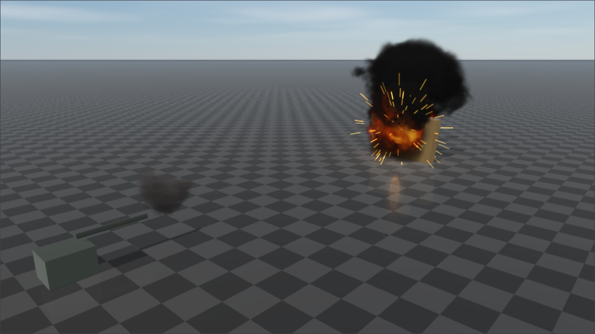

# Rayrai Example: Explosion and Projectile



## Overview

The smallest use of RaiSim's [explosions and projectiles](../../Explosions.md). A gun fires at a wall
of crates, and every two seconds the wall is built again and the next of three events goes off:

1. A solid 10 kg round at 300 m/s. It has no charge, so it stops where it hits and hands the crate
   its momentum.
2. A 12 kg shell at 250 m/s carrying 1.5 kg of TNT. It explodes where it hits, and the blast wave
   throws the crates.
3. 3 kg of TNT on the ground beside the wall (`World::addExplosion()`).

Each hit is printed with the name of what it struck. rayrai draws the muzzle flashes, tracers,
fireballs, sparks and smoke from the physics snapshot without any code of its own
([Explosion effects](../../rayrai/Explosions.md)); the smoke drifts with the wind.

## Run

```bash
./build-examples/examples/rayrai_explosion_projectile
```

CMake target: `rayrai_explosion_projectile`. Source: `examples/src/rayrai/dynamics/rayrai_explosion_projectile.cpp`.
On Windows, run `rayrai_explosion_projectile.exe` instead.

## API pattern

```cpp
// Air for the projectiles' drag; its velocity is the wind.
auto air = raisim::FluidMedium::air();
air.velocity = {2.0, 1.0, 0.0};
world->setAmbientFluid(air);

// A solid round: no charge.
raisim::ProjectileProperties solid;
solid.mass = 10.0;
solid.radius = 0.05;
world->addProjectile(muzzle, {300.0, 0.0, 9.0}, solid);

// An explosive shell, which detonates where it hits.
raisim::ProjectileProperties shell;
shell.mass = 12.0;
shell.radius = 0.06;
shell.explosion.chargeMass = 1.5;
world->addProjectile(muzzle, {250.0, 2.0, 12.0}, shell);

// A charge on the ground.
raisim::ExplosionProperties charge;
charge.chargeMass = 3.0;
charge.surfaceBurst = true;
world->addExplosion({19.5, -1.8, 0.1}, charge);

// What the projectiles hit, oldest first, with increasing identifiers.
for (const auto& hit : world->getProjectileHits())
  if (hit.id >= nextHit) { nextHit = hit.id + 1; /* hit.objectIndex, hit.position, hit.velocity */ }
```

The rendering window gets the explosions, projectiles and hits with the rest of the world in each
`raisin::PhysicsSnapshot`, and draws them by the snapshot's world time. For a game with a tank,
craters, wind and barrels that set each other off, see [Tank Battle](rayrai_tank_battle.md).
