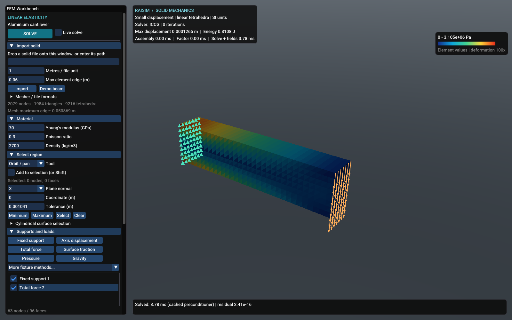

# Rayrai Example: FEM Workbench



Open a B-rep CAD solid, click its faces to apply supports and loads, and inspect
displacement, stress, and strain. The example uses RaiSim's single-threaded linear static FEM solver and
renders its results with Rayrai. It opens with a solved aluminium cantilever.

Use this page's **Run on web** button to run the same C++ workbench in the browser.
The site uses its existing `web-examples/example.html?example=rayrai_fem_workbench`
launcher. Uploaded models and calculations remain on the visitor's computer.

## Workflow

The **Edit** and **Result view** buttons at the top of the panel switch modes.
Edit shows the undeformed solid with its supports and loads; its controls are
grouped in tabs, one per task:

| Tab | Contents |
| --- | --- |
| Model | open, add or drop CAD files, units, element size, refinement and mesher settings |
| Parts | the parts, their visibility, materials, removal |
| Loads | face selection, supports and loads |
| Connect | glue, bolts and joints between parts |
| File | save and load projects |

The panel switches to the Parts or Loads tab after a file opens. Result view
shows the deformed, colored solid and the display, summary and export controls.

1. Drop a STEP, IGES or BREP file on the window, or choose **Open CAD** in the
   **Model** tab. A dropped file joins a CAD model that is already open (see
   [Assemblies](#assemblies-parts-and-materials)); **Open CAD** replaces it. Only
   B-rep solids open; mesh files are rejected. Set **Metres per BREP unit** before
   opening a BREP (use `0.001` for millimetres); STEP and IGES carry their units.
   The CAD opens as its tessellated B-rep faces, without tetrahedra, and the
   camera orbits its bounds center.
2. Dark lines mark the boundaries between CAD faces. Click a face in the 3D view.
   The whole CAD face is selected and turns amber;
   hovering shows which face is under the pointer. Ctrl+click or Shift+click adds
   or removes faces, and clicking empty space clears the selection. See
   [Navigating the view](#navigating-the-view) for rotating and zooming. Faces keep their CAD identity after meshing, so the same
   faces stay selectable on the volume mesh. **Select by coordinates** selects nodes on
   a coordinate plane, on a cylinder, or inside a dragged box.
3. In the **Loads** tab, the buttons apply to the selected faces:
   **Fixed support**, **Normal roller**, **Axis displacement** and **More
   supports**; **Total force**, **Pressure**, **Surface traction** and
   **Gravity**. Gravity acts on the whole body and needs no selection; the other
   buttons stay disabled until something is selected. Supports appear as green
   cones and loads as magenta arrows in the 3D view, hidden by the solid where it
   is in front of them, and their faces are tinted. Choose a condition in the list
   to edit its values, select its region
   again, or delete it. Conditions can also be disabled. A **Total force** on
   faces acts normal to them by default: its magnitude is spread over the faces
   as a uniform pressure and a positive value pushes into them. Its **Direction**
   can instead be X/Y/Z components, or **Normal to a reference face**: choose
   **Pick reference face** and click the face whose normal sets the direction
   (shown in cyan). **Reverse** flips the sign. Conditions on whole CAD faces
   remember those faces, so they follow the CAD through every remesh.
4. Choose **Set material** to pick one of 170 engineering materials, or enter
   Young's modulus, Poisson's ratio, and density. The initial values are
   representative aluminium properties.
5. Set **Max element edge (m)**, then choose **Solve**. The workbench switches to
   Result view, generates a
   volume mesh from the original geometry using the current settings, transfers
   supports and loads, and solves. Every tetrahedron edge is bounded by the requested
   maximum; small features and geometric accuracy can require smaller elements.
   Change the size and solve again to regenerate a finer or coarser mesh. **Live
   solve** recalculates edits when the current mesh is valid. Changing only loads
   and prescribed values reuses the stiffness factorization or iterative preconditioner.
   A progress bar in the panel shows the meshing stage and the solver stage with
   elapsed time; **Cancel** stops either. Errors appear in red at the top of the
   panel until dismissed. The solver runs in the background, so the view can still be rotated;
   editing pauses until it finishes. The same geometry and settings always produce
   the same mesh. With **Refine stress concentrations** on (the default), Solve
   then refines the mesh where the stress error is largest and solves again; see
   [Adaptive refinement](#adaptive-refinement).
6. In Result view, the gauge (**Von Mises stress**) and curve
   (**Displacement magnitude**) icon buttons at the bottom centre of the 3D view
   switch between the two most used fields; hovering over a button names it.
   They stay half transparent until the pointer is over them. The field list in the panel
   also offers stress and strain components and principal stresses. Values are
   shown from blue (low) to red (high); hovering over the solid shows the value of
   the element under the pointer. See [Result view](#result-view) for labels,
   probes, deformation, contours and the factor of safety. **Mesh edges** draws
   every surface edge of the mesh, so refined regions are visible.
7. In the **File** tab, save a `.rfem` project, including its original
   geometry, CAD faces, meshing settings, material, conditions and generated mesh.
   Result view exports VTK displacement/reaction point fields and stress/strain
   element fields. Saved projects open with **Load project** or by dropping them
   on the viewport.
   Browser exports download files; desktop exports use the entered paths.

## Assemblies, parts and materials

Every solid of a CAD file is a part. Dropping a STEP, IGES or BREP file on the
window, or **Add CAD**, adds it to the open model as more parts, in the
coordinates stored in the file; supports and loads already applied stay on their
faces. **Open CAD** replaces the model. On the desktop the command line takes
several files: `rayrai_fem_workbench frame.step bracket.step` opens the first and
adds the rest.

The **Parts** tab lists the parts as expandable rows. Each row has a stripe in
the part's colour in the 3D view, its name and material, an eye button that shows
or hides it and a remove button:

- Expand a part to rename it, choose its material and set its position.
  Clicking one of its faces in the 3D view selects the part and expands its row.
  In Edit mode the selected part is lighter.
- **Model material** (the default) uses the material at the top of the tab;
  **Own material** gives the part its own. **Set material** opens the material
  library: choose a family on the left (carbon and alloy steels, stainless
  steels, cast irons, aluminium, titanium, copper, nickel and magnesium alloys,
  other metals, plastics, reinforced plastics and composites, elastomers, wood,
  ceramics and glass, concrete and stone), then a grade on the right, or search
  all of them by name. Each grade fills in Young's modulus, Poisson's ratio,
  density and strength, which remain editable. The values are typical
  room-temperature handbook data; a supplier's data sheet takes precedence. The
  strength is the yield strength, or for brittle materials (grey cast iron,
  ceramics, glass, concrete, wood) the lower of the tensile and compressive
  strengths, as noted for each family.
- Hidden parts cannot be clicked, which lets you reach faces covered by another
  part, such as contact faces. The quickest way is to right-click the part in the
  view: it stays hidden until you pick a face, then comes back. While any part is
  hidden, **Show all parts** at the right edge of the view brings them all back.
  **Isolate** hides every other part, **Show all** brings them back and **Focus**
  frames the camera on the part. Hovering over a face names its part.
- The remove button deletes the part together with the supports, loads and
  connections on it; after meshing, the other parts keep their mesh. **Clear
  all** empties the model.

## Result view

- **Labels**: **Label max stress and displacement** (on by default) pins the
  peak von Mises stress and the peak displacement in the view with leader lines,
  and the lowest factor of safety where it is elsewhere. **Label min and max of
  the shown field** does the same for the selected field. Drag a label to move
  it out of the way (its leader line follows); double-click it to put it back.
- **Probe values**: click points on the solid to pin numbered probes; their
  values follow the selected field and are listed in the panel.
- **Deformation**: Automatic scales the largest displacement to 5% of the model
  size, True scale shows it unmagnified, Custom takes a factor. **Animate** cycles
  the deformation.
- **Contours**: **Smooth** averages element values at the nodes (displacement is
  exact at the nodes); turn it off to see the constant value of each element.
  **Color bands** quantizes the scale into discrete bands, and **Grey below**
  greys out the lower part of the range to show where a value is high.
- **Factor of safety**: yield strength divided by von Mises stress, red where it
  is lowest. Library materials include strengths; enter your own under the
  part's material (zero leaves it unknown and the part grey).
- **Summary**: peak stress and displacement, strain energy, minimum factor of
  safety, the reaction force of every support, what every connection carries
  (below), element count and estimated error.
- **Connections**: the force and moment each glue, bolt and joint transmits, and
  its stresses. For glue: the average peel (positive pulls the faces apart) and
  shear, the peak peel, compression and shear, and the equivalent shear
  sqrt(shear^2 + peel^2 / 3). The peaks spread the force and moment the glue
  carries over the bond, as the elastic method for bonded joints does, so peel
  from bending and shear from twisting are included and the values do not
  depend on the mesh. The stresses at single nodes are listed too: at the edges
  of a bond they grow without bound as the mesh is refined, so they are not used
  for the factor of safety. For a bolt: the axial and shear stress of the shank
  and its von Mises stress, axial plus bending stress at the surface with shear.
  For joints: the average contact stress and the moment. Set **Adhesive
  strength** (lap shear strength, with typical values for epoxies,
  methacrylates, cyanoacrylates, polyurethanes and silicones) or **Bolt yield
  strength** (property classes 4.6-12.9, A2-70, A4-80) in the connection's
  settings for its factor of safety, red below 1. **Label glue and bolt
  stresses** pins the equivalent stress and safety factor where it peaks.
- The box at the top left shows the solver, the last message and, while solving,
  the progress and **Cancel**.

## Navigating the view

| Action | Mouse |
| --- | --- |
| Zoom about the point under the cursor | scroll wheel |
| Rotate | drag empty space with the left button, or drag with the middle button |
| Pan | drag with the right button, or Ctrl and the middle button |
| Move a part (Edit mode, several parts) | drag the part with the left button |
| Hide a part until you pick a face | right-click the part |

Zooming keeps the point under the cursor in place, as in SolidWorks, so you can
move in on any part and rotate around it. The view no longer recentres when parts
are added, removed or remeshed. The icon buttons at the bottom centre of the
view bring it back: **Center** (crosshair) looks at the geometric centre of all parts
at the current zoom, and **Fit all** (corners) also zooms so that every part is
visible.

Dragging a part moves it parallel to the screen. **Move parts** (the arrows
button at the bottom centre) locks the parts so that dragging rotates the view
instead. For exact positions, expand the part in the **Parts** tab and enter its
**Offset X/Y/Z** in metres or **Rotation X/Y/Z** in degrees (press Enter), or
move it by a step with **Move by** (metres) and **Rotate by** (degrees), like
Move Component and Rotate Component of SolidWorks. Rotations are about the fixed
X, Y and Z axes, in that order, and turn the part about its centre. **Reset**
puts the part back where its CAD file places it. A
moved part keeps its supports, loads, connections and mesh, so no remeshing is
needed; the centres and axes of the supports and loads on it move with it.
Remeshing from the CAD files applies the position again. A part that shares
nodes with another part cannot be moved on its own.

## Positioning parts with mates

Parts open where their CAD files put them. Mates place them against each
other, as in a SolidWorks assembly. The first part of a model is **Fixed**:
mates move the other part, and dragging a fixed part turns the view. Uncheck
**Fixed** in the **Parts** tab to move it, or fix another part there.

**Quick mates.** Select a face on each part (plain clicks in the **Connect**
tab, Ctrl/Shift+click elsewhere). The toolbar beside the pointer offers the
mates that fit those faces, most likely first, under **Place** followed by the
part that moves (the part clicked first, unless it is fixed; the arrows button
places the other part instead). Hovering over a mate shows where the part would
go; clicking adds it. The toolbar then offers **Flip**, **Edit** and **Undo**
for that mate, and the connections that now fit, so placing two faces on each
other and gluing them are two clicks. Distance, Angle and Width open the panel
to set their value.

**The mate editor.** **Add mate** in the **Connect** tab opens the editor, like
the Mate PropertyManager of SolidWorks. Its two boxes hold the faces of the part
that moves and the faces it is placed on: click a box, then click faces in the
view to add or remove them (the moving faces are yellow, the other cyan). Pick
a mate type; types that do not fit the faces are greyed. The view previews the
result while you change the options, and the editor says how many motions the
part keeps. **OK** adds the mate, **Cancel** leaves everything as it was.

| Mate | Faces | The moving part turns and moves until |
| --- | --- | --- |
| Coincident | two planes | its face lies on the other face |
| Parallel | planes, axes, or a plane and an axis | they are parallel |
| Perpendicular | planes, axes, or a plane and an axis | they are perpendicular |
| Tangent | a plane, cylinder or sphere with a cylinder or sphere | the faces touch |
| Concentric | two cylinders, two spheres, or a sphere and a cylinder | the axes line up, or the centre lies on the axis |
| Distance | planes, axes or centres | they are the given distance apart |
| Angle | two planes or two axes | they make the given angle |
| Lock | any faces | it keeps its place on the other part |
| Profile center | two planes | its face lies on the other face, centre on centre |
| Width | two planes of a tab, two planes of a slot | the tab is centred in the slot |

- **Anti-aligned** turns the faces or axes against each other, **Aligned** makes
  them point the same way. Coincident, Profile center and Distance between
  planes start anti-aligned, so the parts touch instead of overlapping; the
  others start with the nearer alignment.
- Distance and Angle start at the current distance or angle, so the part does
  not move until you change the value. **Other side** puts the moving face on
  the other side of a plane, or inside instead of outside for Tangent.
- The part moves as little as possible: Coincident keeps the face's position in
  the plane, Concentric its position along the axis and turn about it.

**Mates stay with the parts.** They are listed under **Mates** in the
**Connect** tab, named as in SolidWorks (Coincident1, Distance2): the buttons
flip, edit or remove a mate, and removing one leaves the parts where they are.

- A part keeps all of its mates, so a second mate on a side face fixes how it
  turns on the first. A mate that contradicts the others is refused and nothing
  moves. The **Parts** tab shows how many motions each part keeps (6 when free,
  0 when fully positioned) and which mates it has.
- Dragging a part shows it moving within the motions its mates leave free: a
  part on a Coincident face slides along the face. Shift+drag turns a part about
  its centre. Parts positioned on a moved part follow it.
- If the other part is already positioned on the part you chose to move, that
  other part moves instead.
- Projects save positions, fixed parts and mates.

## Quick supports and loads

Clicking a face of one part opens a small toolbar beside the pointer with the
supports and loads that fit it: **Fixed** and **Roller** for a plane, **Fixed**,
**Bearing** and **Bolt hole** for a cylinder (their axis and centre are fitted
to the faces), **Fixed** and **Ball** for a sphere, and **Force** and
**Pressure**. A button applies the condition to the selected faces and opens it
in the **Loads** tab to set its values; **...** opens the tab with every support
and load, and the cross closes the toolbar. Ctrl/Shift+click adds faces first.
Selecting faces on two parts shows the connection toolbar instead.

## Connecting parts

Parts are separate bodies until they are connected. Selecting faces on two parts
offers the connections that fit in the **Connect** row of the quick toolbar,
best first (highlighted). Hovering over one shows its animation, **...** adds
the others and the cross closes the toolbar. The faces of the part clicked
first are the first faces in the table below.

| Selected faces | Suggestions |
| --- | --- |
| concentric cylinders (shaft and hole) | pin, slider, glue if they touch, rigid link |
| concentric spheres (ball and socket) | ball joint, glue if they touch, rigid link |
| coincident planes facing each other | glue, rigid link |
| parallel planes facing away from each other, in line (bolt head and nut seats) | bolt, rigid link |
| anything else | glue if they touch, rigid link |

Alternatively, choose a connection under **Connections** in the **Connect**
tab. The editor shows its two boxes at once: click faces for the first box, and
the second box takes the faces of the other part; click a box to change its
faces, then press **OK**. **Glue touching faces** glues every pair of faces where
two parts touch within the surface accuracy, like the bonded contact sets that
SolidWorks finds automatically, and skips pairs that are already glued. Hide a
part to reach faces it covers. Connections are listed under **Connections**,
where they can be edited, disabled or deleted.

| Connection | First faces | Second faces | Transfers |
| --- | --- | --- | --- |
| Glue | faces to bond | the faces they touch | everything, node by node (bonded surface tie) |
| Bolt | head seat around a hole | nut seat on the other part | through an elastic bolt beam, with optional preload |
| Pin | pin or shaft surface | hole surface | all motion except rotation about the axis; optionally sliding along it too |
| Ball joint | ball surface | socket surface | translation; the parts turn freely |
| Slider | sliding faces | guide faces | all motion except sliding along the direction |
| Rigid link | faces of one part | faces of the other | all motion, rigidly between the two face sets |

Bearing and slider axes are fitted to the selected faces when they share one
(cylinders and extrusions); otherwise enter the axis. Joints move the two face
patches by their average translation and rotation, so the faces are not made
rigid. Support the assembly so that every part is held directly or through its
connections; a joint that leaves a part free to turn or slide needs a support
that holds that motion, or Solve reports which part is free. Glue needs touching
faces; its projection tolerance follows the surface accuracy.

Solve meshes all files, several at once on up to half of the CPU cores, and
solves the parts together.

Hovering over a support or load button, or an entry of **More supports**, shows
a short animation of what it does.

## Adaptive refinement

After each solve, the workbench estimates the discretization error of every
element: it averages the element stresses at each vertex into a continuous
stress field and integrates the energy of the difference to each element's
constant stress (a Zienkiewicz-Zhu estimate). Elements holding half of the
estimated error are bisected across their longest edges, which keeps the mesh
conforming and the element shapes bounded, and the model is solved again. The
loop stops when the estimated energy error is below **Target error (%)**, after
**Refinement steps** refinements of the generated mesh, or when another step would
exceed **Element limit**. **Minimum edge** optionally keeps elements from shrinking
below a length. Each step at most halves an element, so refinement follows the
stress gradient gradually: fillets, holes, load patches and support edges become
finer, while uniformly stressed regions keep the original mesh.

Refined faces stay on their CAD faces and inside the original mesh faces, so
supports, loads and the selection follow them exactly. Solving again after
changing loads refines further only until the step limit is reached; changing
**Max element edge** or the surface error generates a new mesh. Turning the option
off solves on the generated mesh alone and still reports the estimated error.

The estimate measures the error of the energy, not of the peak stress. The exact
stress at a sharp re-entrant corner or along a fully clamped edge is infinite, so
refinement keeps concentrating there and the peak stress keeps rising; read
stresses a little away from such singular points, or round the corner in CAD.

On a 52,000-tetrahedron STEP part, three steps refined the mesh to 398,000
tetrahedra and reduced the estimated error from 47% to 31% in 16 s of solving
(Intel Core Ultra 7 265K, one core). Large models use multigrid-preconditioned
conjugate gradients, which keeps those solves to a few seconds each.

In the **Model** tab, under **Mesher**, **Surface error, 0=auto (m)** controls geometric
approximation separately from element size. Automatic accuracy is the smaller of
1% of the requested edge and 0.1% of the original geometry's bounding diagonal.
CAD is tessellated again at that accuracy on Solve. A tighter error can increase
meshing time even with a coarse element size.

CAD imports can be regenerated at either finer or coarser sizes.

Surface conditions retain their original geometric regions and capture accuracy
across remeshing and project reload. Transfers check coverage in both directions
so a load or fixture cannot silently lose an unresolved part of its region.
A partial patch boundary must conform to the generated mesh: select a complete
surface, split the CAD face, or supply a conforming volume mesh if the workbench
cannot transfer it exactly. Node-only selections represent discrete locations;
use a surface selection for continuous support. Failed transfers leave the
previous model intact.

## Files

The workbench opens B-rep CAD solids only: STEP (`.step`, `.stp`), IGES (`.iges`,
`.igs`) and BREP (`.brep`), plus its own `.rfem` projects. Volume meshes and
triangle surface meshes (STL, OBJ, PLY, glTF and similar) are rejected; export a
STEP solid from the CAD program instead. Each B-rep face of the CAD file is one
selectable face in the workbench.

The browser translates CAD with the separately loaded occt-import-js/Open CASCADE
WebAssembly library and meshes it with RaiSim's Delaunay mesher compiled to
WebAssembly. Desktop uses the same mesher in the bundled native helper with shared
Open CASCADE libraries; no external mesher or Python is needed. Each CAD solid is
meshed separately and retained as a distinct region, including touching assembly
parts. The boundaries of CAD faces are kept exactly in the mesh, so supports and
loads on whole CAD faces transfer to it. STEP and IGES units are read from the CAD
file and converted to metres. BREP has no unit metadata; set metres per BREP unit
before opening it.

For a custom native helper location, set `RAISIM_FEM_MESHER`. Import errors
distinguish a missing executable or script interpreter from a geometry failure and
retain the mesher log.

Native SolidWorks `.sldprt` and `.sldasm` files require a
separate proprietary-format translator; export STEP from SolidWorks.

## Run on desktop

Build the RaiSim SDK with `RAISIM_BUILD_FEM_MESHER=ON` (the default for native
builds with CMake 3.20 or newer). This builds the pinned meshing dependencies from
source and installs `bin/raisim_fem_mesher`, its shared CAD libraries and
notices. Linux builds use Clang 20. The workbench finds the SDK helper
automatically; a sibling RaiSim source checkout also supports building it locally.
`RAISIM_FEM_MESHER_EXECUTABLE` selects an existing helper at example configuration.

From the `raisim2Lib` directory on Linux:

```bash
cmake -S examples -B build-examples -DCMAKE_PREFIX_PATH=/path/to/raisim-sdk \
  -DCMAKE_C_COMPILER=clang-20 -DCMAKE_CXX_COMPILER=clang++-20 \
  -DCMAKE_BUILD_TYPE=Release
cmake --build build-examples --target rayrai_fem_workbench -j12
./build-examples/rayrai_fem_workbench
./build-examples/rayrai_fem_workbench part.step
```

On Windows the executable is `build-examples/bin/rayrai_fem_workbench.exe`.
`--self-test` checks the workbench model, face picking, load edits, factor reuse,
project round-trip, VTK export, and translated/tiny/large mesh camera framing
without a window. `--frames N --capture image.png`
captures the desktop app for a fixed run. `--test-drop file` exercises its SDL
file-drop path.

The native integration suite checks surface validity, positive tetrahedral volumes,
CAD units, B-rep face ids, independent assembly regions, and failure cleanup. Run these from the
RaiSim source checkout:

```bash
python3 test/fem/test_native_mesher.py --mesher /path/to/raisim_fem_mesher -v
python3 benchmark/fem_mesher_benchmark.py --mesher /path/to/raisim_fem_mesher
```

`--geometry all` adds a hollow cylinder, sphere and supplied volume refinement to
the STEP assembly. `--preview` also measures surface-only CAD preparation with zero
tetrahedra. `--reference-mesher` requires byte-identical meshes from a previous
helper build, and `--compare-mesher` times any other helper. Results include time,
volume error, minimum, 1st-percentile and average tetrahedron mean ratio, and
actual maximum edge. Timed-out benchmark cases and accuracy-target misses are
reported explicitly. See the [native meshing measurements](../../LinearElasticityBenchmarks.md#native-meshing)
for timings and geometric errors.

CMake target: `rayrai_fem_workbench`. Source:
`examples/src/rayrai/fem/rayrai_fem_workbench.cpp`.

## Model limits

This is small-displacement, small-strain isotropic linear elasticity, with
four-node tetrahedra. It does not model plasticity, fracture, large rotations,
or contact between separate components. The supports and connections must eliminate all unrestrained rigid modes
of the complete assembly. Zero-stiffness mechanisms and invalid meshes
produce errors. Linear tetrahedra require mesh refinement for bending and can
lock for nearly incompressible materials. The material editor warns above
Poisson ratio 0.45. See the [bending convergence measurements](../../LinearElasticityBenchmarks.md#bending-convergence)
before choosing a mesh. Local stress peaks at sharp corners,
point loads, and ideal supports require convergence checks.

See [Linear elasticity](../../LinearElasticity.md) for the C++ API and validation.

## Fixture methods

Use **More supports** after selecting a region. Selection can use clicked CAD
faces, a box, a coordinate slab, or a cylindrical surface defined by its axis,
center, radius, length and tolerance.

| Method | Behavior |
| --- | --- |
| Fixed / axis displacement | Restrain chosen global axes, with optional nonzero motion. |
| Directional / symmetry | Prescribe displacement along an arbitrary direction. |
| Normal roller | Restrain selected-surface normal motion; sharp edges get separate normal constraints for each face group. Use a cylindrical bearing when roll must be free. |
| Slider / guide | Restrain two directions perpendicular to the guide axis. |
| Cylindrical bearing | Restrain radial motion and optionally the average axial center; roll is free by default. Other supports must remove any remaining global rigid rotation for a unique static solution. |
| Grounded bolt hole | Restrain shaft radial/tangential motion and a separately captured axial seat region. |
| Bolt connector | Connect two captured head/nut surface patches with diameter, material, grip length and reference preload. Reports force and end moments. |
| Remote displacement | Impose translation and small rotation around an entered center. |
| Ball / spherical support | Restrain patch-average translation while permitting rotation and local deformation. |
| Elastic foundation | Distribute a specified total directional stiffness over a surface. |
| Bonded surface tie | Project slave nodes onto a captured master triangle surface within tolerance and couple their displacements. |

For a bolt connector, capture the first patch when adding the condition, select
the second region, then use **Capture second region** in the condition editor.
Grounded bolt holes use the second region for the axial seat. Bonded ties use it
as the master surface. Save all fixture definitions in the RFEM project. Version 5
projects retain original geometry, CAD faces, settings and geometric selection
references for remeshing; versions 1–4 remain readable, and their faces are
grouped into smooth patches (edges sharper than 35 degrees separate them).
Projects from versions 1–3 keep their existing mesh resolution. Version 5 also
stores force directions and the CAD faces of each condition. Tie projections are cached across load edits.

Bolt preload means tension at zero relative head motion; the resulting tension
also depends on the compliance of the connected parts. These are linear beam
connectors, without thread contact, friction or joint separation. Bonded ties
use node-to-surface interpolation and can have interpolation error for unrelated
triangulations; refine the interface and check convergence. Keep tied surfaces
coincident; a finite projection gap approximates their connection.

## Acknowledgements

The interface icons are [Uicons by Flaticon](https://www.flaticon.com/uicons),
used under the Flaticon license. The workbench shows this credit in its panel;
`rsc/fonts/uicons/LICENSE.txt` lists the icons and the license terms.
