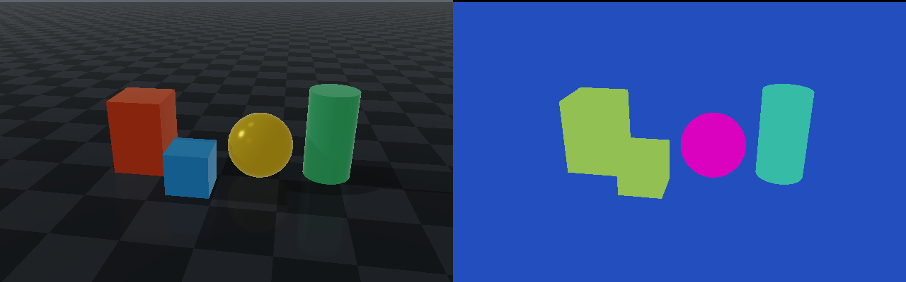

# Rayrai Example: Segmentation Camera

## Overview

Renders an RGB image and a segmentation image from the same camera and the same
physics snapshot and shows them side by side. Every object carries a semantic
class (`Ground`, `Box`, `Sphere`, `Cylinder`), so the segmentation view can be
colored by class, where both boxes share one color, or by object instance,
where each object has its own color. RGB is shown on the left and segmentation
on the right, at 640 x 400 pixels per image.

## Screenshot



## Target

CMake target: `rayrai_segmentation_camera`.

## Run

From the repository root, build the target and run it:

```bash
source ./raisim_env.sh
cmake --build build-examples --target rayrai_segmentation_camera --parallel 2
./build-examples/examples/rayrai_segmentation_camera
```

See [Build examples](../../BuildAndTest.md#build-examples) to configure a new
build directory.

On Windows, run `rayrai_segmentation_camera.exe` instead.
This example renders in process with rayrai and does not need `rayrai_tcp_viewer`.

## Semantic classes and object instances

The app starts with **Color by** set to **Semantic class**. Both boxes have the
same `Box` label, so they have the same segmentation color even though their
RGB appearances differ. Segmentation colors visualize integer IDs; they do not
come from an object's material or RGB color.

| Color by | Integer image used | Box A and Box B |
| --- | --- | --- |
| **Semantic class** (default) | Semantic labels | Share one color because both have the `Box` label. |
| **Object instance** | World object indices | Have different colors because they are separate objects. |

Select **Color by → Object instance** in the app to color by object. The legend
shows the class or object assigned to each color. Black marks pixels with no
geometry within the camera's clipping range. Use **Rotate camera** for
automatic rotation, or **Camera angle** to choose a view; both images move
together.

## Save a comparison

Use `--screenshot` to save a 1280 x 400 PNG with RGB on the left and the
semantic segmentation on the right, then exit:

```bash
./build-examples/examples/rayrai_segmentation_camera --screenshot semantic.png
```

The PNG contains the two images without the app controls or legend. Capture
mode uses a hidden window and still requires a working OpenGL context.

## Details

- Names the classes with `World::addSegmentationClass()` and labels each body
  with `Object::setSegmentationLabel()`.
- Renders the color image with `renderWithExternalCamera()` and the segmentation
  image with `RayraiWindow::renderSegmentation()` from the same `raisin::Camera`,
  so the two images line up pixel for pixel.
- Reads the integer ids back with `raisin::Camera::readSegmentation()` and
  colors them with `SegmentationCamera::colorize()`, which gives each id a fixed
  color; background pixels are black.

See [Segmentation camera](../../Sensors.md#segmentation-camera) for the images,
labels and the URDF and XML syntax.
