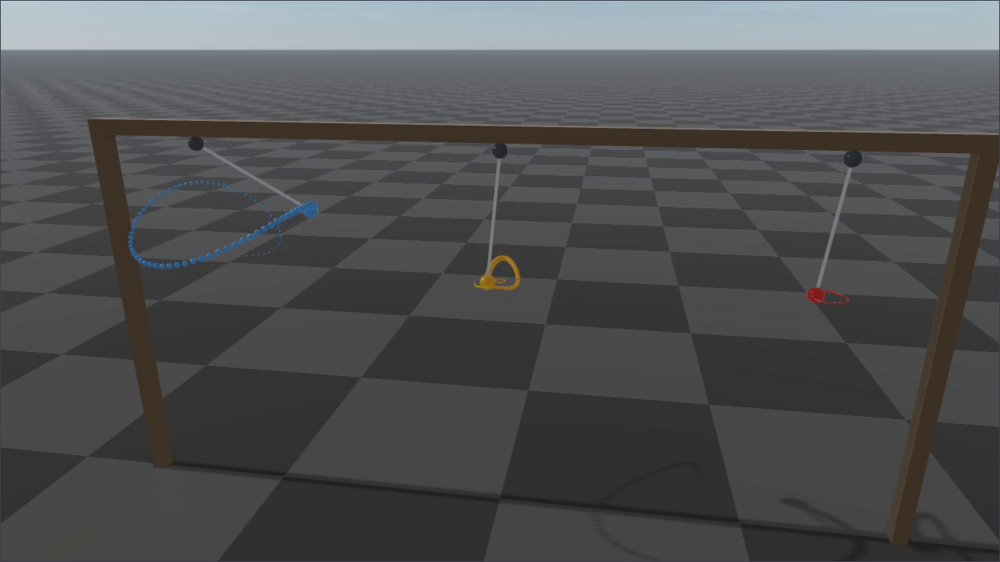

# Rayrai Example: Spherical Joint Friction



## Overview

Coulomb friction of spherical joints ([Joint Damping and Friction](../../articulated_system/JointDampingAndFriction.md#spherical-joints)).
Three spherical pendulums ($m = 1\,kg$ at $d = 0.5\,m$) are released on the same conical swing,
tilted $1.1\,rad$, and differ only in the friction $\tau_c$ of their spherical joints:

| Bob | `<dynamics friction>` | Friction cone | What happens |
| --- | --- | --- | --- |
| blue | none | – | swings on |
| orange | $0.2\,Nm$ | $2.3°$ | spirals down slowly and stops |
| red | $0.6\,Nm$ | $7.0°$ | spirals down quickly and stops |

The friction torque is the same in every direction and opposes the bob's rotation, so the swing
loses energy at every turn instead of stopping one direction first. A bob can stop wherever gravity's
torque, $m g d \sin\theta$ at the tilt $\theta$, is at most $\tau_c$: anywhere inside the ring drawn
in its color. It stops off the vertical, and stays there. The example prints where and when each bob
came to rest, and releases the pendulums again every 12 seconds.

## Run

```bash
./build-examples/examples/rayrai_spherical_joint_friction
```

CMake target: `rayrai_spherical_joint_friction`. Source: `examples/src/rayrai/dynamics/rayrai_spherical_joint_friction.cpp`.
On Windows, run `rayrai_spherical_joint_friction.exe` instead.

## API pattern

The friction is the standard URDF attribute of the spherical joint:

```xml
<joint name="ball" type="spherical">
    <parent link="socket"/>
    <child link="bob"/>
    <dynamics friction="0.6"/>
</joint>
```

The joint's generalized velocity is the bob's angular velocity in its own frame. A joint held by
friction keeps only round-off of it:

```cpp
auto* pendulum = world->addArticulatedSystem(urdf);
pendulum->setState(gc, gv);  // gc: quaternion w, x, y, z; gv: angular velocity
world->integrate();
const bool atRest = pendulum->getGeneralizedVelocity().e().norm() < 1e-9;
```
