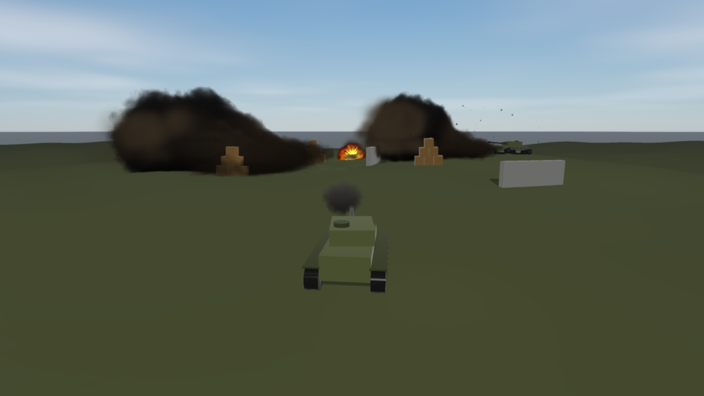

# Rayrai Example: Tank Battle



## Overview

A small tank on rolling hills fires shells at crate pyramids, concrete walls, two parked tanks and
clusters of fuel barrels, under a breeze. It shows the explosions and projectiles of RaiSim and how
rayrai draws them:

- The tank is one articulated system (`rsc/tank/tank.urdf`): a hull on two
  [tracks](../../articulated_system/Tracks.md), each a belt around a driven sprocket, an idler and three road wheels; a
  turret that turns on the hull; and a gun that elevates in the turret. Velocity control on the
  sprockets drives it and position control aims the turret and the gun.
- Each shell is a [projectile](../../Explosions.md#projectiles): it flies under gravity and the drag
  of the air, whose velocity is the wind, so a crosswind carries it sideways. The world's air is
  `raisim::FluidMedium::air()` with the wind as its velocity (`World::setAmbientFluid()`). A sweep of
  its path each step makes it hit whatever is in the way however fast it flies. It hands its momentum
  to what it hits, and the gun recoils with the same momentum.
- An explosive shell sets off an [explosion](../../Explosions.md) where it hits: the blast wave
  reaches nearby bodies a few milliseconds later and pushes each face that the charge can see, so
  crates behind a wall stay put. The explosion digs a crater in the terrain.
- A fuel barrel goes off when a shell hits it or when a blast reaches it with more than 1.5 bar of
  overpressure, so one barrel sets off its neighbours.
- rayrai draws each explosion as a fireball that swells and cools into a rising cloud of smoke,
  sparks and debris, a flash of light and a scorch mark, with a muzzle flash at the gun and a tracer
  behind each shell ([Explosion effects](../../rayrai/Explosions.md)). The smoke drifts with the wind.

## Controls

| Input | Action |
| --- | --- |
| `W` / `S` | drive forward / back |
| `A` / `D` | turn left / right |
| arrow keys | turn the turret, raise and lower the gun |
| `Space` | fire (1.2 s to reload) |
| `H` / `P` | show help / pause |

The panel holds the same controls for touch screens (throttle, turn, turret and elevation sliders and
a Fire button), an Aim at barrel button, and the shell speed, charge, explosive or inert shells and the
wind.

## Run

```bash
./build-examples/examples/rayrai_tank_battle
./build-examples/examples/rayrai_tank_battle --screenshot tank.png --frames 330
```

CMake target: `rayrai_tank_battle` (C++20). Source: `examples/src/rayrai/games/rayrai_tank_battle.cpp`.
With `--screenshot` the example aims at the nearest barrels, fires a salvo and saves the frame.
