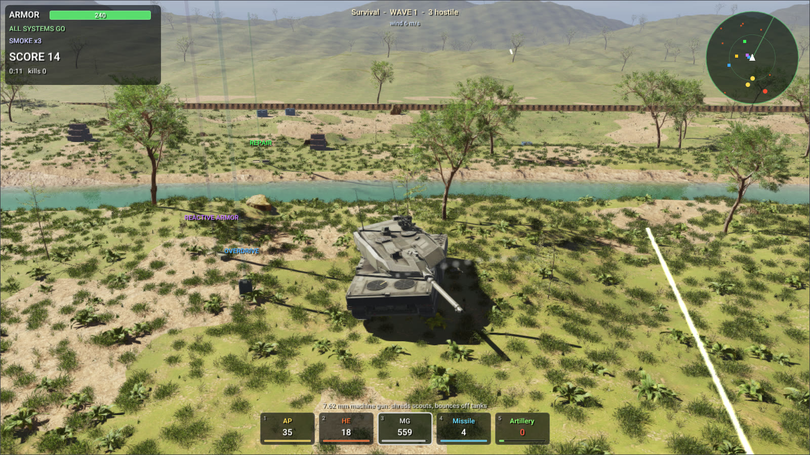
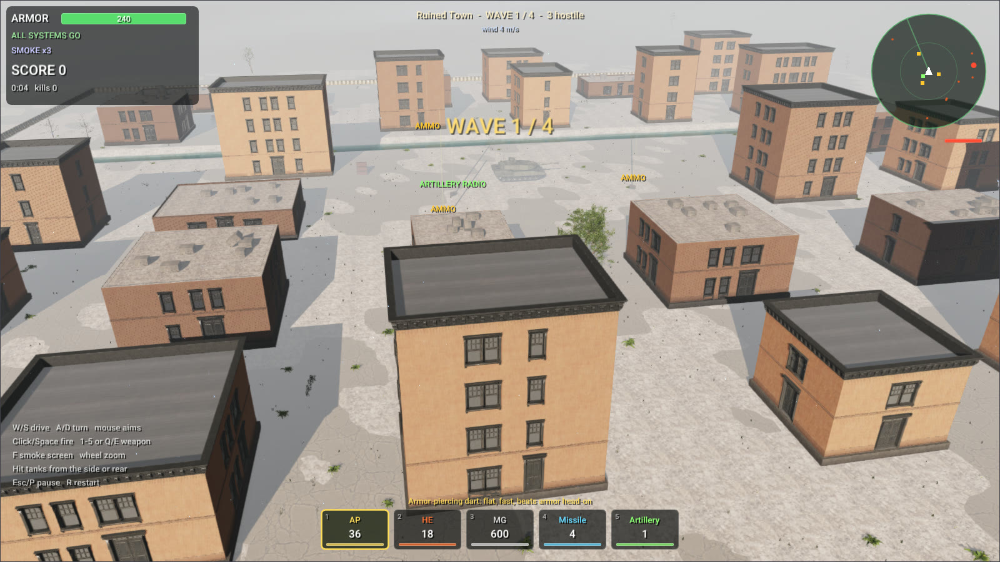
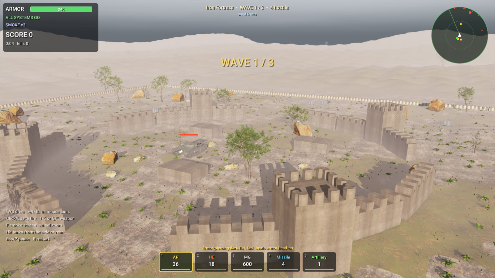

# Rayrai Example: Tank Survival



*The vehicles are licensed under CC BY 4.0 and credited in [Asset Credits](../../AssetCredits.md#tank-survival-vehicles); the props, plants, buildings and textures are Poly Haven assets under CC0.*

## Overview

A tank survival game in six levels, each with its own terrain and weather: a green valley at noon, desert
dunes in a crosswind, a ruined town under an overcast sky, snow ridges in the late afternoon, a fortress
assault and an endless survival. Enemy vehicles arrive in waves around your Leopard 2: scouts, tanks,
tank destroyers that snipe from range, self-propelled guns that mark their target before the shells land,
and heavily armored brutes. The same source builds for the desktop and, with the
[WebAssembly SDK](../../WebAssemblySdk.md), for the browser.



- Every shell is a RaiSim [projectile](../../Explosions.md#projectiles): it drifts with the wind (the
  world's air, `World::setAmbientFluid()`) and slows down in water. Hits are resolved against the front,
  side, rear and roof armor of the vehicle they strike, with ricochets at shallow angles.
- High-explosive shells, missiles, artillery and exploding barrels set off [explosions](../../Explosions.md)
  whose blast waves push tanks, wrecks, crates and barrels and dig craters in the terrain. Wrecks burn.
- The tanks are articulated systems on [tracks](../../articulated_system/Tracks.md). A river crosses each
  level as a fluid volume: tanks wade through it, are slowed and buoyed by it, and push its water aside.
- rayrai draws the explosions as fireballs, smoke, dust and debris with soft particles
  ([Explosion effects](../../rayrai/Explosions.md)), the river with its flow, the weather of each level, and
  rough terrain planted with trees, shrubs and grass that keep their detail far from the camera. The town
  is built from Poly Haven's modular apartment facades, as in the [City](rayrai_city.md) example.
- Weapons: armor-piercing and high-explosive shells, a coaxial machine gun, guided missiles, artillery
  strikes and a smoke screen. Pickups bring ammunition, repairs, reactive armor, missiles and radios.



## Controls

| Input | Action |
| --- | --- |
| `W` / `S`, `A` / `D` | drive, turn |
| mouse | point at what to hit; the turret turns there and the gun sets its own elevation |
| click or `Space` | fire |
| `1`–`5`, `Q` / `E` | pick a weapon, cycle through them |
| `F` | lay a smoke screen |
| mouse wheel, right drag | zoom, turn the camera |
| `P` or `Esc` / hold `R` / `H` | pause, restart, how to play |

Aiming needs no up and down: the gun of your tank is stabilized and raises itself for the range to the
point under the cursor, on slopes too. Near an enemy the sight locks on it (red brackets) and leads it.
A dotted arc shows where a round fired now would fly, to a ring where it would strike: red on a vehicle.
The **How to play** button (or `H`) opens the controls; they come up before the first mission. Arrows at
the edge of the screen point to enemies out of view, and an arrow beside the wind's speed shows where it
blows. Tanks flatten the small trees of the arena, and
shells and blasts fell them.

On a slow computer the main menu lowers the render quality while the level behind it draws slowly, until
it runs smoothly (the game itself slows down below 25 frames a second); a quality picked in the menu, or
given with `--quality`, is kept.

## Run

The game is in [`raisim2Lib/wasm`](https://github.com/raisimTech/raisim2Lib/tree/master/wasm). On the desktop it
builds against the installed RaiSim and rayrai packages:

```bash
cmake -S wasm -B build-wasm-native -DCMAKE_BUILD_TYPE=Release -DCMAKE_PREFIX_PATH="$PWD/raisim;$PWD/rayrai"
cmake --build build-wasm-native --target tank_survival
./build-wasm-native/tank_survival
./build-wasm-native/tank_survival --autopilot --level 3 --quality 3
```

`--level N` starts the Nth level, `--autopilot` lets the tank play itself, `--quality 0-3` picks Fast,
Balanced, High or Ultra rendering, and `--frames N --screenshot file.png` saves the Nth frame. For the
browser, build the same project with Emscripten and the SDK as the [WebAssembly SDK](../../WebAssemblySdk.md#quick-start)
page describes, or [play it on this website](https://raisim.com/games/tank-survival/).

The smaller [Tank Battle](rayrai_tank_battle.md) example drives one tank of boxes and cylinders in a
single file, to show the explosion and projectile API on its own.
