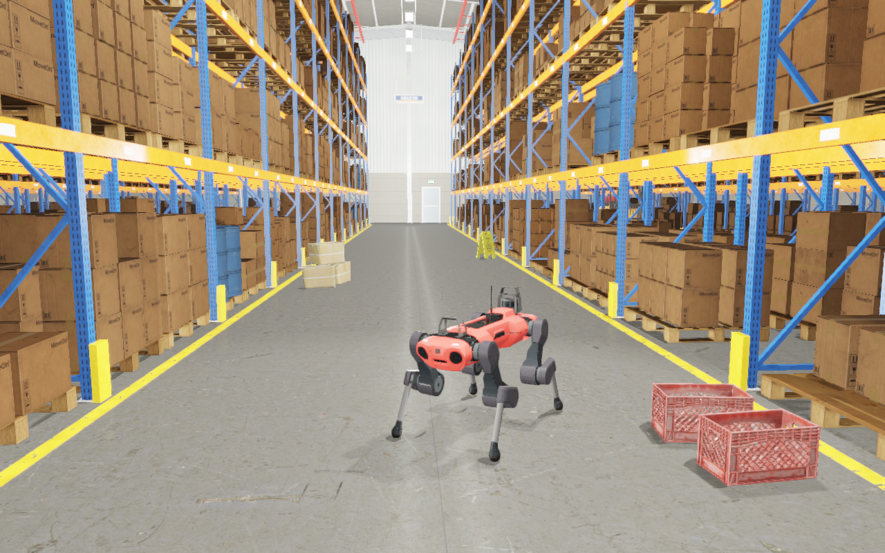
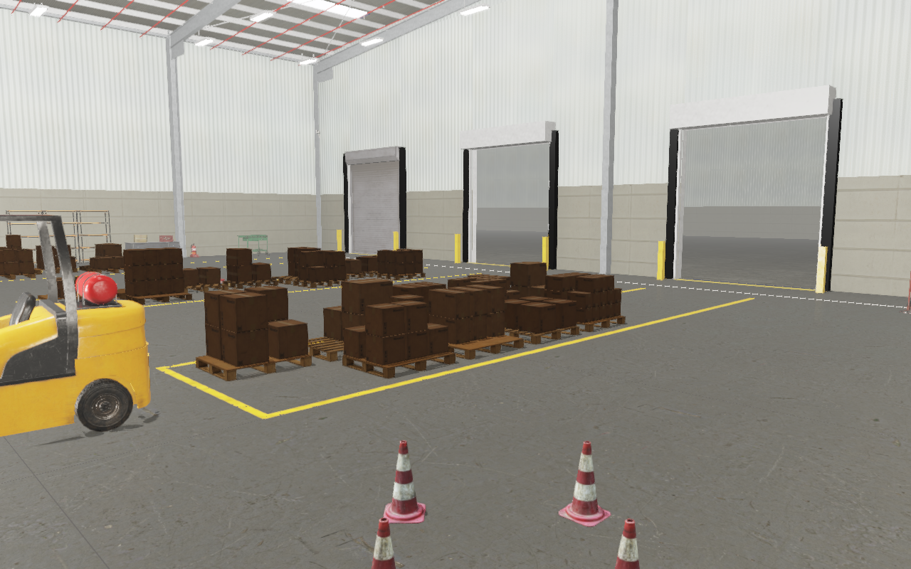
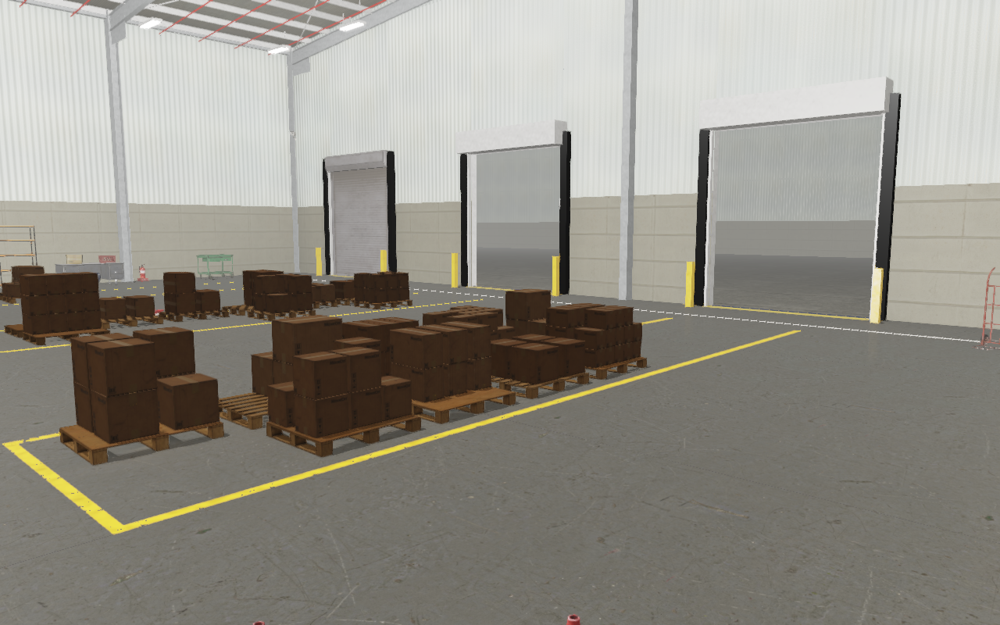

# Rayrai Example: Warehouse



*The forklift, pallet jack, pallets and cartons are licensed under CC BY 4.0 and credited in [Asset Credits](../../AssetCredits.md#warehouse).*

## Overview

A photoreal warehouse with pallet racks, forklifts and a loading dock, stored
as a RaiSim Engine scene, `rsc/warehouse/rayrai_warehouse.rscene`. An ANYmal C
quadruped stands in an aisle. The floor, walls and roof use diffuse indirect
lightmaps baked in Blender Cycles from the warehouse geometry and fixtures.
Aisle and dock fill lights bring out the carton faces. The aisle spotlight
casts ANYmal’s live shadow across the concrete. The scene file loads the bake
and material settings when the example adds the robot:

```cpp
auto world = std::make_shared<raisim::World>(
  exampleRscPath(argv[0], "warehouse/rayrai_warehouse.rscene"));
// The .rscene reader creates no articulated systems, so the robot is added here.
addStandingAnymal(*world, exampleRscPath(argv[0], "anymal_c/urdf/anymal.urdf"));
raisin::RayraiWindow viewer(world, 1280, 800);  // applies the scene
```

<video class="doc-video" src="../../../../rsc/docs/video/examples/rayrai_warehouse_baked.mp4" poster="../../../../rsc/docs/video/examples/rayrai_warehouse_baked.jpg" controls loop muted playsinline preload="metadata" aria-label="Camera moves past ANYmal C in the aisle and pans over the loading dock"></video>



## Run

```bash
./build-examples/examples/rayrai_warehouse
./build-examples/examples/rayrai_warehouse --screenshot warehouse.png
```

Source: `examples/src/rayrai/worlds/rayrai_warehouse.cpp`, which runs the
`photoreal_scene.hpp` it shares with the city example (CMake target
`rayrai_warehouse`). `--screenshot` saves one frame and exits, and
`--scene` loads another `.rscene` file.

## The scene

- A 60 m × 36 m steel-frame hall with skylights and four dock doors, two of
  them open to a sunlit yard.
- Ten rows of pallet racks with four shelf levels, filled with cartons and
  drums on pallets.
- A dock area with staging lanes, two forklifts, a pallet jack, shelves and a
  packing desk.
- Colliders for the walls, racks, floor loads and props. Cartons, crates,
  cones and a wet-floor sign are dynamic, so a robot can push them.



## Assets

All files are in `rsc/warehouse`; the scene also uses the sky, asphalt and
traffic cones in `rsc/city`. The props and textures come from Poly Haven
(CC0). The forklift, pallet jack, pallets and cartons are Sketchfab models
under CC BY 4.0, credited in `rsc/warehouse/ATTRIBUTION.md`.

See [.rscene File](../../RsceneFile.md) for the scene format.
