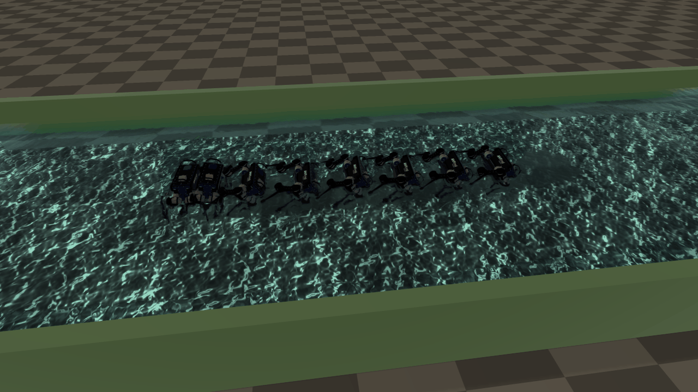

# Server Example: Fluid Stream with ANYmal

## Overview

ANYmal stands across a stream 0.55 m deep, the water pushing on its side
([Fluids](../../Fluids.md)). The water holds part of its weight up and drags on its legs and body,
and its joints hold the standing pose with PD control.
- A gentle stream leaves it standing.
- Past about 1.2 m/s, the drag on its side tips it over. The water then carries it off downstream,
  rolling it along the bed.

Once it reaches the end of the channel, or has lain fallen for four seconds, it stands up at the start
again, and the example prints how often the stream has knocked it over.



ANYmal in a stream of 2 m/s, every half second from standing. Within a second the water tips it onto
its side, and then carries it downstream.

## Controlling the stream

The example adds a slider, `Stream speed [m/s]`, from 0 to 3 m/s
(`RaisimServer::addSlider()`). The rayrai TCP viewer shows it in its **Controls** window, at the lower
right of the view. Drag it past 1.2 m/s to see ANYmal knocked over. Each step, the example reads it
with `RaisimServer::getSlider()` and sets the water's velocity with `World::setFluidVolume()`.

## Target

CMake target: `fluid_stream_anymal`.

## Run

```bash
./build-examples/examples/fluid_stream_anymal
```

Connect `rayrai_tcp_viewer` to port 8080. On Windows, run `build-examples/bin/fluid_stream_anymal.exe`.

## Details

- ANYmal stands across the current, so the stream pushes on its narrow side, as when a robot crosses a
  river. Its joints hold the standing pose with gains of 200 N m/rad and 5 N m s/rad.
- The bed's friction is 1.2, that of a stony bed, so the feet grip and the robot tips over rather than
  sliding off upright.
- The scene lives in `include/fluid_stream.hpp`, which it shares with
  [Fluid Stream](./fluid_stream.md).
