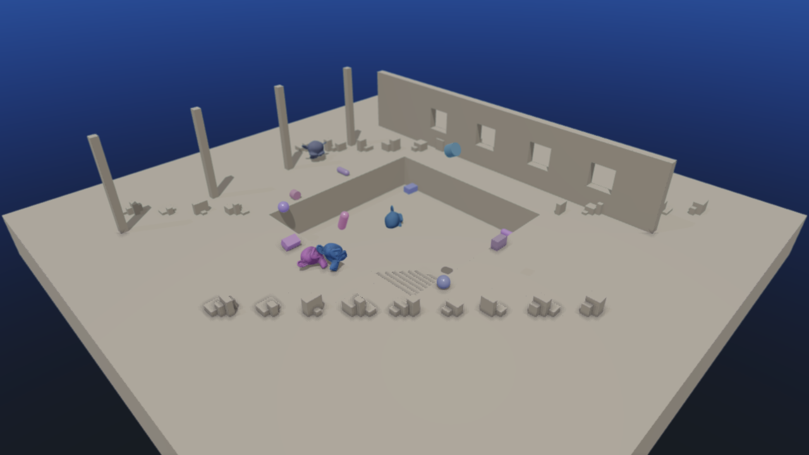

# Server Example: Voxel Map Collision

## Overview

Drops spheres, boxes, capsules, cylinders, convex meshes and triangle meshes onto a voxel
playground with stairs down into a pit, a wall with windows, pillars and rubble, while craters
are carved into the floor and refilled. Use `rayrai_tcp_viewer` for supported visualization.

## Screenshot



## Target

CMake target: `voxel_map_collision`.

## Run

Run the build-tree executable:

```bash
./build-examples/examples/voxel_map_collision
```

On Windows, run `voxel_map_collision.exe` instead.
This example uses RaisimServer. Start `rayrai_tcp_viewer` and connect to port 8080.

## Details

- Builds a 12 m x 12 m map of 5 cm voxels and shapes it with `VoxelMap::fillBox()`.
- Adds a new body every 0.3 s, cycling through every collision shape, until 120 bodies are in
  the scene. The meshes use the bundled `monkey/monkey.obj`.
- Every 8 s, `VoxelMap::fillSphere()` carves a crater of radius 1 m into the floor; 4 s later
  `VoxelMap::setVoxels()` fills the removed voxels back in, and bodies inside the refill are
  pushed out of the solid. Sleeping bodies on a crater wake when it is carved.
- See [Voxel Map](../../VoxelMap.md).
