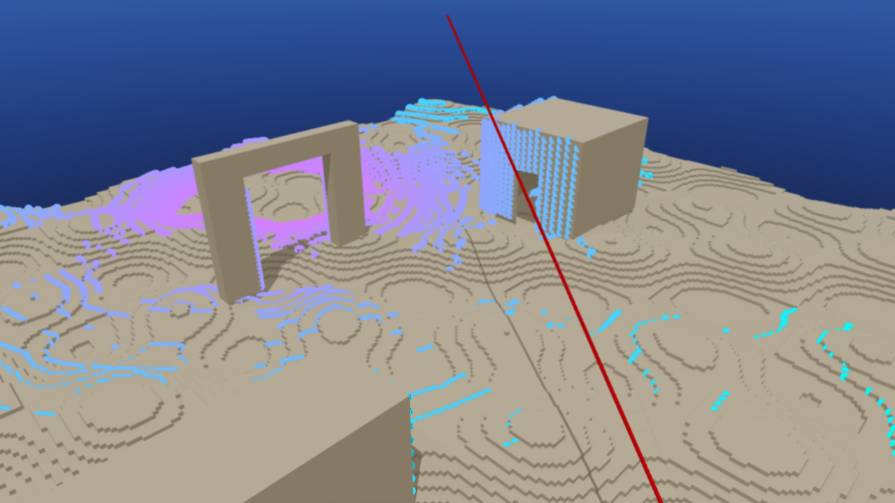

# Server Example: Voxel Map Ray Casting

## Overview

Scans a voxel map with a spinning lidar and a single probe ray. The map holds rolling hills, a hut
with a door, an arch and a tunnel through a hill, so the scan shows overhangs and hollow spaces
that a height map cannot represent. Use `rayrai_tcp_viewer` for supported visualization.

## Screenshot



## Target

CMake target: `voxel_map_ray_casting`.

## Run

Run the build-tree executable:

```bash
./build-examples/examples/voxel_map_ray_casting
```

On Windows, run `voxel_map_ray_casting.exe` instead.
This example uses RaisimServer. Start `rayrai_tcp_viewer` and connect to port 8080.

## Details

- Builds a 30 m x 30 m map of 0.1 m voxels with `World::addVoxelMap()` and `VoxelMap::fillBox()`,
  then carves the hut's interior, its door and the tunnel out of the solid.
- A lidar of 32 x 512 rays drives along a circle 1.2 m above the terrain and scans it every step
  with `World::rayTestLidar()`; the hits are drawn as a point cloud colored by range.
- A probe ray sweeps the scene from above with `World::rayTest()`; a red line and a sphere mark
  where it hits the first occupied voxel.
- See [Voxel Map](../../VoxelMap.md).
