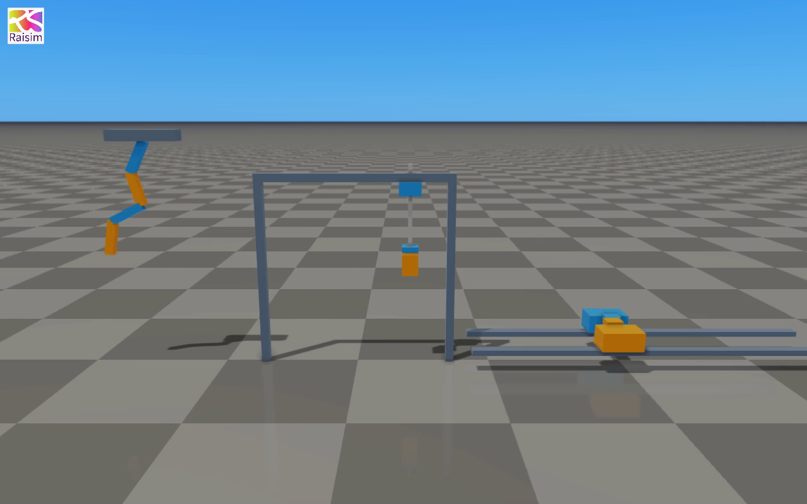

# Server Example: Articulated Join

Join objects into articulated systems while the simulation runs, and take them
apart again. The scene has three stations that repeat every six simulated
seconds. Each uses `World::joinObjects()` or `World::detachJoint()` in a
different way. See [Joining objects](../../ArticulatedJoins.md) for the rules,
what a joined system keeps, and the Python API.



<video class="doc-video" src="../../../../rsc/docs/video/examples/articulated_join.mp4" poster="../../../../rsc/docs/video/examples/articulated_join.jpg" controls loop muted playsinline preload="metadata" aria-label="Boxes joined into a swinging chain, a gantry picking up and releasing a tool, and two carriages docking and undocking, recorded from the running RaiSim example"></video>

The clip is recorded from the example's simulated objects through
`rayrai_tcp_viewer`.

## A chain built from boxes

A static beam and four moving boxes become one swinging chain. The first call
joins the beam and a box with a hinge; because the beam is static, the new
system has a fixed base. Each later call joins the next box to the system made
by the previous one:

```cpp
system = world.joinObjects(system, system->getBodyIdx("link1"), link2, 0, hinge);
```

The boxes start with different horizontal velocities. Each join conserves
momentum, so the chain swings with the motion the boxes had, minus what the
hinges remove. The joints are part of the system's generalized coordinates,
so the links never separate.

## Picking up and releasing a tool

The gantry is an articulated system with two prismatic joints. It lowers its
hook onto the orange box and joins it with a fixed joint at the box's top face:

```cpp
gantry = world.joinObjects(gantry, gantry->getBodyIdx("hook"), tool, 0,
                           fixedJoint("tool_mount", gripPointInHookFrame));
```

The tool's mass and inertia become part of the hook body, and the PD controller
of the gantry keeps its gains and targets. The gantry lifts the tool, carries
it 0.8 m and releases it:

```cpp
auto parts = world.detachJoint(gantry, "tool_mount");
gantry = parts[0];  // the gantry, with its own mass again
tool = parts[1];    // the tool, a one-body floating system
```

The released tool keeps the velocity it had on the hook and falls to the
ground. Its link frame is now the `tool_mount` frame at its top face, so the
example tracks its centre of mass.

## Docking two robots

Each carriage is a separate fixed-base robot on its own rail. Both are fixed to
the world, so joining their carriages closes a loop. `getLoopJointNames()`
returns `{"dock"}`: the dock is enforced as a loop-closure constraint, and the
system keeps one coordinate per carriage. A 0.3 N force on the orange carriage
accelerates both. After three seconds the dock is detached; the orange carriage
is pushed back while the blue one coasts on. `JoinOptions::childPrefix` names
the blue carriage's links and joints `passive/...`, because both robots use the
same names.

## Build and run

CMake target: `articulated_join`. From the `raisim2Lib` checkout after
configuring the examples:

```bash
cmake --build build-examples --target articulated_join rayrai_tcp_viewer --parallel 12
```

Start the viewer, then the example in another terminal:

```bash
# Terminal 1
./build-examples/examples/rayrai_tcp_viewer --auto-frame

# Terminal 2
./build-examples/examples/articulated_join
```

Connect to the port the example prints, normally `8080`. On Windows, run the
corresponding `.exe` files under `build-examples/bin`. The example uses only
primitive geometry.

### Run the physics checks without a viewer

`--headless` runs one six-second cycle, prints the chain's joint angles, where
the tool was carried and where it came to rest, and the carriages' velocities,
and exits with an error if any station misbehaves:

```bash
./build-examples/examples/articulated_join --headless
```

The engine test build registers it as `testArticulatedJoinExample`.
`raisimPy/examples/articulatedJoin.py` runs the gantry and docking stations
from Python; `testPythonArticulatedJoin` checks it.
