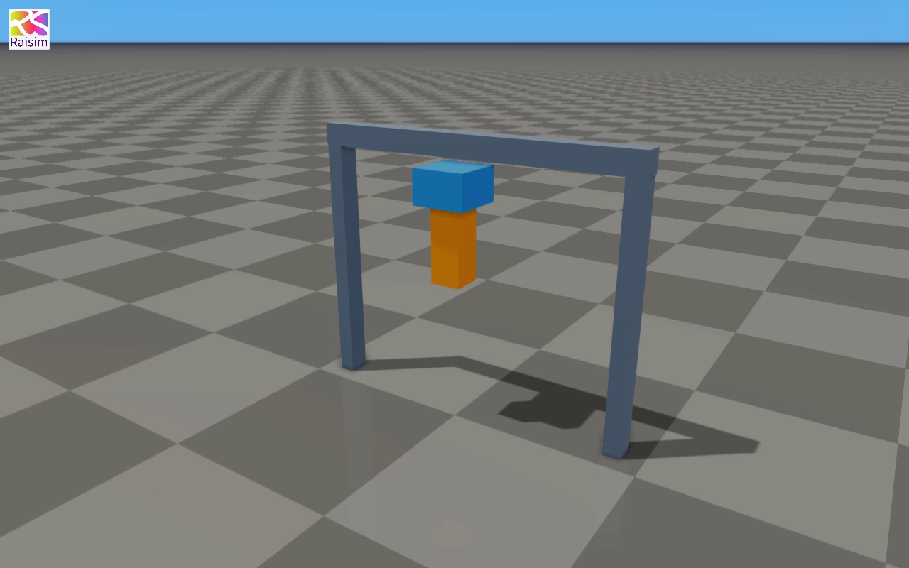
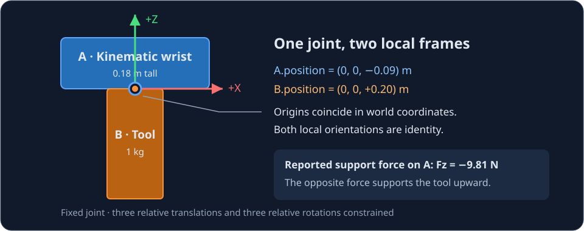
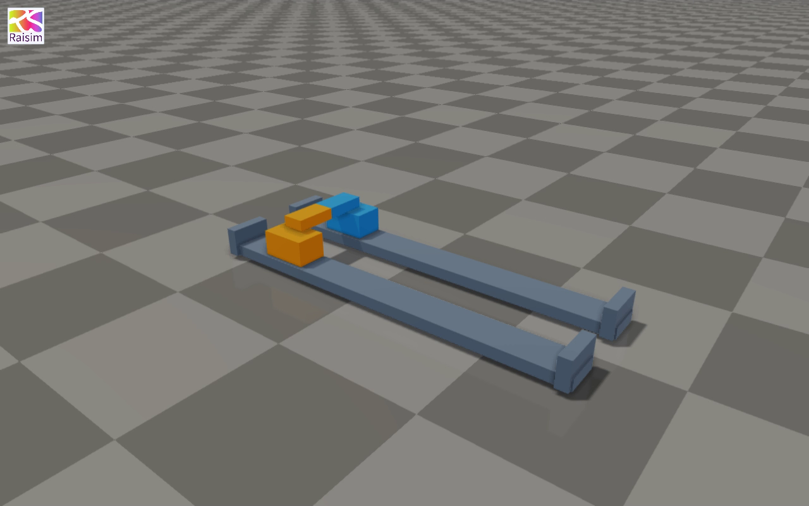

# Server Example: Runtime Joints

Attach and release a tool, or dock two independently loaded robot mechanisms,
while the simulation is running. Both scenes use `World::addRuntimeJoint()` and
`World::removeRuntimeJoint()`; the joint is solved together with the rest of the
world's constraints. See [Runtime joints](../../RuntimeJoints.md) for all four
joint types, frames, breaking thresholds, and Python bindings.

## Tool attachment and release

The blue wrist follows a prescribed horizontal motion. A fixed runtime joint
holds the orange, 1 kg tool below it, preserving their relative position and
orientation. After two simulated seconds, the example removes the joint: the
tool keeps its velocity, falls under gravity, and lands on the ground while the
wrist returns. The scene restarts every four simulated seconds.



<video class="doc-video" src="../../../../rsc/docs/video/examples/runtime_joints.mp4" poster="../../../../rsc/docs/video/examples/runtime_joints.jpg" controls loop muted playsinline preload="metadata" aria-label="Runtime joint tool attachment and release, recorded from the running RaiSim example"></video>

The screenshots and clips on this page are recorded from the example's simulated
objects through `rayrai_tcp_viewer`.

### Attachment frames and support load

Each attachment is expressed in its own body's frame. Here both local
orientations are identity: the wrist's bottom and the tool's top meet at the
same world point. The fixed joint constrains all six relative directions.



```cpp
using Joint = raisim::RuntimeJoint;
auto* mount = world.addRuntimeJoint("tool_mount", Joint::Type::Fixed,
    {wrist, 0, {0., 0., -0.09}},
    {tool, 0, {0., 0., 0.20}});

world.integrate();
const auto supportForce = mount->getForce();
world.removeRuntimeJoint(mount);
```

`getForce()` reports the force on attachment A, the wrist. While it supports the
tool at constant horizontal speed, its vertical component is `-9.81 N`; the
opposite force acts upward on the tool. The wrist is kinematic and receives no
velocity change from that reaction. After removal, discard the joint pointer.

## Docking two independent robots

The second scene creates two separate articulated systems, each with a fixed
base and a 1 kg carriage on a prismatic joint. The orange carriage is driven
with `0.35 N`; the blue carriage has no commanded force. A fixed runtime joint
connects their docking tabs, so they accelerate together at `0.175 m/s²`.



<video class="doc-video" src="../../../../rsc/docs/video/runtime_joints_docking.mp4" poster="../../../../rsc/docs/video/runtime_joints_docking.jpg" controls loop muted playsinline preload="metadata" aria-label="Two independent articulated robots sharing motion through a runtime dock, then separating after release"></video>

At two simulated seconds the dock is removed. The orange carriage continues
accelerating under its commanded force, while the blue carriage coasts. Their
increasing separation demonstrates that they are independent systems again.
The headless run checks a `-0.175 N` dock reaction on the driven robot before
release and a `0.7 m/s` velocity difference two seconds afterward.

The companion Python example, `raisimPy/examples/runtimeJoints.py`, exercises
the same attach–transfer–release workflow without a viewer.

## Build and run

CMake target: `runtime_joints`. From the `raisim2Lib` checkout after configuring
the examples:

```bash
cmake --build build-examples --target runtime_joints rayrai_tcp_viewer --parallel 12
```

Start the viewer, then start either scene in another terminal:

```bash
# Terminal 1
./build-examples/examples/rayrai_tcp_viewer --auto-frame

# Terminal 2: tool attachment and release
./build-examples/examples/runtime_joints --visualize

# Or: docking two independent robot carriages
./build-examples/examples/runtime_joints --visualize --scene docking
```

The example serves the world by default, so it can also be launched from the
viewer's example chooser. Connect to the port printed by the example, normally
`8080`. The viewer's pause
and single-step controls work with the scripted simulation. Deleting a wrist,
tool, or robot endpoint in the viewer stops the example. Stop the process to
close the repeating demo.

On Windows, run the corresponding `.exe` files under `build-examples/bin`.
RaiSim uses its standard activation-key lookup; pass `--activation-key FILE` to
select a key explicitly. This example uses only primitive geometry and needs
no external 3D assets.

### Run the physics checks without a viewer

Use `--headless` to run one four-second cycle, check its result, print the
reaction load and release result, and exit:

```bash
./build-examples/examples/runtime_joints --headless
./build-examples/examples/runtime_joints --headless --scene docking
```

The engine test build registers these as `testRuntimeJointExample` and
`testRuntimeJointDockingExample`.

## Re-record the figures and videos

With the example and viewer built, the repository's media generator records
both scenes and extracts the figures:

```bash
CC=clang-20 python3 docs/image_generators/runtime_joint_media.py \
  --build build-examples/examples
```

It uses the same offscreen capture and H.264 encoding as the examples gallery.
The tool clip also appears under **Mechanisms** in the [Examples](../../Examples.md)
gallery.
