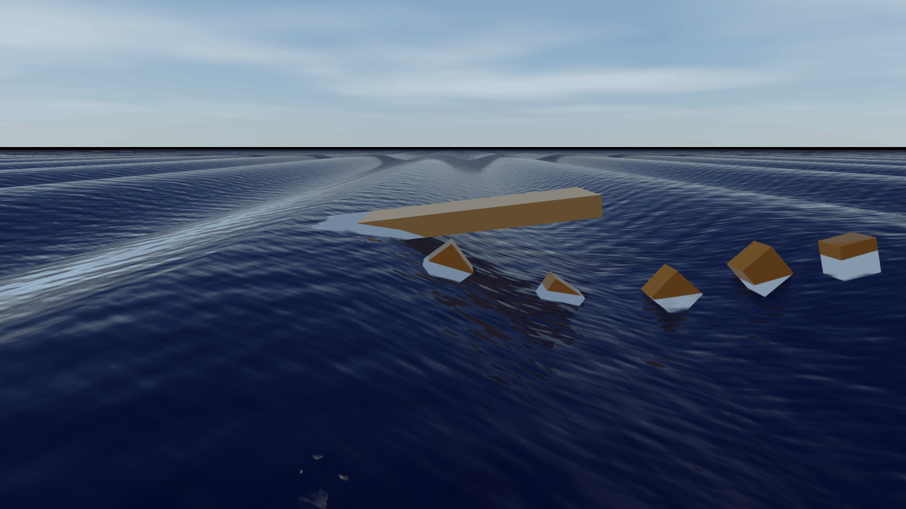
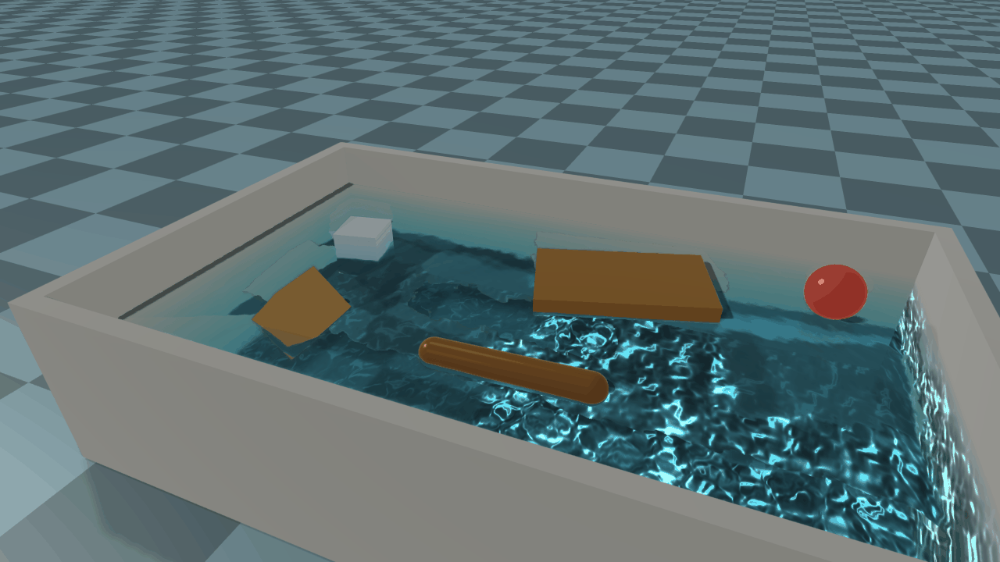
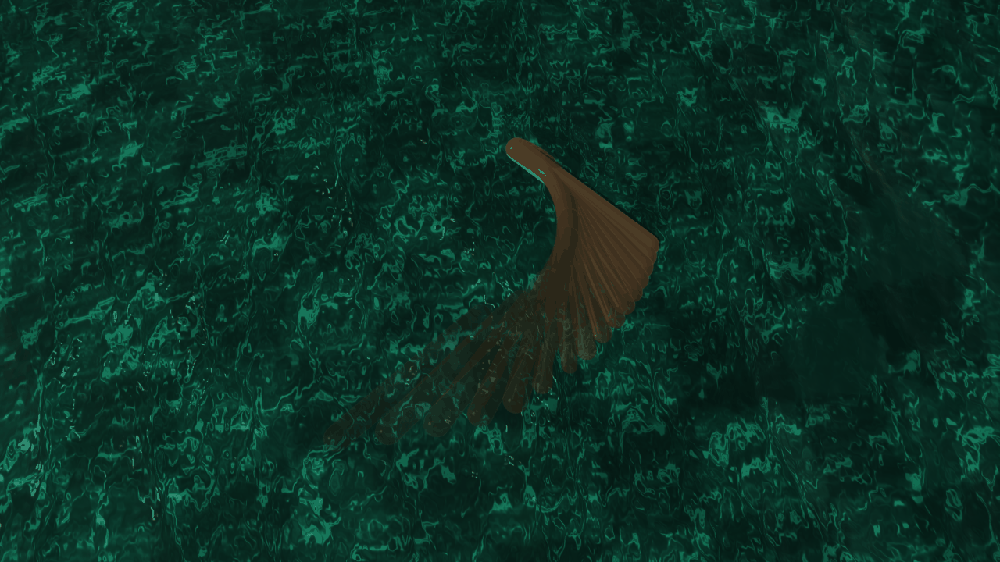
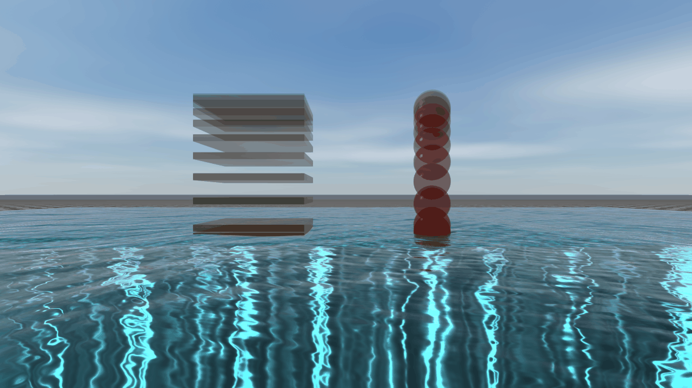

# Dynamics of Fluid Forces

This page writes out the forces that fluids put on a body and the motion they produce. How to add
water, air and waves to a world is described in [Fluids](../Fluids.md).

The page follows the notation of [Conventions and Notations](../ConventionsAndNotations.md#dynamics).
In addition:

- $\boldsymbol{v}$ and $\boldsymbol{\omega}$ are the velocity of a body's center of mass and its
  angular velocity; together they form its twist $\boldsymbol{\nu} = (\boldsymbol{v}, \boldsymbol{\omega})$.
- $\boldsymbol{v}_f$ is the velocity of the fluid: the current of a volume or the wind, plus the
  motion of its waves.
- $\boldsymbol{\nu}_r = (\boldsymbol{v} - \boldsymbol{v}_f, \boldsymbol{\omega})$ is the twist of
  the body relative to the fluid.
- $\rho$ and $\mu$ are the density and the dynamic viscosity of a fluid. Where a liquid and the
  ambient fluid both touch a body, $\rho_\ell$ and $\rho_a$ tell them apart.
- $\boldsymbol{g}$ is the gravity of the world and $g = |\boldsymbol{g}|$.

## Equation of motion

Fluids act on every dynamic body through its collision shapes. Each shape adds its share, and the
shares of all shapes of a body add up. With $\dot{\boldsymbol{\nu}} = (\dot{\boldsymbol{v}},
\dot{\boldsymbol{\omega}})$ the accelerations in the world frame, a rigid body moves as

$$
(\boldsymbol{M}_B + \boldsymbol{M}_A)\,\dot{\boldsymbol{\nu}}
+ \boldsymbol{C}_B(\boldsymbol{\nu})\,\boldsymbol{\nu}
= \boldsymbol{f}_g + \boldsymbol{f}_b + \boldsymbol{f}_a + \boldsymbol{f}_d + \boldsymbol{f}_\mu
+ \boldsymbol{f}_M + \boldsymbol{f}_e + \boldsymbol{f}_r + \boldsymbol{f}_K + \boldsymbol{f}_c.
$$

- $\boldsymbol{M}_B$ is the rigid body's spatial inertia, in the world frame about its center of mass,
  and $\boldsymbol{C}_B(\boldsymbol{\nu})\boldsymbol{\nu} = (\boldsymbol{0}, \boldsymbol{\omega}\times
  \boldsymbol{I}\boldsymbol{\omega})$ its gyroscopic term.
- $\boldsymbol{M}_A$ is the added mass: the fluid that moves with the body. $\boldsymbol{f}_K$ is the
  force that this fluid puts on the body as the body turns (Kirchhoff's equations; see
  [Added mass](#added-mass)).
- On the right are gravity $\boldsymbol{f}_g$, buoyancy $\boldsymbol{f}_b$, the push of an accelerating
  liquid $\boldsymbol{f}_a$, pressure drag and lift with skin friction $\boldsymbol{f}_d$, viscous drag
  $\boldsymbol{f}_\mu$, Magnus lift $\boldsymbol{f}_M$, water entry $\boldsymbol{f}_e$ and wave
  radiation $\boldsymbol{f}_r$. $\boldsymbol{f}_c$ are contacts, joints and every other force.

Every wrench here is a force and a moment about the center of mass. A force $\boldsymbol{f}$ at a
point $\boldsymbol{r}$ from the center of mass adds the moment $\boldsymbol{r}\times\boldsymbol{f}$.

### Which fluid touches a shape

A collision shape belongs to the first volume of liquid in which:
- its centroid lies within the volume's horizontal bounds and above its bottom;
- the shape reaches below the volume's surface.

The surface cuts the shape into two parts:
- the part below it lies in the liquid, with volume $V_s$ and centroid $\boldsymbol{c}_s$;
- the rest lies in the ambient fluid, with volume $V - V_s$, where $V$ is the volume of the shape.

A shape that belongs to no volume lies wholly in the ambient fluid. Each part feels the fluid it
lies in, with that fluid's density, viscosity and velocity.

## The surface

A shape sees the surface as one plane, through a point at height $\eta_s$ with the upward normal
$\boldsymbol{n}_s$:

- A volume without waves or a sampler has a still, horizontal surface at its `surfaceHeight`
  $\bar z$.
- A sampler gives the plane through its sample at the shape's centroid, tilted by its normal.
- Waves give the plane of the waves averaged over the shape's extent (below).

The cut of the shape by this plane is exact for every shape:
- a sphere's cap and its waterplane, a disc, in closed form;
- a box or a mesh by cutting its faces;
- a cylinder or a capsule by integrating the circular segments under the plane, and the chords of
  its waterplane, along its axis.

### Waves

Each wave $j$ of a volume is a linear wave on deep water. It travels along the horizontal unit
vector $\boldsymbol{d}_j$ with wavenumber $k_j = 2\pi/\lambda_j$, amplitude $a_j$, phase $\varphi_j$
and frequency $\Omega_j = \sqrt{g k_j}$. The surface over the horizontal point $\boldsymbol{x}$ at
the world time $t$ is

$$
\eta(\boldsymbol{x}, t) = \bar z + \sum_j a_j \cos\theta_j,\qquad
\theta_j = k_j\,\boldsymbol{d}_j\cdot\boldsymbol{x} - \Omega_j t + \varphi_j.
$$

Under the surface, at the height $z$, the liquid moves with the velocity of the current plus

$$
\boldsymbol{v}_w = \sum_j a_j \Omega_j\, e^{k_j z'}
\begin{bmatrix} \cos\theta_j\, \boldsymbol{d}_j \\ \sin\theta_j \end{bmatrix},\qquad
z' = \min(z - \bar z,\ \eta - \bar z).
$$

The motion decays with the depth below the mean level $\bar z$. Above the mean level, up to the
surface, it keeps growing as the same exponential. For waves low against their length, each parcel
of liquid turns on a circle of radius $a_j e^{k_j z'}$: forward under a crest, back under a trough.

The acceleration of the liquid is that of a parcel as it moves, not of the flow at a fixed point:

$$
\boldsymbol{a}_w = \frac{\partial \boldsymbol{v}_f}{\partial t} + (\nabla \boldsymbol{v}_f)\,\boldsymbol{v}_f,
$$

with $\boldsymbol{v}_f$ the whole velocity of the liquid, current included. The second term carries
the change of the flow along the path of the parcel. With it, a particle as dense as the liquid moves
with the liquid. Over many waves it keeps its depth and drifts forward with the Stokes drift of low
waves, $\sum_j a_j^2 \Omega_j k_j e^{2 k_j z'}$.

### The plane over a body on waves

A body on waves sees them averaged over its extent. Let $\boldsymbol{\Sigma}$ be the horizontal
second moments of its volume about its centroid, per unit volume: $\frac{1}{3}\mathrm{diag}(h_x^2,
h_y^2)$ for a level box of half sizes $h_x, h_y$, $\frac{r^2}{4}\boldsymbol{I}$ for an upright
cylinder, and $\frac{r^2}{5}\boldsymbol{I}$ for a sphere. Each wave $j$ reaches the plane with its
height and its slope weakened by how far the body extends along it:

$$
\eta_s = \bar z + \sum_j a_j\,e^{-\sigma_j}\cos\theta_{c,j},\qquad
\boldsymbol{G} = -\sum_j a_j k_j\,e^{-0.6\,\sigma_j}\sin\theta_{c,j}\,\boldsymbol{d}_j,\qquad
\sigma_j = \tfrac{1}{2}k_j^2\,\boldsymbol{d}_j^T\boldsymbol{\Sigma}\,\boldsymbol{d}_j.
$$

Here $\theta_{c,j}$ is the phase of the wave at the body's centroid. The plane passes through
$\eta_s$ over the centroid with the horizontal slope $\boldsymbol{G}$, and
$\boldsymbol{n}_s \propto (-\boldsymbol{G}, 1)$.

The weights are those of a least-squares fit of the surface over the body. The height comes from
a Gaussian of covariance $\boldsymbol{\Sigma}$, and to second order in the body's size against the
wave it is the mean of the surface over the body. The slope comes from a Gaussian of
$0.6\,\boldsymbol{\Sigma}$, which gives, to the same order, the least-squares slope over a body
uniform along the wave, such as a box seen along a side. A disc would take $2/3$, so for other
shapes the slope is a close calibration rather than exact.

- **Wall-sided bodies.** A box or an upright cylinder displaces the liquid over its bottom, and its
  buoyancy and its pitch and roll moments follow the true surface closely. In RaiSim's tests, a 2 m
  box on a 4 m wave of amplitude 0.06 m is within 0.14 % of the buoyancy of the water over its bottom
  and 0.13 % of its moment, where the tangent plane misses by 3 % and 18 %. With the crest over its
  middle and the wave along its length, a box of the same length misses by 0.7 %.
- **Small bodies.** A body small against the waves sees the plane tangent to them,
  $\sigma_j \to 0$.
- **Smooth and symmetric.** The plane changes smoothly as a body turns. It is the same for a
  sphere in any orientation, and for a cylinder or a capsule spun about its axis.

A raft half a wave long on an 8 m wave, at the moment its middle sits on a node: one end lies in the
trough and the other on the crest, and the raft tilts along the wave. The crates in front, small
against the wave, ride the surface at its own height and slope.

The velocity $\boldsymbol{v}_f$ and acceleration $\boldsymbol{a}_w$ of the liquid are taken at the
centroid of the shape. For the velocity of a sphere wholly below the surface this is exact, since
the mean of a potential flow over a sphere is its value at the center. The acceleration's part
$(\nabla\boldsymbol{v}_f)\boldsymbol{v}_f$, and longer bodies, are approximations.

## Buoyancy

Each fluid pushes the part of the shape in it up with the weight of the fluid that part displaces.
The force acts at the centroid of that part:

$$
\boldsymbol{f}_b = -\rho_\ell V_s\,\boldsymbol{g}\ \text{at}\ \boldsymbol{c}_s
\;-\; \rho_a (V - V_s)\,\boldsymbol{g}\ \text{at the centroid of the rest}.
$$

Since it acts at the centroid of the displaced volume, the restoring moment of a floating body is
that of hydrostatics. A body floats upright where its metacenter lies above its center of mass. A
body whose density lies between the ambient fluid's and the liquid's floats at the depth where
$\boldsymbol{f}_b$ balances its weight.

The bodies of the [fluid pool example](../examples/server/fluid_pool.md) at rest. Each floats at the
depth where it displaces its own weight: the light ball rides high, and the ice block, at 92 % of
the water's density, floats almost wholly under. The half-dense cube turns an edge up: on a face, its
metacenter lies below its center of mass.

## Accelerating liquid

Liquid that accelerates pushes a body as it would push the liquid the body displaces. It also carries
the body's added mass along. This is the inertia force of Morison's equation, and the dynamic part of
the Froude–Krylov force of the waves:

$$
\boldsymbol{f}_a = \rho_\ell V_s
\begin{bmatrix}\boldsymbol{a}_w \\ \boldsymbol{c}_s\times\boldsymbol{a}_w\end{bmatrix}
+ \boldsymbol{M}_{A,\ell}\begin{bmatrix}\boldsymbol{a}_w \\ \boldsymbol{0}\end{bmatrix},
$$

where $\boldsymbol{M}_{A,\ell}$ is the part of the added mass in the liquid. A sampler may give an
acceleration as well. A liquid at rest or with a steady current gives none.

## Drag and lift

The surface of each shape is made of faces. A face $i$ has the area $A_i$, the outward normal
$\boldsymbol{n}_i$ and the centroid $\boldsymbol{r}_i$, and it moves through the fluid with

$$
\boldsymbol{w}_i = \boldsymbol{v} + \boldsymbol{\omega}\times\boldsymbol{r}_i - \boldsymbol{v}_f.
$$

A face that meets the flow, $\boldsymbol{w}_i\cdot\boldsymbol{n}_i > 0$, feels a pressure along its
normal. Every face is rubbed along its plane by skin friction:

$$
\boldsymbol{f}_{d,i} = -\tfrac{1}{2}\rho\,A_i\left(\kappa_i C_D\,|\boldsymbol{w}_i|\,
\max(0, \boldsymbol{w}_i\cdot\boldsymbol{n}_i)\,\boldsymbol{n}_i + C_f\,|\boldsymbol{w}_{t,i}|\,
\boldsymbol{w}_{t,i}\right),\qquad
\boldsymbol{w}_{t,i} = \boldsymbol{w}_i - (\boldsymbol{w}_i\cdot\boldsymbol{n}_i)\,\boldsymbol{n}_i.
$$

- $C_D$ is the shape's drag coefficient (`FluidCoefficients::drag`, or its own; see
  [Fluids](../Fluids.md#drag-and-lift)) and $C_f$ the skin friction coefficient.
- The factor $\kappa_i$ makes the pressure over the whole shape add up to the textbook drag
  $\tfrac{1}{2}\rho C_D A_p |\boldsymbol{w}|\boldsymbol{w}$ on the area $A_p$ the shape shows to
  the flow. It is $\tfrac{3}{2}$ on a sphere and on the ends of a capsule, $\tfrac{4}{\pi}$ on the
  side of a cylinder or capsule, and 1 on flat faces.

A face of a shape cut by the surface is cut too:
- the part below the surface feels the liquid;
- the part above feels the ambient fluid.

Summing over faces gives the moments as well, so:
- a plate at an angle of attack $\alpha$ feels lift $C_D\sin\alpha\cos\alpha$ and drag
  $C_D\sin^2\alpha$;
- a link that swings is braked more at its tip;
- a body that turns meets the flow faster on its outer faces.

A sphere feels the face pressure integrated exactly over the part of it in each fluid, with
$\boldsymbol{w}$ the velocity of its center relative to that fluid. Wholly in one fluid, its drag is
$-\tfrac{1}{2}\rho\pi r^2 C_D|\boldsymbol{w}|\boldsymbol{w}$. Cut by the surface, the liquid pushes
on the wet cap only, so a sphere half under water that moves sideways is pushed back and lifted.
The force changes smoothly as the sphere sinks in, and it does not depend on how the sphere is
turned. Its spin feels skin friction, $-\tfrac{3\pi^2}{8}\rho C_f r^5|\boldsymbol{\omega}|\boldsymbol{\omega}$
in each fluid, in proportion to the area that fluid wets.

### Viscous drag

The viscosity drags each part of a shape like the sphere of the same volume, of diameter $d$
(Stokes):

$$
\boldsymbol{f}_\mu = -\frac{V_m}{V}\begin{bmatrix} 3\pi\mu d\,\boldsymbol{w} \\
\boldsymbol{c}_m\times 3\pi\mu d\,\boldsymbol{w} + \pi\mu d^3\boldsymbol{\omega}\end{bmatrix},
$$

with $V_m$ and $\boldsymbol{c}_m$ the volume and centroid of the part in that fluid, and
$\boldsymbol{w}$ its velocity relative to the fluid at $\boldsymbol{c}_m$. It dominates at low
Reynolds number.

A sphere's drag coefficient follows its Reynolds number $Re = \rho|\boldsymbol{w}|d/\mu$, with
$\boldsymbol{w}$ the velocity of the shape's centroid relative to the fluid, by Brown and Lawler's
correlation (a fluid without viscosity takes 0.47, and a `drag` coefficient of 0 or more replaces it):

$$
C_D(Re) = \frac{24}{Re}\left(1 + 0.15\,Re^{0.681}\right) + \frac{0.407}{1 + 8710/Re}.
$$

The face pressure carries all of it but the Stokes part $24/Re$, which is $\boldsymbol{f}_\mu$. A
grain therefore settles at Stokes' speed, and a ball sinks at the speed the correlation gives.

### Magnus lift

A sphere that spins, and a cylinder or capsule that spins about its axis, is lifted across the flow:

$$
\boldsymbol{f}_M = C_M\,\rho\,V_m\,\boldsymbol{\omega}_s\times\boldsymbol{w},
$$

at $\boldsymbol{c}_m$, with $\boldsymbol{\omega}_s$ the spin (the whole $\boldsymbol{\omega}$ of a
sphere, its axial part for a cylinder or capsule) and $C_M$ the `magnusLift` coefficient.

## Added mass

A body that accelerates also accelerates the fluid around it. The fluid that moves with it is the
added mass, a symmetric $6\times 6$ inertia about the center of mass:

$$
\boldsymbol{M}_A = c_A\left(\rho_\ell \frac{V_s}{V} + \rho_a\frac{V - V_s}{V}\right)
\boldsymbol{X}^T\hat{\boldsymbol{M}}_A\boldsymbol{X}.
$$

- $\hat{\boldsymbol{M}}_A$ is the shape's added mass per unit density about its centroid, in its
  principal axes. It comes from Lamb's coefficients for ellipsoids and DNV-RP-C205 for boxes,
  plates and cylinders (see [Fluids](../Fluids.md#added-mass)).
- $\boldsymbol{X}$ moves it to the body's center of mass and frame.
- $c_A$ is the `addedMass` coefficient.

**Inertia.** $\boldsymbol{M}_A$ joins the rigid inertia on the left of the equation of motion. Contacts,
joints and tendons act on a body as heavy as $\boldsymbol{M}_B + \boldsymbol{M}_A$. A ping-pong ball
under water starts up at $\frac{\rho V - m}{m + \frac{1}{2}\rho V}\,g$, not
$\frac{\rho V - m}{m}\,g$.

**Turning.** The fluid carried along has the momentum $(\boldsymbol{p}, \boldsymbol{h}) =
\boldsymbol{M}_A\boldsymbol{\nu}_r$, and it pushes the body as the body turns (Kirchhoff). In the
world frame,

$$
\boldsymbol{f}_K =
\boldsymbol{M}_A\begin{bmatrix} \boldsymbol{\omega}\times(\boldsymbol{v} - \boldsymbol{v}_f) \\ \boldsymbol{0}\end{bmatrix}
- \begin{bmatrix} \boldsymbol{\omega}\times\boldsymbol{p} \\
\boldsymbol{\omega}\times\boldsymbol{h} + (\boldsymbol{v} - \boldsymbol{v}_f)\times\boldsymbol{p}
\end{bmatrix}.
$$

The second term is Kirchhoff's, the one the body frame would show. The first appears because
$\dot{\boldsymbol{\nu}}$ are world-frame accelerations: the added mass resists the acceleration of
the body's frame, not of the world's. For a sphere, whose added mass is the same in every direction,
the two cancel. Here $\boldsymbol{v}_f$ is the velocity of the fluids around the body, each weighted by
the added mass it carries.

The term $(\boldsymbol{v} - \boldsymbol{v}_f)\times\boldsymbol{p}$ is the Munk moment, which turns
a long body toward broadside to its motion through the fluid. A body wholly in one still, inviscid
fluid, with no other force on it, keeps its kinetic energy
$\tfrac{1}{2}\boldsymbol{\nu}^T(\boldsymbol{M}_B + \boldsymbol{M}_A)\boldsymbol{\nu}$.

A floating log shoved at 2.5 m/s at 34° to its axis, shown every 0.16 s. The water it carries yaws
it, and the drag slows it and bends its path, so it swings round as it glides.

## Water entry

As a body sinks into the liquid, its added mass in the liquid grows, and the body hands its momentum
to the liquid it sets moving (von Kármán). While its waterplane of area $A_{wp}$ sinks at the speed
$\dot s = -\boldsymbol{w}\cdot\boldsymbol{n}_s > 0$, with $\boldsymbol{w}$ the velocity of the
waterplane's centroid relative to the liquid, the submerged volume grows at
$\dot V_s = A_{wp}\dot s$. A body rising out of the liquid feels no such force. The added mass in the liquid
grows as fast as that in the ambient fluid shrinks, and the body trades momentum with both:

$$
\boldsymbol{f}_e = -c_A\,\frac{\dot V_s}{V}\,\boldsymbol{X}^T\hat{\boldsymbol{M}}_A\boldsymbol{X}
\left(\rho_\ell\,\boldsymbol{\nu}_{r,\ell} - \rho_a\,\boldsymbol{\nu}_{r,a}\right),
$$

with $\boldsymbol{\nu}_{r,\ell}$ and $\boldsymbol{\nu}_{r,a}$ the body's twist relative to the
liquid and to the ambient fluid.

It is quadratic in the sinking speed. A flat plate that falls flat onto the water slows at once to
$m v_0/(m + m_A)$, where $m_A$ is its added mass in the water.

A plate and a ball, both of 0.3 times the water's density, let go 1 m over a pool and shown every
50 ms. The plate meets the water with its whole face. The water it sets moving as it sinks in is many
times its own mass (26 times once wholly under), so it stops on the surface at once, from 4.2 m/s to
0.3 m/s within 50 ms. The ball's added mass is under twice its own and grows gradually as it sinks in:
it plunges and bobs back up.

## Wave radiation

A body that heaves through the surface makes waves, which carry its energy away. At the waterplane
centroid, along $\boldsymbol{n}_s$, it feels

$$
\boldsymbol{f}_r = -b\,(\boldsymbol{w}\cdot\boldsymbol{n}_s)\,\boldsymbol{n}_s,\qquad
b = \frac{b_s b_w}{b_s + b_w},\qquad b_s = \frac{\rho\,\omega_h^3 A_{wp}^2}{2g},\qquad
b_w = \frac{\rho g A_{wp}}{2\omega_h},
$$

with $\boldsymbol{w}$ the velocity of the waterplane centroid relative to the liquid and
$\rho = \rho_\ell$.
- $\omega_h = \sqrt{(\rho_\ell - \rho_a)\,g A_{wp}/(\rho_\ell V_s + m_{A,h})}$ estimates the body's natural
  heave frequency from the liquid it displaces and its added mass in heave $m_{A,h}$.
- $b_s$ is Haskind's damping of a body small against the waves it makes, and $b_w$ caps it for a
  wide body.
- The volume's `waveRadiation` scales $b$.

## A time step

During a step from $t$ to $t + \Delta t$:

- **The added mass** is part of the body's inertia for the whole step, so contacts, joints and
  tendons see it.
- **Drag acts at the end of the step.** Drag, skin friction, viscous drag, wave radiation and water
  entry act as $\boldsymbol{f}(\boldsymbol{\nu}_{t+1}) \approx \boldsymbol{f}(\boldsymbol{\nu}_t) -
  \boldsymbol{D}(\boldsymbol{\nu}_{t+1} - \boldsymbol{\nu}_t)$. $\boldsymbol{D}$ is a symmetric,
  positive approximation of the forces' derivative: each face's pressure along its normal, a bound
  on skin friction, and the sphere's drag coefficient held for the step. Along the flow, a sphere's
  $\boldsymbol{D}$ is the derivative of its drag, twice the drag per unit speed as for any force
  quadratic in the speed, also where the surface cuts it. With the inertia and the motion of the
  sphere's center held over the step, this drag cannot add kinetic energy in still fluid, whatever
  the inertia. A body that turns within the step is not covered: with its added mass switched off,
  a 1 g body spinning at about 150 rad/s, whose sphere, 1 m across, displaces half a tonne of water,
  gains about $2.5\times10^{-6}$ of its energy in a 1 ms step with the sphere cut by the surface,
  and $3.4\times10^{-5}$ with it wholly under water. Water entry, quadratic in the sinking speed, adds its derivative along the
  waterplane's normal, at half weight for a body that moves by the mean of its old and new
  velocities. The step moves the body as if its inertia
  were $\boldsymbol{M}_B + \boldsymbol{M}_A + \Delta t\,\boldsymbol{D}$. A grain whose drag would stop
  it within a fraction of a step settles at its terminal speed without overshoot. A rod sliding along
  its length slows down without turning around.
- **Other fluid forces** are taken at the state the step starts from.
- **Waves sampled at the step's center.** Waves and their liquid are sampled where the step centers
  its forces. A body that moves by the mean of its old and new velocities (a free single body, or an
  articulated system integrating with `TRAPEZOID`) samples them half a step ahead in time, at its
  position half a step ahead, and lays that surface on the body where it is. A body that moves by its
  new velocity (`SEMI_IMPLICIT`, or a single body in contact or held by a tendon) samples them at the
  start. Particles carried by the waves therefore keep their orbits over many periods.
- **Turning and added mass in a free single body.** It integrates its turning and the turning of
  its added mass by the midpoint rule, so wholly in one still, inviscid fluid and with no other force
  on it, it keeps its energy.

`Object::getFluidForce()` and `Object::getFluidTorque()` report, for the last step,
$\boldsymbol{f}_b + \boldsymbol{f}_a + \boldsymbol{f}_d + \boldsymbol{f}_\mu + \boldsymbol{f}_M +
\boldsymbol{f}_e + \boldsymbol{f}_r + \boldsymbol{f}_K$ at the state the step started from. They
leave out the part of the added mass that resists the body's acceleration,
$-\boldsymbol{M}_A\dot{\boldsymbol{\nu}}$, and the change the drag makes over the step as the velocity
changes.

## Articulated systems

Each link of an articulated system is a rigid body with its own fluid wrench $\boldsymbol{f}_i$,
added mass $\boldsymbol{M}_{A,i}$ and drag derivative $\boldsymbol{D}_i$. Let $\boldsymbol{J}_i$
be the Jacobian of the twist of link $i$ at its center of mass. The fluids add the generalized
force $\sum_i \boldsymbol{J}_i^T\boldsymbol{f}_i$, and the step moves the system with the mass
matrix

$$
\tilde{\boldsymbol{M}} = \boldsymbol{M} + \sum_i \boldsymbol{J}_i^T
\left(\boldsymbol{M}_{A,i} + \Delta t\,\boldsymbol{D}_i\right)\boldsymbol{J}_i
$$

besides its joint damping (see [Dynamics and Control](../articulated_system/DynamicsAndControl.md)).

- $\boldsymbol{D}_i$ includes water entry as for a single body, by the integration scheme.
- A floating base feels its fluid wrench like a single body.
- A fixed base feels none.
- A leg swinging through water is braked and loaded at every link. The joints and the contacts
  see the water the legs carry along.

## A body at rest in a fluid

A body that floats or hovers comes to rest where the forces balance:

$$
\rho_\ell V_s + \rho_a (V - V_s) = m,
$$

with the centroid of the displaced fluid on the vertical through the center of mass.

A body without contacts whose fluids leave it out of balance by more than a thousandth of gravity
never falls asleep. Neither does a body within the horizontal bounds of a volume with waves or a
sampler, since the surface may move while it rests.
