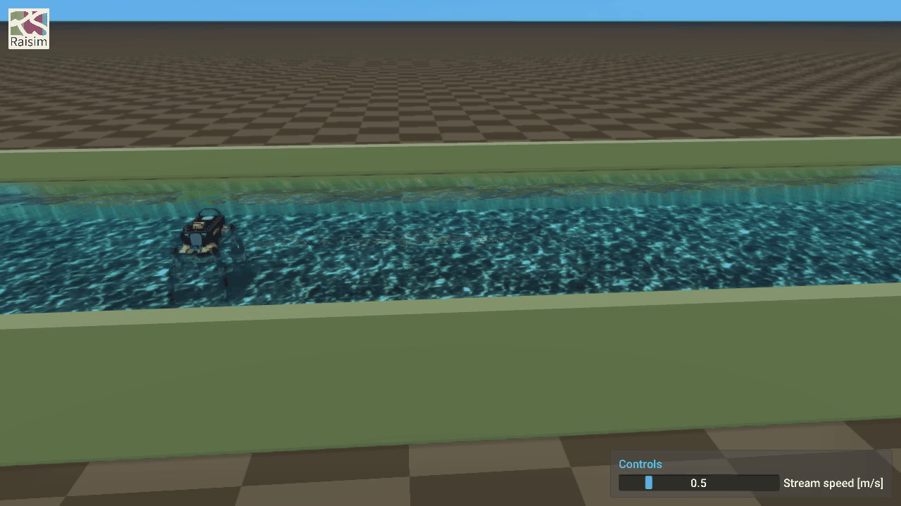

# Viewer Sliders

A `RaisimServer` application can put sliders in the [rayrai TCP viewer](../RayraiTcpViewer.md) and
read them while the simulation runs. Use one for any value you want to change by hand as you watch:
the speed of a current, the wind, a controller's gain, a target height.

<figure>

<figcaption>The fluid stream with ANYmal example in the TCP viewer. Its slider, <em>Stream speed [m/s]</em>, sits in the <strong>Controls</strong> window at the lower right. Drag it past about 1.2 m/s and the stream knocks ANYmal over.</figcaption>
</figure>

[Viewer icon credits](../AssetCredits.md).

## A first slider

This program rolls a light ball across the ground with the wind, and lets you set the wind:

```cpp
#include "raisim/RaisimServer.hpp"
#include "raisim/World.hpp"

int main() {
  raisim::World world;
  world.setTimeStep(0.002);
  world.addGround();
  auto* ball = world.addSphere(0.3, 0.2);
  ball->setPosition(0.0, 0.0, 0.3);
  raisim::FluidMedium air = raisim::FluidMedium::air();
  world.setAmbientFluid(air);

  raisim::RaisimServer server(&world);
  const size_t wind = server.addSlider("Wind [m/s]", -5.0, 5.0, 0.0);
  server.launchServer(8080);

  for (;;) {
    RS_TIMED_LOOP(2000)
    const double speed = server.getSlider(wind);
    server.integrateWorldThreadSafe([&] {
      if (air.velocity[0] == speed) return;
      air.velocity = {speed, 0.0, 0.0};
      world.setAmbientFluid(air);
    });
  }
}
```

Run it, start `rayrai_tcp_viewer`, and connect. A **Controls** window with one slider,
*Wind [m/s]*, appears at the lower right of the view. Drag the slider to 2 and the ball rolls off
along x, about 2 m in its first 3 s; drag it below zero and the wind pushes it back.

Three calls do the work:

- `addSlider(name, min, max, value)` adds a slider labelled `name`, from `min` to `max`, starting at
  `value`, and returns its index: 0 for the first, 1 for the next, and so on.
- `getSlider(index)` returns the slider's value: the last one the viewer's user set, or the starting
  value until then.
- `integrateWorldThreadSafe(callback)` runs the callback while it holds the world's lock and then
  steps the world. That is where the value goes into the world (see [Using a value](#using-a-value)).

## From the viewer to your program

1. The server sends its sliders to the viewer when the viewer connects, and again whenever they
   change.
2. You drag a slider. The viewer sends the new value with its next scene update, usually within a
   frame or two.
3. The server keeps the value within `[min, max]`, and `getSlider()` returns it from then on.
4. The value stays on the server. A viewer that disconnects and connects again shows the values the
   program holds, and with no viewer connected the program keeps the last one set.

`getSlider()` takes a lock of the sliders' own, not the world's. Call it from any thread, as often as
you like: it costs about as much as locking a mutex.

## Using a value

The server's network thread reads the world while your program steps it, so change the world only
while you hold the world's lock. The callback of `integrateWorldThreadSafe()` is the place:

- **Read the slider outside the callback, change the world inside it.** `getSlider()` needs no
  world lock.
- **Do not step the world in the callback.** `integrateWorldThreadSafe()` steps the world right
  after the callback, once per call. A callback that also calls `world.integrate()` steps the world
  twice a call, and keeps it running while the viewer pauses it.
- **Set a state on any call; add forces once a step.** The callback runs on every call, also while
  the viewer pauses the simulation and no step follows. Setting a velocity, a gain or a target is
  safe. Forces from `setExternalForce()` add up until the next step, so a force added on every call
  piles up during a pause and strikes the body all at once when it resumes. Add them once for each
  world time instead; they wait for the step, as the
  [underwater ROV](../examples/server/underwater_rov.md) example's thrusters do:

  ```cpp
  double staged = -1.0;  // the world time the forces were last added at
  for (;;) {
    RS_TIMED_LOOP(2000)
    const double force = server.getSlider(push);
    server.integrateWorldThreadSafe([&] {
      if (world.getWorldTime() == staged) return;
      staged = world.getWorldTime();
      box->setExternalForce(0, {force, 0.0, 0.0});
    });
  }
  ```

  A slider moved during the pause changes the force from the second step after the pause. Do not use
  `server.isSimulationPaused()` to decide: a single step from the viewer's step buttons runs while
  the server stays paused.
- **Count time in world time.** A timer or a controller's integral that advances by a time step
  per call runs on during a pause. Take the time from `world.getWorldTime()`, or act once for each
  world time as above.
- **Change the world only when the value changes**, if the change costs something.
  `setAmbientFluid()` wakes every sleeping body, so the program above sets the wind only when the
  slider has moved.

A scene that does its own bookkeeping can keep it in an `update()` that does not step, called from
the callback, as the [fluid stream](../examples/server/fluid_stream.md) example does:

```cpp
const double speed = server.getSlider(streamSpeed);
server.integrateWorldThreadSafe([&] { scene.update(speed); });
```

## Several sliders

Each `addSlider()` adds one more, in order, to the same window. A server holds up to 64. You may add
sliders before or after `launchServer()`; a connected viewer shows a new one with its next update.

```cpp
const size_t kp = server.addSlider("Kp", 0.0, 400.0, 200.0);
const size_t kd = server.addSlider("Kd", 0.0, 20.0, 5.0);
const size_t height = server.addSlider("Base height [m]", 0.3, 0.6, 0.54);
```

`addSlider()` stops with an error for an empty name or one longer than 256 bytes, a `min`, `max` or
starting value that is not finite, a `min` not below `max`, or a 65th slider; `getSlider()` stops
with one for an index `addSlider()` did not return. A starting value outside the range is moved
into it.

## In the viewer

- The **Controls** window sits at the lower right of the view, one slider per line, labelled by its
  name.
- **Drag** a slider to change its value, or **Ctrl+click** it and type a number. A typed number
  outside the range is clamped to it.
- While you hold a slider, the server's replies do not move it. When you let go, it shows the value
  the server kept.
- With [split panes](../RayraiTcpViewer.md#split-panes), each pane shows the sliders of the server it is
  connected to.
- The window is hidden while the pane is disconnected, and when it replays a recorded session.

Viewers too old to know sliders do not show the window; the program then keeps the starting values.

## Python

raisimPy has the same calls. Python's `integrateWorldThreadSafe()` takes no callback, so hold the
lock around the change with `lockVisualizationServerMutex()`:

```python
import time

import numpy as np
import raisimpy as raisim

world = raisim.World()
world.setTimeStep(0.002)
world.addGround()
ball = world.addSphere(0.3, 0.2)
ball.setPosition(np.array([0.0, 0.0, 0.3]))
air = raisim.FluidMedium.air()
world.setAmbientFluid(air)

server = raisim.RaisimServer(world)
wind = server.addSlider("Wind [m/s]", -5.0, 5.0, 0.0)
server.launchServer(8080)

while True:
    speed = server.getSlider(wind)
    if air.velocity[0] != speed:
        air.velocity = np.array([speed, 0.0, 0.0])
        server.lockVisualizationServerMutex()
        world.setAmbientFluid(air)
        server.unlockVisualizationServerMutex()
    server.integrateWorldThreadSafe()
    time.sleep(world.getTimeStep())
```

## On the wire

For a client of your own (see [RaiSim Server](../RaisimServer.md) for the protocol):

- The feature is bit 8 of the handshake, `PROTOCOL_FEATURE_CONTROLS`.
- **`SET_CONTROLS`** (server request 8) carries every slider: an `int32` count, then for each its
  name (an `int32` length and the bytes), and `min`, `max` and `value` as `double`s. A reply carries
  it when the sliders differ from those the client last received: in the first reply after
  connecting, and after a slider is added or its value changes.
- **`CR_SET_CONTROL`** (client request 300) sets one: an `int32` slider index and a `double` value.
  The server clamps the value to the slider's range. An index out of range or a value that is not
  finite makes the server reject the whole frame and close the connection.
- When the server clamps a value to the one it already holds, nothing changes, and no
  `SET_CONTROLS` follows. A client that shows the value should show the server's own after its
  request has been answered, as the TCP viewer does.

## Examples

- [Fluid stream](../examples/server/fluid_stream.md): a slider sets the speed of a stream carrying
  crates, logs and beach balls past a post.
- [Fluid stream with ANYmal](../examples/server/fluid_stream_anymal.md): the same slider, against a
  standing ANYmal.
