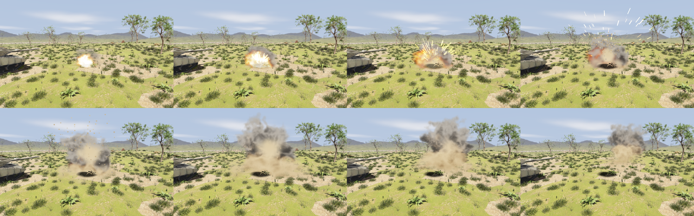
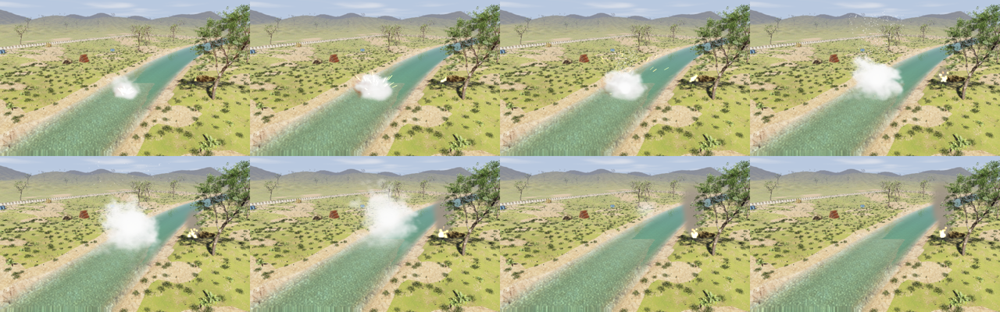

# Explosion Effects

`raisin::RayraiWindow` draws the [explosions and projectiles](../Explosions.md) of the world it shows,
with no code beyond setting them off:

- **Explosions** (`World::addExplosion()` and explosive projectiles): a fireball that flashes white-hot,
  swells and cools through orange to dull red and into soot; a cloud of smoke that billows, rises and
  spreads for several seconds, lit by the sun from above and by the fire from within; sparks and
  debris thrown out of it; and a flash of light on its surroundings. Fireball and smoke are heaps of
  uneven lobes, laid out anew for every explosion and bent by noise, with ragged, wispy rims.
- **Ground bursts** (`surfaceBurst` or a crater) also throw up a column of earth and dust under the
  smoke, dust that rolls out along the ground, clods of earth that arc out and fall back, and leave a
  scorch mark. A charge at or under the surface of one of the window's water bodies throws up a column of
  spray and mist instead.
- **Muzzle flashes** where projectiles are launched, sized by the cube root of the projectile's kinetic
  energy (a tank gun's at full size, a machine gun's a sixth of it), **tracers** behind them in flight and
  **sparks** where an inert projectile hits.
- **Fires** (`addFireEffect()`): flickering flames and a column of black smoke, for a burning wreck or
  a fuel spill.

Sizes and durations scale with the cube root of the charge, as the blast does. Smoke and dust drift
with the wind of the world's ambient fluid (`World::setAmbientFluid()`), and sparks, clods and debris
drag against it. Smoke, dust and debris are lit by the window's main light and sky as its meshes are, so
they keep their color in a photoreal scene lit by a strong sun.



`addExplosionEffect()` draws an explosion that is not in the world, for example one a game computes
itself:

```cpp
raisin::ExplosionEffect effect;
effect.position = {4.0f, 0.0f, 0.3f};
effect.chargeMass = 2.0f;   // kg of TNT: sets the size and duration
effect.onGround = true;     // column of earth and dust, clods and a scorch mark
effect.dustColor = {0.19f, 0.13f, 0.075f};  // the soil it throws up (linear albedo)
viewer.addExplosionEffect(effect);
```

| `ExplosionEffect` field | Default | Meaning |
| --- | --- | --- |
| `position` | origin | Center of the charge (m). |
| `chargeMass` | 1 kg | TNT-equivalent mass; sets the size and duration. |
| `onGround` | `false` | A ground burst: earth, dust, clods and a scorch mark. |
| `smokeColor` | (0.34, 0.32, 0.30) | Albedo of the smoke (linear RGB). |
| `dustColor` | (0.26, 0.22, 0.17) | Albedo of the earth and dust of a ground burst. |
| `inWater` | `false` | A burst at a water surface: spray and mist instead of earth. |

`addFireEffect()` starts a fire that burns for a while:

```cpp
raisin::FireEffect fire;
fire.position = {2.0f, -3.0f, 0.4f};  // base of the flames (m)
fire.size = 0.9f;                     // radius of the flames (m); the smoke column scales with it
fire.duration = 30.0f;                // seconds it burns; it dies down over the last fifth
viewer.addFireEffect(fire);
```

Its flames and smoke are particles, so a fire costs far less than a ray-marched explosion: a dozen
burning wrecks add a few hundred quads to a frame.



The window compiles the shaders of the effects when it first draws one, and the first scorch mark
switches post-processing to the variant that draws projected decals. A game calls
`prepareExplosionEffects()` after creating the window: it compiles those shaders, and the next frame
draws the decal variant once with a hidden decal, so that the browser also builds its GPU pipeline then.
Without it, the first shot stalls a frame while they compile, for about a second in the browser.

## Settings

`setExplosionEffectSettings()` takes an `ExplosionEffectSettings`:

| Field | Default | Meaning |
| --- | --- | --- |
| `enabled` | `true` | Draw explosions, muzzle flashes, impacts and tracers. |
| `sizeScale` | 1 | Multiplies the size of fireballs and smoke clouds. |
| `smokeLifetime` | 8 s | How long the smoke of a 1 kg charge lasts. |
| `marchSteps` | 32 | Samples per pixel through fire and smoke (8 to 64): fewer cost less and look grainier. |
| `volumeDownsample` | 2 | Fire and smoke are marched at 1/n of the image's width and height (1 to 4) and blended into it along its depth, so that they stay behind nearer objects: 2 costs about a third of 1, and 3 about half of 2. |
| `sparks` | `true` | Throw sparks, debris and dust. |
| `flashLight` | `true` | Light the surroundings with the brightest fireball. |
| `scorchMarks` | `true` | Leave scorch marks under ground bursts. |
| `scorchLifetime` | 60 s | How long a scorch mark stays before it fades. |
| `tracers` | `true` | Draw glowing streaks behind projectiles in flight. |
| `useWorldTime` | `true` | Animate with the world's time, so effects pause and rewind with the simulation and sensor images are reproducible; `false` animates with the wall clock, for a window whose world does not advance. |
| `smokeColor` | (0.12, 0.115, 0.11) | Albedo of the smoke of the world's explosions (linear RGB). |
| `dustColor` | (0.26, 0.22, 0.17) | Albedo of the earth and dust their ground bursts throw up; match it to the ground (sand, snow, concrete). |

The world's explosions take their colors from the settings. A charge over water that is under the
surface of a water body the window draws (`setWaterBody()`, simulated rivers included), or less than half
the cube root of its mass (in metres, kg) above it, bursts as spray.

## How they are drawn

The fireball and smoke of each explosion are ray-marched through the sphere that bounds them, after the
opaque scene: each ray stops at the scene's surface, read from a copy of its depth, so the fire and
smoke wrap around the ground and the objects in them. Their density comes from a small tiling 3D noise
texture over three octaves, shaped into billowing puffs; the smoke is lit by the sun through a few
shadow samples toward it, by the sky and by the fire's glow. The main light falls on it as on a
Lambertian surface (its color over pi), so smoke and dust are as bright as ground of the same albedo.
A ground burst's smoke stands on a column from the ground, narrower at its foot, and a thin layer of
dust spreads along the ground around it; the lower the medium, the more it takes the dust's color. The
result is tone-mapped like the scene's meshes, so it glows into bloom where post-processing has it.

Sparks, flames, clods, debris, dust and smoke particles and tracers are camera-facing quads
depth-tested against the scene. The lit ones are drawn farthest first, then the glowing ones; the soft
ones fade out over a depth proportional to their size where they meet the scene, read from the same
depth copy, so a dust puff does not end in a hard line on the ground. The effects appear in every camera
that draws the scene's color, sensor cameras included.

The flash is one additional light (`AdditionalLight`, a point light without shadows) and the scorch marks
are projected decals, at most four. The window adds them after the application's lights and decals for
each render and takes them away when the render ends, so the application's lists and their indices never
change. They count toward the limits of 16 lights and 8 decals and are skipped when those are full.

The effects follow the physics snapshots the window shows (`PhysicsSnapshot::explosions`, `projectiles`,
`projectileHits` and `wind`), so they also work with `applyPhysicsSnapshot()` on a render thread. Each
effect belongs to the explosion, hit or launch that caused it and is drawn from it alone, sparks and
puffs included, so a replay draws the same picture. A checkpoint restored to before an explosion drops
its effect, one restored to while it was still burning or smoking draws it again, and an explosion
replayed after a restore gets its effect even when it reuses an identifier. Effects removed with
`clearExplosionEffects()` stay removed. In the browser the effects draw through the WebGPU backend like
the rest of the scene.

The fireball and smoke cost a ray march over the pixels they cover, so rayrai keeps the march short and
coarse and blends it into the image:

- Each ray takes about `marchSteps` steps across the volume's bounding sphere, so rays that cross only
  its edge or meet the scene early take fewer.
- The march fetches the noise only where it can change the density, so the empty reaches of a volume's
  bounding sphere cost less than its cloud.
- It runs at half the image's width and height (`volumeDownsample`). Each marched pixel stops at the
  nearest scene depth among the image pixels it covers, and neighbouring marched pixels start their rays
  at interleaved fractions of a step.
- Each image pixel blends the four by four nearest marched pixels, weighted by distance and by how close
  the depth each one stopped at is to its own. This averages the interleaved starts into smooth smoke
  instead of grain, and keeps smoke behind a tank from spilling over its edges or over a gun barrel or
  branch thinner than a marched pixel.

On an RTX 5070 at 1600 x 900 with 32 steps, a smoke screen across half the view adds 0.85 ms to the frame
(0.5 ms at a third of the resolution, which Tank Survival uses). The worst case is a camera inside
overlapping clouds: looking into the dust of a dozen ground bursts (`rayrai_explosion_volume_benchmark`)
adds 1.8 ms, 0.9 ms at a third of the resolution and 5.9 ms at full resolution. Fewer `marchSteps` make
it cheaper and grainier.
