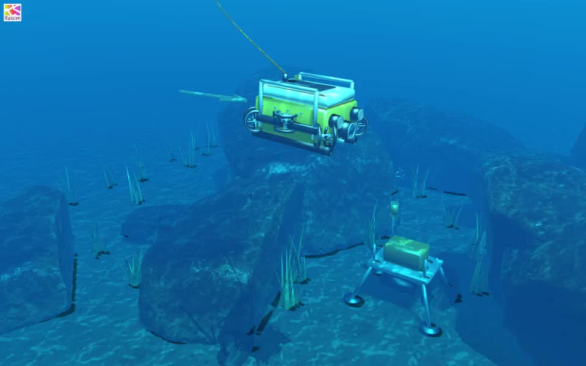

# Underwater ROV assets



A seabed survey scene for `underwater_rov`: a detailed six-thruster vehicle,
syntactic foam cap, protective rails, camera port and work lamps, an acoustic
survey lander, sand ripples, rock shelves, shells, seagrass and sea fans. The
orange tether is drawn by the server and follows the vehicle. Decorations have
no collision or fluid geometry; the original 88 kg compound and controller
still determine its motion.

The six new GLBs total 8.53 MB (decimal). Including the scene and the existing
Rock 07/09 meshes and textures it references, the runtime dependency set totals
about 12 MB, below the 200 MB budget. Textures are 1K; geometry and JPEG/PNG
images are embedded in ordinary Z-up GLBs, with no Draco or WebP requirement.
Source `.blend` downloads and importer caches are not part of the asset pack.
`fluid_example_rov_scene` checks the full dependency size and physics agreement;
`underwater_rov_assets` checks the packaged files and embedded mesh data.
`rayrai_underwater_rov_sync` transfers the real server manifest and chunks to a
viewer cache with inaccessible source paths, then checks all local references.

## Sources

- [Coast Rocks 01](https://www.blenderkit.com/asset-gallery-detail/989946eb-151d-4e36-99ca-3698b0f46514/),
  Poly Haven, CC0. Downloaded through BlenderKit; the lowest source LOD is
  rescaled and exported with its 1K textures as `coast_rocks.glb`.
- [Lambis Shell](https://www.blenderkit.com/asset-gallery-detail/19b1ef54-c54a-4c0c-b309-28f1b266686f/),
  Poly Haven, CC0. Downloaded through BlenderKit, centered, rescaled to 30 cm
  and exported as `shell.glb`.
- [Coast Sand 01](https://polyhaven.com/a/coast_sand_01), Poly Haven, CC0.
  Its 1K diffuse, OpenGL normal and roughness maps texture `seabed.glb`.
- [Rock 07](https://polyhaven.com/a/rock_07) and
  [Rock 09](https://polyhaven.com/a/rock_09), Poly Haven, CC0. Reused from the
  adjacent `offroad_buggy/props` resources without duplicating their files.
- `rov.glb`, `marine_life.glb`, `survey_station.glb`, and the seabed mesh are
  original geometry generated for this example.

Powered by [Poly Haven](https://polyhaven.com). Its asset license is
[CC0](https://polyhaven.com/license). `sources.json` records source IDs and
runtime file hashes; no API keys or signed download URLs are stored.

## Regeneration

In the adjacent `raisim` source checkout, use
`examples/scripts/generate_underwater_rov.py` with Blender 5:

```bash
blender -b -t 6 --python examples/scripts/generate_underwater_rov.py -- \
  --downloads /tmp/underwater-rov-sources \
  --output ../raisim2Lib/rsc/underwater_rov
```

The downloads directory contains the 1K Blender sources `coast_rocks.blend`
and `shell.blend`, and the 1K JPEG maps `sand_diff.jpg`, `sand_nor_gl.jpg` and
`sand_rough.jpg`. The scene layout and lights live in `underwater_rov.rscene`.
The hidden `VehicleAsset` record puts `rov.glb` in the server's shared file
manifest; the moving instance is streamed as `rov_shell`.
