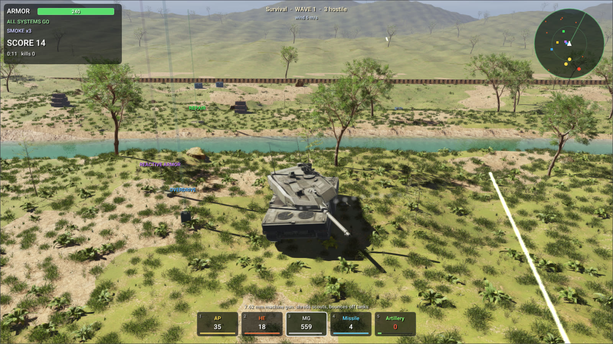

# Building your own WebAssembly programs with RaiSim



This folder shows how to build browser programs on RaiSim and Rayrai with the **RaiSim WebAssembly SDK**:
prebuilt RaiSim and Rayrai libraries for [Emscripten](https://emscripten.org), their headers, CMake packages
and a small page runtime. The SDK ships compiled WebAssembly objects only; the RaiSim and Rayrai sources are
not part of it. Your program is ordinary C++: the same source builds for the desktop against the native
packages and for the browser against the SDK.

| Example | What it shows |
| --- | --- |
| [`src/tank_survival`](src/tank_survival) | A tank survival game drawn by Rayrai: six levels with their own weather, six kinds of enemy vehicle in waves, five weapons, armor zones and ricochets, blast waves, craters, burning wrecks, a river to wade and a HUD, over photoreal rough terrain with grass, woods and distant hills. It becomes `tank_survival.html`. |
| [`src/crate_blast.cpp`](src/crate_blast.cpp) | RaiSim alone: a shell blows a crate stack apart. It runs under Node.js. |

## 1. Get Emscripten and the SDK

The SDK is built with Emscripten **4.0.0**; programs must use the same version.

```bash
git clone https://github.com/emscripten-core/emsdk.git
cd emsdk && ./emsdk install 4.0.0 && ./emsdk activate 4.0.0 && source ./emsdk_env.sh
```

Download `webassembly-sdk-<version>.zip` from the RaiSim release and unpack its folder here as `sdk/`:

```bash
cd raisim2Lib/wasm
unzip webassembly-sdk-<version>.zip && mv webassembly-sdk-<version> sdk
```

## 2. Build

```bash
emcmake cmake -S . -B build -DCMAKE_BUILD_TYPE=Release
cmake --build build --parallel
```

## 3. Run

```bash
node build/crate_blast.js
python3 sdk/share/rayrai/web/serve.py --directory build
```

Open <http://localhost:8000/tank_survival.html> in a recent Chrome or Edge. The page needs WebGPU,
WebAssembly JavaScript Promise Integration and cross-origin isolation (`serve.py` sends the headers).

Controls: W/S drive, A/D turn, the mouse aims the turret, click or Space fires, 1–5 pick a weapon (Q/E
cycle), F lays smoke, the wheel zooms, a right-button drag turns the camera, P pauses, R restarts and H
shows the help. Drive to the supplies under the light beams to pick up ammunition, repair kits, reactive
armor, missiles and artillery radios. Program arguments come from the page's `?arg=` parameters, for
example `tank_survival.html?arg=--autopilot&arg=--level&arg=4` lets the tank play the fourth level by itself.

The game reads its models and textures from `../rsc`; the page downloads them (273 files, about 110 MB)
before the game starts, with `rayrai_add_web_app(... ASSETS ...)`. `DESCRIPTION`, `URL` and `IMAGE` give the
page the tags that make a shared link show as a card; set `-DTANK_SURVIVAL_URL=` to the address you publish
it at. You can also play it on [raisim.com](https://raisim.com/games/tank-survival/). The
vehicles are Sketchfab models under CC BY 4.0, credited in
[`rsc/tank_survival/ATTRIBUTION.md`](../rsc/tank_survival/ATTRIBUTION.md); the rest is CC0. On the desktop
the same source plants broadleaf trees too; the web page leaves them out, since their mesh alone is a
95 MB download.

## Your own program

```cmake
cmake_minimum_required(VERSION 3.20)
project(my_game CXX)
find_package(rayrai CONFIG REQUIRED PATHS "${CMAKE_CURRENT_SOURCE_DIR}/sdk" NO_DEFAULT_PATH NO_CMAKE_FIND_ROOT_PATH)

add_executable(my_game main.cpp)
rayrai_add_web_app(my_game TITLE "My game")           # links rayrai::rayrai and writes my_game.html
target_link_options(my_game PRIVATE "--embed-file=${CMAKE_CURRENT_SOURCE_DIR}/assets@/assets")
```

- `raisim::raisim` is RaiSim alone; `rayrai::rayrai` adds the renderer and links RaiSim. Both set the
  compile and link options their libraries were built with (`-pthread`, `-fwasm-exceptions`, `-msimd128`).
- `rayrai_add_web_app()` builds `<target>.mjs` and `.wasm`, writes `<target>.html`, and copies the page
  runtime next to them: `rayrai-app.mjs` (loads the program and runs `main()` on the canvas),
  `graphics.mjs` (Rayrai's WebGPU backend), `touch-input.mjs` and `isolation-worker.js`.
- A Rayrai program opens its window with `ExampleApp` (`rayrai/example_common.hpp`) exactly as on the
  desktop. `main()` owns the page's main thread; `ExampleApp::endFrame()` yields to the browser once a frame.
- Files reach the program through Emscripten's `--embed-file` or `--preload-file`, or are written into its
  file system from JavaScript.
- To start a program from your own page, import `runRayraiApp()` from `rayrai-app.mjs`.

Serve the build folder over HTTPS (or localhost) with `Cross-Origin-Opener-Policy: same-origin` and
`Cross-Origin-Embedder-Policy: require-corp`; hosts that cannot send headers get them from
`isolation-worker.js`, which the page installs. Serve `.wasm` as `application/wasm`.

## License

The SDK is under the RaiSim WebAssembly license (`sdk/LICENSE.txt`):

- **Who may distribute:** academic users only (the eligibility of its clause 2), and only for academic
  research or teaching. Commercial users may build programs for evaluation but not distribute them.
- **What may be distributed:** your program. Never the SDK, its libraries or headers, or RaiSim and
  Rayrai on their own.
- **Notice:** every distribution must state clearly that the program is built with RaiSim and Rayrai under
  the RaiSim WebAssembly license, and include the license and the third-party notices.

`rayrai_add_web_app()` and `raisim_web_add_license()` copy `raisim-license.txt` and
`raisim-third-party-notices.txt` next to the program. The generated page shows the notice with links to
both; keep it, or show an equivalent notice on your own page. Anything else needs a separate license from
RaiSim Tech Inc. (raisim@raionrobotics.com).
